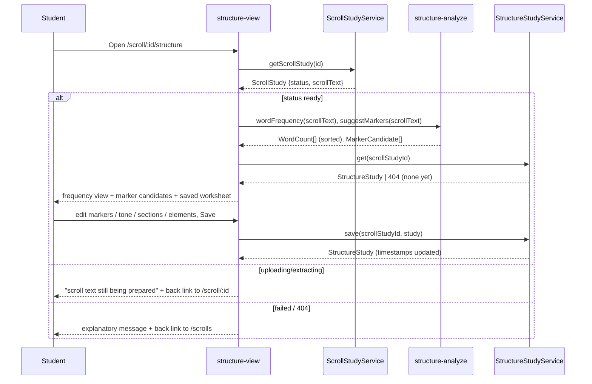

# Design Document: Analyze the Structure of the Book (Step 7 — Structure Study)

## Overview

This feature adds the **Structure Study** tool for inductive-study **Step 7 — Analyze the
Structure of the Book**. Given a book's running text (a `ready` **Scroll Study** from the shipped
Step 4 tool), it (a) **derives** a repeated-word frequency view in the browser so the student can
spot the book's focus words, (b) surfaces **candidate structural markers** (transitional phrases,
direct address, strong declaratives) by matching a small client-owned signal-phrase list against
the text, and (c) lets the student **persist** their own structural judgments — genre, tone, an
ordered list of sections, selected/added markers, and an optional elements chart — as a
re-openable **Structure Study** record. The sections list is shaped so a later Step 8 (Provisional
Outline) tool can consume it without re-entry.

The design follows the shipped Step 6 tools exactly. The frequency view and signal matching are
**pure, client-side, dictionary/phrase-list derivations** over the student's own scroll text — the
same approach the **Parse Scroll for Pronouns** tool uses (`.kiro/specs/parse-scroll-for-pronouns/`),
so no app-provided Bible text is introduced and nothing goes into any AI prompt. The persisted
record mirrors the shipped **Antecedent Study** (`.kiro/specs/antecedent-analysis/`): one record
per scroll per user, keyed by `scrollStudyId`, served by a new CRUD Lambda behind the existing
Cognito-authorized API Gateway, backed by a new DynamoDB table that is additive and
stateful-safe. It reuses the project's Angular 21 standalone + signals + Bulma patterns and the
scroll-nested routing already used by `pronoun-view` and `antecedent-view`.

Consistent with the product's copyright stance, the analyzed text is the **student's own uploaded
document**, already persisted and scoped to them; software surfaces candidates and counts, and the
student makes every structural call.

## Architecture

The feature adds a new lazily-routed Angular component, a pure derivation utility (frequency +
signal matching), a new client service for the Structure Study CRUD, and a new backend
table + CRUD Lambda + API routes that mirror the existing `antecedent-study` path.

```mermaid
graph TD
    subgraph Frontend ["Frontend (Angular 21 + Bulma)"]
        SV[structure-view Component<br/>frequency + markers + sections + save]
        SA[structure-analyze.ts<br/>pure frequency + signal matcher]
        SW[structure-wordlists.ts<br/>fixed stop-word + signal-phrase lists]
        SSVC[StructureStudyService<br/>new CRUD client]
        SCR[ScrollStudyService<br/>existing]
    end

    subgraph AWS ["AWS Cloud"]
        APIGW[API Gateway + Cognito authorizer]
        ScrollFn[scroll-study Lambda<br/>existing]
        StructFn[structure-study Lambda<br/>new CRUD]
        DDBS[(DynamoDB: ScrollStudies<br/>existing)]
        DDBST[(DynamoDB: StructureStudies<br/>new)]
    end

    SV -->|getScrollStudy id| SCR
    SCR -->|GET /scroll-studies/id| APIGW --> ScrollFn --> DDBS
    SV -->|scrollText| SA
    SA -->|reads| SW
    SA -->|WordCount[] / MarkerCandidate[]| SV
    SV -->|get/save structure| SSVC
    SSVC -->|GET/PUT /scroll-studies/id/structure| APIGW --> StructFn --> DDBST
```



## Decisions

**Derive the frequency view client-side; persist only the student's judgments.** Two things could
be computed: the repeated-word frequency and the signal-phrase candidates. Both are **pure
functions of the student's own already-fetched scroll text**, exactly like `parsePronouns`, so
they run in the browser and persist nothing — recomputed on each load. Only the *interpretive*
output (genre, tone, markers the student kept, sections, elements) is persisted. This keeps the
backend to a single CRUD surface (no server-side text processing, no Bedrock) and matches the
derived-vs-persisted split the Step 6 tools already drew (pronoun list derived, antecedent
assignments persisted).

**One record per scroll per user, keyed by `scrollStudyId` (mirrors `AntecedentStudy`).** A
Structure Study is the student's single structural worksheet for one book, so there is exactly one
per `(scrollStudyId, userId)`. This matches `AntecedentStudies` precisely — fetched by exact key,
upserted on save — so **no GSI is needed** and the CRUD surface is a two-method `GET`/`PUT` under
the scroll (not a list/create/delete collection like `/books`). An alternative of modeling it as a
free-standing collection (`/structure-studies` with its own ids and a list view) was rejected: it
would need a GSI and a list UI for no benefit, since a Structure Study is always reached from its
one scroll, the same way the antecedent study is.

**New table vs. reuse an existing one.** We add a dedicated `StructureStudies` table rather than
new item types inside `WordStudies`/`ScrollStudies`/`AntecedentStudies`. Rationale, identical to
the Book-Study and Antecedent-Study decisions: it keeps access patterns, item shapes, and
lifecycles cleanly separated; it avoids touching a stateful, PITR-protected table (`WordStudies`);
and the marginal cost is effectively zero under on-demand billing. The table copies the
`AntecedentStudies` layout exactly — `PK`/`SK`, `PAY_PER_REQUEST`, AWS-managed encryption,
`removalPolicy: config.statefulRemovalPolicy`, **no GSI, no PITR** — so it is `Retain` in prod
(additive, not a stateful-guard violation) and `Delete` in dev, and it adds **no** `StageConfig`
field, keeping the "PITR on WordStudies only" prod test and the "true nowhere" dev test green.

**One Lambda for the domain.** A single `StructureStudyFn` handles both `/scroll-studies/{id}/
structure` methods (`GET`, `PUT`), mirroring how `AntecedentStudyFn` handles the two
`.../antecedents` methods. This keeps the function count and IAM surface minimal (one function,
scoped read/write to the one new table).

**Word lists owned by the frontend; signal matching is advisory.** The stop-word list and the
signal-phrase list are fixed, client-owned TypeScript constants (like `bible-books.ts` and the
pronoun dictionary), the single source of truth for both the matcher and its tests. Signal matches
are **candidates only**: an un-accepted candidate is never persisted. The student decides which are
structural and may add their own, so the tool never asserts structure (issue #36 constraint).

**No edit of the sections list beyond this record; no Step 8 here.** Sections are stored as an
ordered list of structured records so Step 8 can consume them, but this increment implements no
outline-building. Adding a Step 8 consumer later is additive (the `sections` shape does not change).

## Components and Interfaces

### Frontend components (Angular 21 standalone, signals, Bulma)

**`structure-view` component** (`src/app/structure-view/structure-view.component.ts`), a new
standalone component modeled on `antecedent-view` / `pronoun-view`: signal-based view state,
`ActivatedRoute` param, `ChangeDetectionStrategy.OnPush`, Bulma `section`/`box`/notifications,
`inject()` dependencies, co-located `*.spec.ts`. It:

- reads `scrollStudyId` from the route and calls `ScrollStudyService.getScrollStudy(id)` (same
  service and auth path the scroll/pronoun/antecedent views use — no new scroll service);
- holds a `state` signal (`'loading' | 'ready' | 'preparing' | 'failed' | 'error'`), a `study`
  signal (the scroll), a `frequency` signal (`WordCount[]`), a `candidates` signal
  (`MarkerCandidate[]`), and the editable worksheet signals (`genre`, `tone`, `markers`,
  `sections`, `elements`), plus `saving`/`saveError` signals;
- distinguishes a *not found* study (`404` → terminal `failed`) from a *transient* load failure
  (network/5xx → recoverable `error` with a Retry button) in the `getScrollStudy` `error` callback
  typed `(err: { status?: number })`, the same branch `book-study-detail` / `antecedent-view` use;
- on a `ready` study, computes `frequency` and `candidates` once from `study.scrollText` via the
  pure helpers, then calls `StructureStudyService.get(scrollStudyId)` to load any saved worksheet
  (a `404` means "none yet" → an empty editable worksheet, not an error — Requirement 1 criterion 2);
- renders: the **frequency view** (Bulma table/tag list, per-word counts, two totals, a stop-word
  toggle default on, a top-N bound), the **marker candidates** list with an "accept" affordance and
  a manual add-marker form, the **genre/tone** fields, the ordered **sections** editor (add /
  reorder / edit / remove, with the "divisions are uninspired" reminder line), the optional
  **elements chart** editor, a **Save** button, an empty-state when the scroll text has no words, a
  `preparing` notification with a back link to `/scroll/:scrollStudyId`, a `failed` notification
  with a back link to `/scrolls`, and an `error` notification with a working Retry.

`data-testid`s are namespaced to this view: `structure-frequency`, `frequency-row`,
`frequency-word`, `frequency-count`, `stopword-toggle`, `marker-candidate`, `marker-accept`,
`marker-add`, `marker-row`, `genre-input`, `tone-input`, `section-row`, `section-add`,
`section-reorder`, `elements-chart`, `structure-save`, `structure-empty`, `structure-preparing`,
`structure-failed`.

**Reusing vs. extending.** As with the pronoun and antecedent views, Step 7 is a **new, separate
component on its own scroll-nested route**, not a mode added to an existing view — the same
reasoning that kept `pronoun-view` and `antecedent-view` separate. The structure view *reuses*
`ScrollStudyService` and copies the text-handling/escaping conventions, but modifies no existing
component.

### Pure derivation utility (`src/app/structure-analyze.ts`)

Pure, exported functions (no Angular, no I/O — unit-testable in isolation, mirroring
`pronoun-parse.ts`):

```typescript
export interface WordCount {
  word: string;   // canonical lower-cased form
  count: number;  // whole-word occurrences, >= 1
}

export interface MarkerCandidate {
  kind: 'transition' | 'direct-address' | 'declarative' | 'command' | 'other';
  phrase: string;  // the signal phrase matched, original-cased from the text
  start: number;   // 0-based character offset of the match in the scroll text
}

/** Distinct words with counts, sorted count desc then word asc. `stopWords=true`
 *  filters the fixed stop-word set. Pure; '' -> []. */
export function wordFrequency(text: string, stopWords?: boolean): WordCount[];

/** Candidate structural markers from the fixed signal-phrase list, in text order. Pure; '' -> []. */
export function suggestMarkers(text: string): MarkerCandidate[];
```

**Tokenisation** reuses the pronoun tool's exact rule so the two tools agree on a "word": split on
anything that is not an ASCII letter, each maximal `[A-Za-z]+` run is a token, the apostrophe is a
separator (a contraction splits into letter-runs), matching is case-insensitive on the lower-cased
run. `wordFrequency` counts into a `Map<string, number>`, applies the stop-word filter when
requested, and returns entries sorted count-desc then word-asc (deterministic, like
`parsePronouns`). `suggestMarkers` scans for each signal phrase (case-insensitive, whole-phrase)
and emits candidates in text order; it reads the text as data only and never interprets markup.
Both are O(n) over the input and never throw (`wordFrequency('') === []`,
`suggestMarkers('') === []`).

### Fixed word lists (`src/app/structure-wordlists.ts`)

Two exported constants, grouped in source comments by provenance (the Step 7 reference):
- `STOP_WORDS: ReadonlySet<string>` — common English function words (articles, prepositions,
  conjunctions, auxiliaries) so the frequency view surfaces content focus words by default.
- `SIGNAL_PHRASES: ReadonlyArray<{ kind; phrase }>` — transitional phrases ("now concerning",
  "finally", "therefore", "but", "then"), direct-address markers ("my brethren", "beloved"), and
  strong-declarative/command openers, each tagged with its marker `kind`. The list is advisory
  seed data for candidates, not an assertion of structure.

The lists are plain constants (not fetched or configurable), the single source of truth imported by
both the matcher and its tests, matching `bible-books.ts` and the pronoun dictionary.

### Frontend service and wiring

- **`StructureStudyService`** (`src/app/structure-study.service.ts`, `providedIn: 'root'`), a thin
  `HttpClient` wrapper mirroring `AntecedentStudyService`:
  ```typescript
  get(scrollStudyId: string): Observable<StructureStudy>   // GET  /scroll-studies/{id}/structure
  save(scrollStudyId: string, study: StructureStudyInput): Observable<StructureStudy> // PUT .../structure
  ```
  `baseUrl` comes from `environment.apiUrl`; the service builds URLs with the same
  `${baseUrl}/scroll-studies/${id}/structure` concatenation the existing services use (an
  implementer should not "fix" the documented trailing-slash behaviour — the existing services
  concatenate this way and work).
- **Routes** (`src/app/app.routes.ts`): add one lazy `loadComponent` route (additive; existing
  routes untouched), nested under the scroll id to match the pronoun/antecedent routes:
  ```
  scroll/:scrollStudyId/structure  →  structure-view
  ```
- **Navigation.** No new top-level navbar entry (consistent with the pronoun/antecedent views). The
  student reaches the structure view from the existing `scroll-view` `ready` state via an additive
  **"Analyze structure (Step 7)"** `routerLink` button (the one additive change to `scroll-view`,
  guarded to show only when the scroll text is `ready`), routing to `scroll/:id/structure`. The
  `preparing` state links back to `/scroll/:scrollStudyId` (the scroll view polls to completion;
  the structure view does not poll); the `failed`/404 state links to `/scrolls`.
- **Interceptor** (`src/app/user-id.interceptor.ts`): the structure route lives under
  `/scroll-studies/...`, which the interceptor's predicate already matches, so **no interceptor
  change is required** (the `.../antecedents` path is already authenticated the same way). This is
  called out so an implementer does not add a redundant `/structure` branch.

### Backend Lambda

- **`StructureStudyFn`** (`infra/lambda/structure-study/index.ts`), structured exactly like
  `antecedent-study/index.ts`: resolves `origin` via `getRequestOrigin`, reads `userId` via
  `event.requestContext.authorizer.claims.sub`, dispatches on `httpMethod` + `resource`, returns
  via the shared `corsResponse` helper. Handlers: `GET /scroll-studies/{scrollStudyId}/structure`
  and `PUT /scroll-studies/{scrollStudyId}/structure`. It reads
  `const tableName = process.env['STRUCTURE_STUDIES_TABLE_NAME'] ?? '';` (the `?? ''` fallback
  mirrors the antecedent handler) and relies on `ALLOWED_ORIGINS` for CORS, both set by CDK.
- The handler imports the `StructureStudyRecord` DynamoDB shape (below) from
  `infra/lambda/shared/models.ts` — added next to `AntecedentStudyRecord` — rather than redefining
  it inline, exactly as the antecedent handler does.

## Data Model

### Shared TypeScript model

Add to both `src/app/models.ts` (frontend) and `infra/lambda/shared/models.ts` (backend):

```typescript
/** One structural marker the student recorded in Step 7. */
export interface StructureMarker {
  kind: 'transition' | 'direct-address' | 'declarative' | 'command' | 'other';
  phrase: string;    // required
  ref: string;       // optional free-text location, '' when unset (<=200)
  notes: string;     // free text, '' when unset (<=1000)
}

/** One ordered section/division of the book the student drew in Step 7. */
export interface StructureSection {
  label: string;     // required free text (<=200)
  startRef: string;  // optional free text, '' when unset (<=50)
  endRef: string;    // optional free text, '' when unset (<=50)
  notes: string;     // free text, '' when unset (<=1000)
}

/** One row of the optional elements chart (an element and where it occurs). */
export interface StructureElement {
  element: string;        // required free text (<=200)
  sectionRefs: string[];  // labels/positions of sections where it occurs; [] allowed
}

/** The persisted Step 7 worksheet for one scroll study, owned by the current user. */
export interface StructureStudy {
  scrollStudyId: string;
  userId: string;            // Cognito sub
  genre: string;             // '' when unset
  tone: string;              // '' when unset
  markers: StructureMarker[];
  sections: StructureSection[];   // ordered; feeds Step 8
  elements: StructureElement[];   // optional elements chart; [] when unset
  createdAt: string;         // ISO 8601
  updatedAt: string;         // ISO 8601
}

/** Save payload (server sets userId/timestamps from the token/clock). */
export interface StructureStudyInput {
  genre?: string;
  tone?: string;
  markers?: StructureMarker[];
  sections?: StructureSection[];
  elements?: StructureElement[];
}
```

### DynamoDB table: StructureStudies

A new CDK `dynamodb.Table` in `WordStudyToolStack`, named `n('StructureStudies')` (stage suffix:
prod `StructureStudies`, dev `StructureStudies-dev`), copying the `AntecedentStudies` layout
exactly — `PK`/`SK`, `PAY_PER_REQUEST`, `AWS_MANAGED` encryption,
`removalPolicy: config.statefulRemovalPolicy`, **no GSI, no PITR** (one record per scroll per user,
fetched by exact key).

The DynamoDB item shape `StructureStudyRecord` is added to `infra/lambda/shared/models.ts` next to
`AntecedentStudyRecord` and imported by `StructureStudyFn`:

```typescript
interface StructureStudyRecord {
  PK: string;        // "USER#<userId>"
  SK: string;        // "STRUCTURE#<scrollStudyId>"
  scrollStudyId: string;
  userId: string;
  genre: string;
  tone: string;
  markers: StructureMarker[];
  sections: StructureSection[];
  elements: StructureElement[];
  createdAt: string; // ISO 8601
  updatedAt: string; // ISO 8601
}
```

**Access patterns** (mirroring the antecedent handler):
- Get one: `GetCommand` on `PK = USER#<userId>`, `SK = STRUCTURE#<scrollStudyId>`; a result with a
  non-matching `userId` is impossible because `PK` embeds the caller's `userId`. Absent → `404`.
- Save (upsert): `PutCommand` with the same `PK`/`SK`. On the first save `createdAt` and
  `updatedAt` are the same `new Date().toISOString()`; a later save preserves the existing
  `createdAt` (read-then-write, as the antecedent handler does) and refreshes `updatedAt`.

**CDK wiring (additive, non-stateful-breaking):** new construct id `StructureStudies` and matching
log group; `this.structureStudiesTable.grantReadWriteData(this.structureStudyFn)`; new
`NodejsFunction` with `functionName: n('StructureStudy')`, `logGroup: fnLogs('StructureStudyFn')`,
`entry: .../lambda/structure-study/index.ts`, and `environment:
{ STRUCTURE_STUDIES_TABLE_NAME: this.structureStudiesTable.tableName }` (the shared stack already
injects `ALLOWED_ORIGINS` the same way it does for the other functions); and a `structure` sub-
resource on the existing `scrollStudyByIdResource` (`.../{scrollStudyId}/structure`) with `GET` and
`PUT` methods carrying `authMethodOptions`, exactly as `antecedents` does. No existing construct id
or physical name changes.

- **Removal policy:** `config.statefulRemovalPolicy` — `Retain` in prod (additive; the stateful
  guard reports it as info, not a violation), `Delete` in dev (satisfies the dev
  `DeletionPolicy === 'Delete'` expectation).
- **PITR:** omitted entirely (as `AntecedentStudies`/`BookStudies`/`StrongsData` do); it does **not**
  reuse `wordStudiesPitr`, so the prod "PITR on WordStudies only" and dev "true nowhere" tests stay
  green and no `StageConfig` field is added (`stage-config.ts` prod values unchanged).
- **Log group:** `fnLogs('StructureStudyFn')` adds the stack's **8th** function log group (7 today:
  StrongsLookup, StudyCrud, BookStudyCrud, AISummary, ScrollStudy, AntecedentStudy, ExtractText),
  so the two count-based CDK log-group assertions change from `7` to `8` (see Testing Strategy).

No new un-hashed `public/` asset is added, so the `DeployShell`/`DeployAssets` include/exclude
lists are unaffected. No new CDK context lookup is introduced, so `cdk.context.json` is unchanged.

## API

All routes require the Cognito authorizer; `userId` is the token `sub`.

| Method | Path | Request body | Success | Errors |
|---|---|---|---|---|
| GET | `/scroll-studies/{scrollStudyId}/structure` | — | `200 StructureStudyRecord` | `400` missing auth/id; `404` no record yet |
| PUT | `/scroll-studies/{scrollStudyId}/structure` | `{ genre?, tone?, markers?, sections?, elements? }` | `200 StructureStudyRecord` | `400` invalid field / malformed JSON / missing auth; `404` scroll not owned |
| OPTIONS | both | — | CORS preflight (API default) | — |

The response record uses the stored field names; the frontend service consumes `StructureStudy`
directly (no id remap is needed — the key is `scrollStudyId`, which the client already holds),
mirroring `AntecedentStudyService`.

## Validation

Server-side, in `StructureStudyFn`, before any write (client-side mirrors these for UX but is never
trusted), following `antecedent-study`'s `parseSaveBody` approach (JSON-parse in `try/catch`, reject
non-objects, `null` → `400`):

- **genre / tone** — optional strings; `genre` ≤ 200 chars, `tone` ≤ 2000 chars; absent/empty →
  stored `""`; over-length → `400`.
- **markers** — optional array; each item: `kind` ∈ the fixed set, `phrase` a non-empty string
  ≤ 200, `ref` ≤ 200, `notes` ≤ 1000; a bad item → `400`.
- **sections** — optional array (order preserved as sent); each item: `label` a non-empty string
  ≤ 200, `startRef`/`endRef` ≤ 50, `notes` ≤ 1000; a bad item → `400`.
- **elements** — optional array; each item: `element` a non-empty string ≤ 200, `sectionRefs` an
  array of strings; a bad item → `400`.
- **userId** — taken only from the `sub` claim; any `userId` in the body is ignored. Missing claim
  → `400 "Missing authentication."`.
- **scrollStudyId** path param — required; missing → `400`. (The structure record is keyed by it;
  the handler does not separately verify the scroll exists — a structure save for a scroll the user
  does not own simply writes under that user's own `PK`, and the client only ever reaches this view
  from a `ready` scroll it owns. This matches the antecedent handler, which likewise keys by
  `scrollStudyId` without a cross-table existence check.)

## Error Handling

The 404-vs-transient distinction is made in the frontend `getScrollStudy`/`get` `error` callbacks,
typed `(err: { status?: number })`, setting the terminal `failed` state on `404` and the
recoverable `error` state (with Retry) otherwise — the same branch `antecedent-view` uses.

| Operation | Failure condition | How detected | Recoverable? | Caller receives | Logged |
|---|---|---|---|---|---|
| `getScrollStudy(id)` | scroll not found / not owned (404) | `err?.status === 404` → `failed` | n/a | `failed` state + back link to `/scrolls` | no (expected) |
| `getScrollStudy(id)` | network / 5xx | `err?.status !== 404` → `error` | yes | `error` state with Retry (re-issues the GET) | browser console only |
| `StructureStudyService.get` | no saved record (404) | `err?.status === 404` | n/a | empty editable worksheet (Req 1 crit 2) | no |
| `StructureStudyService.get` | network / 5xx | `err?.status !== 404` | yes | `error` state with Retry | browser console only |
| derive (`wordFrequency`/`suggestMarkers`) | scroll `uploading`/`extracting` | `study.status` | yes (poll via scroll view) | `preparing` notification + back link to `/scroll/:scrollStudyId`; no derive attempted | no |
| derive | scroll `failed` | `study.status` | no (re-upload needed) | `failed` notification + back link to `/scrolls` | no |
| `wordFrequency`/`suggestMarkers` | empty / whitespace text | — | n/a | empty-state box; never throws | no |
| `PUT .../structure` | malformed JSON / bad field | `400` + message | yes (user fixes input) | inline save error, entered values kept | no (expected 4xx) |
| `PUT .../structure` | DynamoDB `PutCommand` throws | `500` + message | yes (user retries; values kept) | implicitly via Lambda error path | CloudWatch |
| any handler | unexpected throw | `500 { message }` via top-level `try/catch` | depends | message surfaced to CloudWatch | CloudWatch |

**Invariant ownership.** User-scoping is owned by the backend: the `PK = USER#<sub>` key means a
student can only read/write their own Structure Study, and the scroll's own 404 (for a scroll they
do not own) blocks reaching the view. "A word is counted / a phrase is a signal candidate" is owned
entirely by `structure-analyze.ts` + the single `structure-wordlists.ts` constants, so there is one
definition of each list in the code.

## Testing Strategy

All tests run under the existing harness (Angular + vitest frontend; vitest + no-AWS setup for the
Lambda). Nothing in this feature calls AWS or Bedrock at test time.

### Unit tests
- **`structure-analyze.ts`** (pure, the bulk of coverage, following `pronoun-parse.spec.ts` and its
  `fast-check` property style):
  - `wordFrequency`: whole-word, case-insensitive counting; apostrophe-split rule (shared with the
    pronoun tokeniser); stop-word filter on removes function words and off counts everything; sort
    order (count desc, then word asc); empty/whitespace → `[]`; the count-conservation property
    (filter off: `sum(counts)` equals the number of matched letter-run tokens); never throws.
  - `suggestMarkers`: each signal phrase in the fixed list is found case-insensitively with its
    `kind` and a correct `start` offset; HTML-significant characters in the text do not break
    matching and are treated as data; no-match text → `[]`; empty → `[]`.
- **`structure-wordlists.ts`**: the stop-word set and signal-phrase list are non-empty, lower-cased
  where expected, and each signal entry carries a valid `kind`.
- **Lambda** (`infra/lambda/structure-study/index.test.ts`, mocked DynamoDB via `setup-no-aws`):
  `GET` returns the stored record / `404` when absent; `PUT` success path (first save sets
  `createdAt === updatedAt`; a second save preserves `createdAt` and bumps `updatedAt`); `userId`
  taken from claims and body `userId` ignored; validation rejects bad `kind`, over-long fields,
  malformed JSON; `400` on missing auth/id. No AWS endpoint is ever hit.
- **`StructureStudyService`** (`structure-study.service.spec.ts`): `get`/`save` hit the right
  URL/verb under `/scroll-studies/{id}/structure`.

### Component tests — `structure-view` (Angular TestBed, stubbed `ScrollStudyService` and
`StructureStudyService`)
- `ready` scroll with no saved study → frequency view + candidates render and the worksheet is
  empty/editable; `ready` with a saved study → the saved genre/tone/markers/sections/elements render.
- empty-text scroll → the empty-state box; `uploading`/`extracting` → `preparing` + back link;
  `failed` → `failed` + reason + back link; scroll `404` → `failed`; network error → `error` with a
  working Retry.
- stop-word toggle default on → toggling re-renders the frequency view; accepting a marker candidate
  adds a marker; adding/reordering/removing a section updates the ordered list; Save calls
  `StructureStudyService.save` and reflects the returned timestamps; a save failure keeps entered
  values and shows an inline error.
- a regression assertion confirms `structure-view` calls only `ScrollStudyService.getScrollStudy`
  and `StructureStudyService` (no unexpected API dependency).

### Property-based tests (fast-check)
- For any `StructureStudyInput`, the Lambda `PUT` → `GET` round-trip returns a record whose
  `genre`/`tone`/`markers`/`sections`/`elements` match the input and whose first-save `createdAt`
  equals `updatedAt`, paralleling the antecedent round-trip property.
- The `wordFrequency` ordering is a total order (count desc, word asc) over arbitrary text.

### CDK assertion tests (`infra/test/word-study-tool-stack.test.ts`)
- **New assertions:** the template contains a `StructureStudies` table with `PAY_PER_REQUEST`,
  AWS-managed encryption, **no GSI, no PITR**; a `StructureStudy` (prod) / `StructureStudy-dev`
  (dev) function; and `/scroll-studies/{scrollStudyId}/structure` `GET`/`PUT` methods guarded by the
  Cognito authorizer.
- **Existing assertions that MUST change (the new function's log group makes the stack's
  function-log-group count 8, not 7):**
  - `keeps 90-day log retention` (prod): the count expectation changes from `7` to `8`; the per-
    group `RetentionInDays === 90` loop is unchanged (the new group uses the stage `logRetention`).
  - `keeps 7-day log retention` (dev): the count changes from `7` to `8`; the per-group
    `RetentionInDays === 7` and `DeletionPolicy === 'Delete'` loops are unchanged (the new group
    satisfies `Delete` via `config.statefulRemovalPolicy`).
  - `uses on-demand billing for every table`, prod `enables PITR on WordStudies only`, and dev
    `sets PITR explicitly false on WordStudies-dev and true nowhere` already iterate all tables and
    continue to pass: `StructureStudies` is `PAY_PER_REQUEST` and omits PITR.
- The stateful-guard check continues to pass because the new table is additive and uses the stage
  removal policy (`Retain` in prod) — no existing stateful resource is replaced or deleted.

## Risks

- **Frequency-view noise.** A raw word count cannot distinguish parts of speech or lemmatise, so
  inflected forms count separately and some high-frequency content words may not be the true focus.
  Accepted for a first structural signal; the stop-word filter (default on) removes the worst noise,
  and the student decides what is a focus word. No type/POS classification (Out of Scope).
- **Signal-phrase recall vs. translation variance.** The signal-phrase list is drawn from the Step 7
  reference and common English markers; a student's uploaded translation may phrase transitions
  differently, so some candidates are missed. Mitigated by letting the student add markers manually;
  the list is a plain constant and trivially extended.
- **Truncated scrolls.** If the scroll was truncated at extraction (`truncated = true`), the
  frequency view and candidates cover only the stored prefix. The view surfaces the existing
  truncation flag so the student is not misled, as the pronoun view does.
- **Elements-chart ↔ sections coupling.** The elements chart references sections by label/position;
  removing a section leaves a dangling reference. Handled by tolerating dangling references (shown
  empty, not an error — Requirement 6 criterion 3) rather than cascading deletes, keeping the save
  idempotent.
- **Scope creep toward Step 8.** Outline-building is explicitly deferred and fenced in Out of Scope;
  the `sections` shape is reserved so the later increment stays additive.

## Out of scope

- **Step 8 outlining** (bracketing/grouping sections into an outline) — a later tool that consumes
  this record's `sections`; only the shape is set up here.
- **Automatic/AI determination** of structure, genre, thesis, or theme — the student makes every
  call; no Bedrock or server-side text processing is added.
- **Grammatical/NLP parsing, lemmatization, or sense disambiguation** of the scroll text.
- **A Bible concordance or any app-provided Bible text** — the frequency view is over the student's
  own scroll only.
- **A top-level "Structure Studies" navbar surface** or a cross-book listing — reached contextually
  from one `ready` scroll, like the pronoun/antecedent views.
- **Jump-to-occurrence navigation** from a frequency/marker entry beyond showing a location.
- **Any change** to the Step 4 Scroll Study, Step 5 Word Study, or Step 6 Pronoun/Antecedent tools,
  or to the `WordStudies` table / `/studies` routes.

## Design Review Responses

_(This section is reserved for responses to the spec PR's design review, following the sibling
specs' convention. It will be filled in with a point-by-point response if the review returns
CHANGES_REQUESTED.)_
