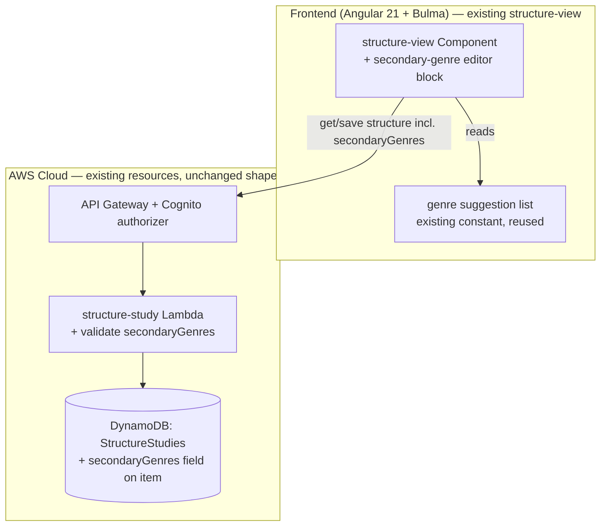

# Design Document: Capture secondary-genre spans (Step 7 — Structure Study enhancement)

## Overview

This is a small, **additive** enhancement to the shipped **Structure Study** tool (inductive-study
**Step 7 — Analyze the Structure of the Book**, `.kiro/specs/analyze-book-structure/`). It lets a
student record **where the genre shifts inside a book** — a run of poetry inside a narrative, a hymn
inside a letter, an oracle inside a historical account — as an ordered list of **secondary-genre
spans** alongside the existing single dominant-`genre` field.

**Why here and not a new Step 11 tool.** The method's Step 11 (Identify the Genre) was considered as
its own tool and skipped: Step 7 already captures the book's dominant genre (a picker of the seven
biblical genres + free text) and tone, backed by the Step 7 reference's genre characteristics table,
so a second genre picker would duplicate it. The Step 7 reference frames the one real gap — in-book
genre transitions — as part of *structure* analysis: *"a single book may contain more than one
genre; naming the dominant genre, and noting where others appear, is part of analyzing the
structure."* So the dominant genre stays the shipped `StructureStudy.genre` field, and this feature
adds the "noting where others appear" list to the same record.

The change is deliberately minimal: **one new optional field** on the `StructureStudy` record
(`secondaryGenres`), its validation in the existing `StructureStudyFn` CRUD Lambda, and **one new
editor block** in the existing `structure-view` component. No new table, no new Lambda, no new
route, no `StageConfig` field, no AI, no migration.

## Architecture

No architectural change. The feature extends three existing files' contents — the shared model, the
structure-study Lambda's validation, and the `structure-view` component — plus their tests. The
data flow is exactly the shipped Step 7 flow; `secondaryGenres` rides the existing
`GET`/`PUT /scroll-studies/{id}/structure` round-trip next to `genre`, `tone`, `markers`,
`sections`, and `elements`.



## Decisions

**Additive field on the shipped record, no new resource.** The dominant genre is already captured
by `StructureStudy.genre`; the gap is only "where do other genres appear." The lowest-risk way to
fill it is one optional ordered list on the same record — mirroring how `sections` and `markers`
already live there — rather than a new table/tool. DynamoDB is schemaless and the handler
read-then-write upserts the item, so an existing Structure Study simply gains the field on its next
save; a record saved before this change reads back with an empty list. There is no migration and the
`StructureStudies` table shape, removal policy, and PITR posture are untouched, so the stateful guard
is indifferent to this change.

**One genre vocabulary.** A secondary-genre row reuses the **same** suggested biblical-genre list the
dominant-`genre` field offers (historical narrative, letter/epistle, poetry, prophecy, apocalyptic,
wisdom, law) with free-text override, so the worksheet has a single genre vocabulary and no second
list to keep in sync. (Today the dominant-genre suggestions are an inline list in `structure-view`;
this feature hoists that list to a small shared constant — see Components — so both the dominant
field and the secondary-span rows read from one source. Hoisting a literal into a constant is
behavior-preserving.)

**Student-authored, locations only.** A span is the student's own observation: `genre` is required,
`startRef`/`endRef` are free-text locations the student types (never app-served verse text), and
`notes` is free text. The tool never infers a genre shift — consistent with Step 7's "the student
makes every structural call." No AI is involved.

**Mirror the `sections` shape and validation exactly.** A secondary-genre span is structurally a
`sections`-like record (a labeled thing with optional ref bounds + notes), so the model shape,
the server validation, and the editor UX all copy the shipped `StructureSection` pattern — minimizing
new surface and keeping the handler's `parseSaveBody` uniform across its list fields.

## Components and Interfaces

### Shared model change

Add a `SecondaryGenre` interface and a `secondaryGenres` field to both `src/app/models.ts`
(frontend) and `infra/lambda/shared/models.ts` (backend), next to `StructureSection` /
`StructureStudy` / `StructureStudyRecord`:

```typescript
/** One span where a genre other than the book's dominant genre appears (Step 7). */
export interface SecondaryGenre {
  genre: string;     // required; from the shared genre list or free text (<=200)
  startRef: string;  // optional free-text location, '' when unset (<=50)
  endRef: string;    // optional free-text location, '' when unset (<=50)
  notes: string;     // free text, '' when unset (<=1000)
}
```

`StructureStudy` (frontend) and `StructureStudyRecord` (backend DynamoDB item) each gain:

```typescript
  secondaryGenres: SecondaryGenre[]; // ordered; [] when unset — ADDITIVE
```

and `StructureStudyInput` (the save payload) gains the optional:

```typescript
  secondaryGenres?: SecondaryGenre[];
```

The server always writes a concrete `secondaryGenres` array (defaulting `[]`), so a `GET` after any
save returns the field; a record written before this feature returns `undefined`, which the frontend
normalizes to `[]` on load (see Error Handling).

### Shared genre-suggestion constant

Hoist the dominant-genre suggestion list (today an inline literal in `structure-view`) into a small
client-owned constant so both the dominant field and the secondary-span rows read from one source:

```typescript
// src/app/structure-genres.ts
export const BIBLICAL_GENRES: readonly string[] = [
  'historical narrative', 'law', 'poetry', 'wisdom', 'prophecy',
  'letter/epistle', 'apocalyptic',
];
```

This is behavior-preserving for the dominant-genre field (same values, still free-text overridable)
and is the single source of truth imported by the component and asserted by a test.

### Frontend component change — `structure-view`

The existing `structure-view` component gains:

- a `secondaryGenres` editable signal (ordered `SecondaryGenre[]`), initialized from the loaded
  study (or `[]`), saved in the `PUT` payload alongside the other worksheet signals;
- a **"Secondary genres (where the genre shifts)"** editor block rendered **immediately after** the
  dominant `genre`/`tone` fields and before (or near) the `sections` editor, so the two genre
  controls read together. Each row: a `genre` input backed by the `BIBLICAL_GENRES` datalist (the
  same affordance the dominant field uses), a `startRef` input, an `endRef` input, a `notes` input,
  and a remove control; plus an "add secondary genre" affordance and reorder controls, mirroring the
  `sections` editor's add/reorder/remove UX;
- a one-line helper caption ("Record a passage whose genre differs from the book's dominant genre —
  e.g. poetry inside a narrative. Reference is a location you type; no verse text is stored.");
- an inline validation guard: a row with a blank `genre` is flagged and blocks save (Req 1 crit 4),
  the same way a blank section `label` is handled today.

New `data-testid`s namespaced to this view, following the existing naming
(`section-row`/`section-add`): `secondary-genre-row`, `secondary-genre-add`,
`secondary-genre-input`, `secondary-genre-startref`, `secondary-genre-endref`,
`secondary-genre-notes`, `secondary-genre-remove`, `secondary-genre-reorder`.

No other component changes. The route, the service, the interceptor, the frequency/marker/section/
elements surfaces, and the dominant `genre`/`tone` fields are untouched.

### Frontend service

`StructureStudyService.save` already sends the whole `StructureStudyInput`; adding the optional
`secondaryGenres` field to that interface means **no service code change** is required — the field
rides the existing `PUT` body. Called out so an implementer does not add a redundant method.

### Backend Lambda change — `StructureStudyFn`

In `infra/lambda/structure-study/index.ts`, extend `parseSaveBody` (or its equivalent field
validation) to validate `secondaryGenres` exactly as `sections` is validated:

- optional array (absent → `[]`); order preserved as sent;
- each item: `genre` a non-empty string ≤ 200; `startRef` ≤ 50; `endRef` ≤ 50; `notes` ≤ 1000;
- a bad item → `400` with a message; `userId` still taken only from the `sub` claim.

The `PutCommand` item gains `secondaryGenres` (defaulting `[]`); the `GetCommand` read returns it as
stored. No change to keys, access patterns, timestamps logic, or CORS.

## Data Model

### DynamoDB item (`StructureStudyRecord`) — additive field

```typescript
interface StructureStudyRecord {
  PK: string;        // "USER#<userId>"            — unchanged
  SK: string;        // "STRUCTURE#<scrollStudyId>" — unchanged
  scrollStudyId: string;
  userId: string;
  genre: string;             // dominant genre — unchanged
  tone: string;
  markers: StructureMarker[];
  sections: StructureSection[];
  elements: StructureElement[];
  secondaryGenres: SecondaryGenre[]; // NEW — ordered; [] when unset
  createdAt: string;
  updatedAt: string;
}
```

**Access patterns unchanged:** `GetCommand` on `PK = USER#<userId>`,
`SK = STRUCTURE#<scrollStudyId>`; `PutCommand` upsert on the same key, preserving `createdAt` and
bumping `updatedAt`. The only difference is one more field on the item.

**No table/CDK change.** The `StructureStudies` table construct, its removal policy
(`config.statefulRemovalPolicy`, `Retain` in prod), its absence of GSI/PITR, the function, and the
routes are all unchanged. The CDK template is unaffected, so **the table/function/log-group counts do
not change** and no CDK assertion needs updating (contrast Step 10, which added a table + two
functions). The stateful guard continues to pass — no existing stateful resource is replaced,
deleted, or re-identified.

No new un-hashed `public/` asset; no new CDK context lookup.

## API

The existing routes are unchanged; `secondaryGenres` rides the existing body/response.

| Method | Path | Request body | Success | Errors |
|---|---|---|---|---|
| GET | `/scroll-studies/{scrollStudyId}/structure` | — | `200 StructureStudyRecord` (now incl. `secondaryGenres`, `[]` when absent on an old record) | `400` missing auth/id; `404` no record yet |
| PUT | `/scroll-studies/{scrollStudyId}/structure` | `{ genre?, tone?, markers?, sections?, elements?, secondaryGenres? }` | `200 StructureStudyRecord` | `400` invalid field (incl. a bad `secondaryGenres` item) / malformed JSON / missing auth |

## Validation

Server-side, in `StructureStudyFn`, added to the existing body validation (client mirrors for UX,
never trusted):

- **secondaryGenres** — optional array (absent → `[]`); each item: `genre` non-empty string ≤ 200;
  `startRef` ≤ 50; `endRef` ≤ 50; `notes` ≤ 1000; a bad item → `400`. Same JSON-parse-in-`try/catch`
  and non-object rejection the handler already applies to `sections`.

## Error Handling

| Operation | Failure | Detected | Recoverable? | Caller receives | Logged |
|---|---|---|---|---|---|
| `GET .../structure` (old record, no field) | — | `secondaryGenres === undefined` | n/a | frontend normalizes to `[]`; empty editor | no |
| `PUT .../structure` | bad `secondaryGenres` item / blank `genre` | `400` + message | yes (fix input) | inline save error, values kept | no (expected 4xx) |
| `PUT .../structure` | DynamoDB throws | `500` | yes (retry) | inline save error, values kept | CloudWatch |
| save with blank-`genre` span (client) | — | client-side guard | yes | row flagged, save blocked until fixed | no |

**Backward compatibility invariant.** A Structure Study saved before this feature has no
`secondaryGenres` field; the frontend load path coerces a missing/`undefined` value to `[]` (the
same tolerance the app already uses for the legacy string-vs-object `englishDefinition` shape), so an
old record opens cleanly with an empty secondary-genre list and gains the field on its next save. No
backfill script is needed or provided.

## Testing Strategy

All tests run under the existing harness (Angular + vitest frontend; vitest + `setup-no-aws` for the
Lambda). Nothing calls AWS or Bedrock.

### Unit tests
- **`structure-genres.ts`**: `BIBLICAL_GENRES` is non-empty and contains the seven reference genres;
  it is the single source the component imports (a test asserts the component renders options from
  this constant, guarding against a re-inlined list).
- **`StructureStudyFn`** (`infra/lambda/structure-study/index.test.ts`, mocked DynamoDB — extend the
  existing suite): `PUT` round-trips `secondaryGenres` (order preserved); a save with no
  `secondaryGenres` stores `[]`; a `GET` of a record **without** the field returns it as absent and
  the handler tolerates it; validation rejects a span with a blank `genre`, an over-long `genre`/
  `startRef`/`endRef`/`notes`, and a non-array `secondaryGenres` (`400`); body `userId` still
  ignored.

### Component tests — `structure-view` (extend the existing spec)
- a saved study with `secondaryGenres` renders the rows in order; a study without the field renders
  an empty secondary-genre editor (no error);
- add / edit / reorder / remove a secondary-genre row updates the ordered list; the `genre` input is
  backed by the shared `BIBLICAL_GENRES` suggestions;
- Save includes `secondaryGenres` in the `StructureStudyService.save` payload and reflects the
  returned state;
- a row with a blank `genre` blocks save with an inline message and preserves entered values;
- a regression assertion that the dominant `genre`/`tone` fields, frequency view, markers, sections,
  and elements editors are unchanged (still present and functional).

### Property-based tests (fast-check)
- For any `StructureStudyInput` including arbitrary `secondaryGenres`, the Lambda `PUT` → `GET`
  round-trip returns a record whose `secondaryGenres` match the input in order, extending the
  existing Structure Study round-trip property.

### CDK assertion tests
- **None change.** This feature adds no table, function, log group, route, or `StageConfig` field,
  so the stack template is unaffected and every existing CDK assertion (counts, PITR, removal policy,
  Bedrock grants) continues to pass unchanged. (Explicitly noted so an implementer does not "update"
  a count that must not move.)

## Risks

- **Overlap with `sections`.** A secondary-genre span and a section can describe the same range
  (e.g. a poetry section that is also a genre shift). Accepted: they capture different observations
  (a section is a division of the author's flow; a secondary genre is a kind-of-literature note) and
  the student may record either or both. No cross-list coupling is introduced, keeping saves
  idempotent — the same reasoning the Step 7 design used for the elements-chart/sections relationship.
- **Backward compatibility.** An old record lacks the field; mitigated by the frontend `[]`
  coercion on load and the server defaulting `[]` on write, with a Lambda test asserting a
  field-less record reads cleanly. No migration.
- **Genre vocabulary drift.** Hoisting the dominant-genre list to a constant must not change the
  dominant field's behavior; mitigated by the constant carrying the identical values and a test
  asserting the component renders from it.
- **Scope creep toward a Step 11 tool.** Fenced in Out of Scope: this is the in-book-transition gap
  only; the dominant genre stays Step 7's existing field and no new tool is built.

## Out of scope

- **A new Step 11 "Genre" tool** — skipped; dominant genre stays Step 7's `genre` field.
- **Moving the dominant `genre` out of Step 7** — additive only, no re-model, no backfill.
- **AI classification** of genre or genre shifts — the student records the observation.
- **Fetching/embedding/serving any Bible verse text** for the span references.
- **Downstream consumption** of secondary-genre spans (Step 8 Outline, Step 10 Figures) — captured
  and stored here; any consumer is a later increment.
- **Any change** to the Step 7 frequency/marker/section/elements surfaces or to any other shipped
  step or the Word Study.

## Design Review Responses

_(Reserved for responses to the spec PR's design review, following the sibling specs' convention.
Filled in point-by-point if the review returns CHANGES_REQUESTED.)_
