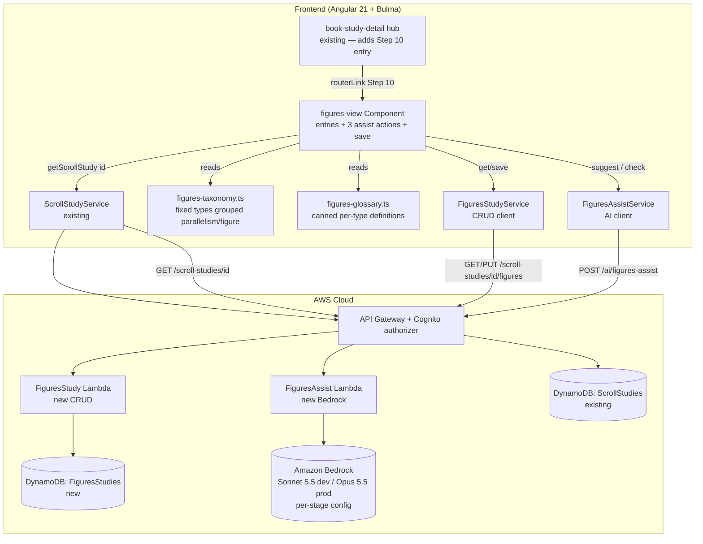

# Design Document: Identify Figures of Speech (Step 10 — Figures Study)

## Overview

This feature adds the **Figures Study** tool for inductive-study **Step 10 — Identify Figures of
Speech**, the first Interpretation-phase step. The student tags passages of the book with a
**figure type** — a figure of speech (metaphor, metonymy, hyperbole, irony, personification, …) or
a Hebrew-poetry **parallelism** form (synonymous, antithetic, synthetic, statement-and-comment,
emblematic) — records their own paraphrase and what they judge each one means, and saves the
worksheet. The tool is reached from the **Book Study hub** that now groups all step work under a
book (`.kiro/specs/link-studies-to-book/`), reads from the Step 4 **Scroll Study**, and persists one
**Figures Study** per scroll per user, keyed by `scrollStudyId`, exactly as the shipped
Antecedent/Structure/Outline studies are.

It is the first tool to combine the shipped **persisted-worksheet** pattern with the shipped
**on-demand Amazon Bedrock assist** pattern (Step 5's AI summary). Because the figures assist does
*judgment* work (does this passage contain a figure? does the student's chosen type fit?) rather than
Step 5's synthesis, the assist model is a **per-stage `StageConfig` value** — **dev uses Claude
Sonnet 5.5, prod uses Claude Opus 5.5** — so the stronger model serves the live student while dev is
free to evaluate a different tier, with no UI picker and no model-selection plumbing (see Decisions).
The AI acts as a **consultant, never a grader**, through three on-demand actions:

1. **Suggest candidates** (AI) — scan the student's own scroll text and return *candidate passages
   to consider*, each with a location and a one-line reason — never an interpretation.
2. **Explain a category** (canned glossary, no AI) — a short definition of a figure/parallelism type
   for a student who does not yet know the term.
3. **Check my tag** (AI) — an opinionated second read of the student's chosen type for a passage,
   phrased as advice the student can overrule.

The AI never writes `figureType`, `text`, or `interpretation`; nothing runs without a button press;
and only student-authored fields are persisted. This mirrors Step 5, the method's one deliberately
assisted step, where the AI synthesizes *the student's own* work.

Consistent with the product's **updated** copyright stance — *"Student Provided Bible text: the app
can use Bible text as long as the student provided it"* — the scroll text and the student's own typed
passages MAY be sent to Bedrock; the app never fetches, embeds, or serves Bible text the student did
not provide, and the canned glossary carries no scripture.

## Architecture

The feature adds a new lazily-routed Angular component, a client-owned taxonomy + glossary constant,
two client services (CRUD + assist), and backend: one new DynamoDB table, a **CRUD Lambda**
(mirroring `structure-study`) and a thin **Bedrock assist Lambda** (mirroring `ai-summary`), with
additive API routes.



```mermaid
sequenceDiagram
    participant U as Student
    participant FV as figures-view
    participant SCR as ScrollStudyService
    participant FSVC as FiguresStudyService
    participant FASVC as FiguresAssistService

    U->>FV: Open /scroll/:id/figures (from Book hub)
    FV->>SCR: getScrollStudy(id)
    SCR-->>FV: ScrollStudy {status, scrollText}
    alt status ready
        FV->>FSVC: get(scrollStudyId)
        FSVC-->>FV: FiguresStudy | 404 (none yet)
        FV-->>U: worksheet (entries) + assist buttons + glossary help
        opt Suggest candidates (AI, on demand)
            U->>FV: press "Suggest candidates"
            FV->>FASVC: suggest(scrollText, notes?)
            FASVC-->>FV: candidates[] (location + type-to-consider + reason)
            FV-->>U: advisory list; student may turn one into an entry
        end
        opt Check my tag (AI, on demand)
            U->>FV: press "Check this tag" on an entry
            FV->>FASVC: check(figureType, reference, text)
            FASVC-->>FV: second-read advice (transient, not saved)
            FV-->>U: advice shown; student keeps or changes the type themselves
        end
        U->>FV: edit entries, Save
        FV->>FSVC: save(scrollStudyId, { entries })
        FSVC-->>FV: FiguresStudy (timestamps updated)
    else uploading/extracting
        FV-->>U: "scroll text still being prepared" + back link to /scroll/:id
    else failed / 404
        FV-->>U: explanatory message + back link
    end
```

## Decisions

**One combined tool; taxonomy grouped so a split stays cheap (locked with the user).** Parallelism
and figures are tagged by the same action, so one `FiguresStudy` record with one `figureType`
taxonomy covers both. The taxonomy carries a `group` tag (`parallelism` | `figure`) on every type,
stored per entry, so a later optional split into two views is a filter over the same records, not a
data migration. Starting combined and splitting later is the cheap direction; starting split and
merging later would mean collapsing two tables/records and a destructive migration.

**One record per scroll per user, keyed by `scrollStudyId` (mirrors Structure/Antecedent/Outline).**
Exactly one Figures Study per `(scrollStudyId, userId)`, fetched by exact key and upserted on save —
so **no GSI**, and the CRUD surface is a two-method `GET`/`PUT` under the scroll, not a
list/create/delete collection. The view is reached from the Book hub step list, the same contextual
navigation the sibling step views use.

**Two Lambdas: isolate the AI.** A `FiguresStudyFn` handles the CRUD (`GET`/`PUT
/scroll-studies/{id}/figures`), mirroring `StructureStudyFn`. A separate thin `FiguresAssistFn`
handles the two Bedrock actions (`POST /ai/figures-assist`), mirroring the shipped `AISummaryFn`.
Keeping the AI in its own function keeps the prompts isolated and independently testable, keeps the
CRUD function free of Bedrock IAM, and matches how `AISummaryFn` is its own function rather than a
mode on `StudyCrudFn`. The assist function is **stateless** — it touches no table, only Bedrock.

**The assist model is a per-stage `StageConfig` value (locked with the user).** Unlike Step 5's
summary (a synthesis task where Haiku is adequate), the figures assist does *judgment* work —
candidate spotting and tag-checking — where model tier measurably matters. Rather than hard-code one
model or ship a student-facing picker (which would add a config knob unrelated to the study and blur
the "assist, never replace" line), the model id is a new `StageConfig` field, `figuresAssistModelId`,
so each stage runs a different tier with **no UI**:

- **prod → Claude Opus 5.5** (Bedrock foundation model `anthropic.claude-opus-5-5`) — the live
  student gets the strongest judgment.
- **dev → Claude Sonnet 5.5** (Bedrock foundation model `anthropic.claude-sonnet-5-5`) — a
  one-tier-down evaluation surface to compare against Opus on real scroll text before committing.

The CDK wires `FiguresAssistFn`'s `MODEL_ID` env and its Bedrock IAM ARNs from `config
.figuresAssistModelId`, so the grant always matches the model the stage actually invokes. Changing
the winner later is a one-line `stage-config.ts` edit (a deliberate maintainer change, exactly the
kind of value that belongs there). This is the only place the two stages intentionally diverge in
behavior; the assist Lambda code and prompts are identical across stages.

The invoked id is the standard cross-Region **US inference profile** for each model —
`us.anthropic.claude-opus-5-5` (prod) and `us.anthropic.claude-sonnet-5-5` (dev) — the same `us.`
profile shape the shipped Haiku summary uses. The 5.5 generation dropped the snapshot date and the
`-v1` suffix (per Anthropic's model-ID versioning), so the ids are dateless; the IAM-ARN helper
derives the foundation-model and inference-profile ARNs from the configured id exactly as the
AISummary grant does. (Model access for both confirmed available on the account.)

**Category help is canned, not AI (locked with the user).** The taxonomy is fixed and a definition of
"metonymy" does not need a live model, so the explanations are a client-owned glossary constant:
free, deterministic, offline, and never a source of stray scripture text. Bedrock is spent only on
the two actions that need *the student's own text* — candidate scan and tag-check.

**AI is a consultant, never a grader.** Every AI action is an explicit button; the output is advisory
and transient; no AI text is ever written into `figureType`/`text`/`interpretation` or persisted as
the student's work. The candidate scan returns *where to look and what kind to consider* (no sense);
the tag-check returns a second opinion phrased so the student remains the decider. This is the
Step 5 principle (AI synthesizes the student's own work) applied to Step 10.

**New table vs. reuse.** A dedicated `FiguresStudies` table, copying the `StructureStudies`/
`AntecedentStudies` layout exactly — `PK`/`SK`, `PAY_PER_REQUEST`, AWS-managed encryption,
`removalPolicy: config.statefulRemovalPolicy`, **no GSI, no PITR** — so it is `Retain` in prod
(additive, not a stateful-guard violation) and `Delete` in dev. The table adds **no** PITR-style
`StageConfig` flag, so the "PITR on WordStudies only" prod test and the "true nowhere" dev test stay
green. (The one new `StageConfig` field this feature adds — `figuresAssistModelId` — is a model-id
string, not a table/stateful property; it changes no physical resource identity and the stateful
guard is indifferent to it.)

## Components and Interfaces

### Frontend component (Angular 21 standalone, signals, Bulma)

**`figures-view` component** (`src/app/figures-view/figures-view.component.ts`), modeled on
`structure-view`/`outline-view`: signal-based view state, `ActivatedRoute` `scrollStudyId` param,
`ChangeDetectionStrategy.OnPush`, Bulma `section`/`box`/notifications, `inject()` deps, co-located
`*.spec.ts`. It:

- reads `scrollStudyId` from the route, calls `ScrollStudyService.getScrollStudy(id)` (no new scroll
  service), and holds a `state` signal (`'loading' | 'ready' | 'preparing' | 'failed' | 'error'`), a
  `study` signal (the scroll), an `entries` signal (the editable figure entries), `saving`/`saveError`
  signals, and assist-state signals (`candidates`, `suggesting`, `suggestError`, plus per-entry
  `checking`/`checkResult`/`checkError`);
- distinguishes a *not-found* scroll (`404` → terminal `failed`) from a *transient* load failure
  (network/5xx → recoverable `error` with Retry) in the `error` callback typed `(err: { status?:
  number })`, the same branch the sibling views use;
- on a `ready` study, calls `FiguresStudyService.get(scrollStudyId)` to load any saved worksheet (a
  `404` means "none yet" → an empty editable worksheet, Req 1 crit 2);
- renders: the **figure-entry editor** (add/edit/reorder/remove, each row with a grouped
  `figureType` picker, `reference`, optional `text`, `interpretation`, `notes`), the **governing-
  caution reminder line**, the **"Suggest candidates"** action and its advisory result list (each
  candidate with an "add as entry" affordance that pre-fills `reference` + suggested type, still
  editable, and a "dismiss"), a per-type **"Explain"** disclosure showing the canned glossary text, a
  per-entry **"Check this tag"** action showing transient second-read advice (never auto-applied), a
  **Save** button, and the `preparing`/`failed`/`error` notifications with back links.

`data-testid`s namespaced to this view: `figure-entry-row`, `figure-entry-add`, `figuretype-select`,
`figure-reference`, `figure-text`, `figure-interpretation`, `figure-notes`, `figure-reorder`,
`suggest-candidates`, `candidate-row`, `candidate-accept`, `candidate-dismiss`, `type-explain`,
`glossary-text`, `check-tag`, `check-result`, `figures-save`, `figures-empty`, `figures-preparing`,
`figures-failed`.

**Reusing vs. extending.** Step 10 is a **new, separate component on its own scroll-nested route**,
like every sibling step view — it reuses `ScrollStudyService` and copies the text-escaping
conventions but modifies no existing step view. The **one** additive change to an existing component
is a **Step 10 entry in the Book Study hub** step list (`book-study-detail`), gated to active when
the scroll is `ready`, routing to `scroll/:id/figures`.

### Client-owned taxonomy and glossary

**`src/app/figures-taxonomy.ts`** — the single source of truth for the picker, server validation
values, glossary keys, and tests:

```typescript
export type FigureGroup = 'parallelism' | 'figure';

export interface FigureType {
  id: string;          // stable id, e.g. 'metaphor', 'antithetic'
  name: string;        // display name, e.g. 'Metaphor', 'Antithetic parallelism'
  group: FigureGroup;
}

/** Fixed list from the Step 10 reference: 5 parallelism forms + ~15 figures, plus 'other'. */
export const FIGURE_TYPES: ReadonlyArray<FigureType>;
export const FIGURE_TYPE_IDS: ReadonlySet<string>;  // for server validation
```

**`src/app/figures-glossary.ts`** — canned, copyright-free definitions keyed by `FigureType.id`,
each a short plain-language definition plus a brief **generic** illustration (no scripture quotation).
Covers every id in `FIGURE_TYPES`. A pure constant; no AI, no fetch.

### Pure assist-prompt helpers (server-side, in the assist Lambda)

Prompt construction lives in `FiguresAssistFn` and is unit-tested as pure functions (no Bedrock at
test time), mirroring `ai-summary`'s `buildPrompt`:

```typescript
// suggest: student's own scroll text + optional notes + the taxonomy names -> candidates
function buildSuggestPrompt(scrollText: string, notes: string, types: readonly string[]): string;
// check: the student's chosen type + reference + their own text -> second-read advice
function buildCheckPrompt(figureType: string, reference: string, text: string): string;
```

Both prompts carry **only** student-provided text and the fixed taxonomy; the suggest prompt
explicitly instructs the model to return *locations + a type to consider + a short reason, and never
an interpretation of the passage*; the check prompt instructs it to *advise, not decide*, and to name
the student as the final judge.

### Frontend services and wiring

- **`FiguresStudyService`** (`src/app/figures-study.service.ts`, `providedIn: 'root'`), a thin
  `HttpClient` wrapper mirroring `StructureStudyService`:
  ```typescript
  get(scrollStudyId: string): Observable<FiguresStudy>                         // GET  /scroll-studies/{id}/figures
  save(scrollStudyId: string, study: FiguresStudyInput): Observable<FiguresStudy> // PUT .../figures
  ```
- **`FiguresAssistService`** (`src/app/figures-assist.service.ts`, `providedIn: 'root'`):
  ```typescript
  suggest(scrollStudyId: string, scrollText: string, notes?: string): Observable<FigureCandidate[]>
  check(figureType: string, reference: string, text: string): Observable<{ advice: string }>
  ```
  Both POST to `/ai/figures-assist` with an `action` discriminator (`'suggest' | 'check'`), mirroring
  how `ai-summary` is a single POST endpoint.
- **Routes** (`src/app/app.routes.ts`): add one lazy `loadComponent` route, nested under the scroll
  id like the sibling step routes (additive; existing routes untouched):
  `scroll/:scrollStudyId/figures → figures-view`.
- **Navigation:** no new navbar entry. The Book Study hub (`book-study-detail`) gains a **Step 10 —
  Figures of Speech** step entry (gated on `ready`), routing to `scroll/:id/figures`. The
  `preparing` state links back to `/scroll/:scrollStudyId`; `failed`/404 links back to the book hub.
- **Interceptor:** the figures CRUD route is under `/scroll-studies/...` (already matched by
  `user-id.interceptor.ts`) and the assist route is under `/ai/...` (already matched, as
  `/ai/study-summary` is) — so **no interceptor change is required**. Called out so an implementer
  does not add a redundant branch.

### Backend Lambdas

- **`FiguresStudyFn`** (`infra/lambda/figures-study/index.ts`), structured exactly like
  `structure-study/index.ts`: resolves `origin` via `getRequestOrigin`, reads `userId` via
  `event.requestContext.authorizer.claims.sub`, dispatches on `httpMethod` + `resource`, returns via
  `corsResponse`. Handlers: `GET` and `PUT /scroll-studies/{scrollStudyId}/figures`. Reads
  `process.env['FIGURES_STUDIES_TABLE_NAME'] ?? ''`. Imports `FiguresStudyRecord` from
  `infra/lambda/shared/models.ts`.
- **`FiguresAssistFn`** (`infra/lambda/figures-assist/index.ts`), structured like `ai-summary/
  index.ts`: a `BedrockRuntimeClient`, `MODEL_ID = process.env['FIGURES_ASSIST_MODEL_ID'] ?? ''`
  (injected by the stack from `config.figuresAssistModelId` — **Opus 5.5 in prod, Sonnet 5.5 in
  dev**, not hard-coded Haiku), an `InvokeModelCommand` with `anthropic_version: 'bedrock-2023-05-31'`
  and a short `max_tokens`, and the **graceful-degrade** `try/catch` that returns a friendly
  "assist unavailable, please try again" payload rather than a 500 on a Bedrock error. It dispatches
  on the body `action` (`suggest` | `check`), validates inputs, builds the matching prompt, and
  returns `{ candidates }` or `{ advice }`. It is stateless (no DynamoDB).

## Data Model

### Shared TypeScript model

Add to both `src/app/models.ts` (frontend) and `infra/lambda/shared/models.ts` (backend):

```typescript
/** One figure/parallelism the student tagged and interpreted in Step 10. */
export interface FigureEntry {
  figureType: string;     // a FIGURE_TYPES id, or 'other'
  otherLabel: string;     // free text when figureType === 'other', else '' (<=100)
  group: 'parallelism' | 'figure';  // derived from figureType; stored for cheap later split
  reference: string;      // required free-text location, no verse text (<=200)
  text: string;           // optional student transcription/paraphrase, '' when unset (<=2000)
  interpretation: string; // student's sense of the figure, '' when unset (<=2000)
  notes: string;          // free text, '' when unset (<=1000)
}

/** The persisted Step 10 worksheet for one scroll study, owned by the current user. */
export interface FiguresStudy {
  scrollStudyId: string;
  userId: string;          // Cognito sub
  entries: FigureEntry[];  // ordered
  createdAt: string;       // ISO 8601
  updatedAt: string;       // ISO 8601
}

/** Save payload (server sets userId/timestamps). */
export interface FiguresStudyInput {
  entries?: FigureEntry[];
}

/** Transient AI candidate (NOT persisted) — surfaced by the suggest action. */
export interface FigureCandidate {
  reference: string;       // location to look at
  suggestedType: string;   // a FIGURE_TYPES id to consider (never auto-applied)
  reason: string;          // one-line why-look-here (never an interpretation)
}
```

### DynamoDB table: FiguresStudies

A new CDK `dynamodb.Table` in `WordStudyToolStack`, named `n('FiguresStudies')` (prod
`FiguresStudies`, dev `FiguresStudies-dev`), copying the `StructureStudies` layout exactly —
`PK`/`SK`, `PAY_PER_REQUEST`, `AWS_MANAGED` encryption, `removalPolicy:
config.statefulRemovalPolicy`, **no GSI, no PITR**.

The DynamoDB item shape `FiguresStudyRecord` is added to `infra/lambda/shared/models.ts` next to
`StructureStudyRecord`:

```typescript
interface FiguresStudyRecord {
  PK: string;        // "USER#<userId>"
  SK: string;        // "FIGURES#<scrollStudyId>"
  scrollStudyId: string;
  userId: string;
  entries: FigureEntry[];
  createdAt: string; // ISO 8601
  updatedAt: string; // ISO 8601
}
```

**Access patterns** (mirroring the structure handler):
- Get one: `GetCommand` on `PK = USER#<userId>`, `SK = FIGURES#<scrollStudyId>`; absent → `404`.
- Save (upsert): `PutCommand` with the same key; first save sets `createdAt === updatedAt`; a later
  save preserves `createdAt` (read-then-write) and refreshes `updatedAt`.

**CDK wiring (additive, non-stateful-breaking):**
- New table construct id `FiguresStudies` + matching log group; `this.figuresStudiesTable
  .grantReadWriteData(this.figuresStudyFn)`.
- `FiguresStudyFn` — new `NodejsFunction`, `functionName: n('FiguresStudy')`, `logGroup:
  fnLogs('FiguresStudyFn')`, `entry: .../lambda/figures-study/index.ts`, `environment: {
  FIGURES_STUDIES_TABLE_NAME: this.figuresStudiesTable.tableName }` (the stack injects
  `ALLOWED_ORIGINS` the same way as the others).
- `FiguresAssistFn` — new `NodejsFunction`, `functionName: n('FiguresAssist')`, `logGroup:
  fnLogs('FiguresAssistFn')`, `entry: .../lambda/figures-assist/index.ts`, `environment: {
  ALLOWED_ORIGINS, FIGURES_ASSIST_MODEL_ID: config.figuresAssistModelId }` (no table env — it is
  stateless). It gets a **Bedrock IAM policy shaped like `AISummaryFn`'s but scoped to the
  per-stage model** — `bedrock:InvokeModel` on the foundation-model ARN and the region/account
  inference-profile ARN **derived from `config.figuresAssistModelId`** (prod → Opus 5.5, dev →
  Sonnet 5.5), so the grant always matches the model the stage invokes. A small helper derives the
  two ARNs from the configured id (`arn:aws:bedrock:*::foundation-model/<id with the `us.` region
  prefix stripped>` and `arn:aws:bedrock:${region}:${account}:inference-profile/<id as configured>`),
  the same ARN shapes the AISummary grant uses — the 5.5 models use the standard `us.` cross-Region
  profile, so no prefix special-casing is needed.
- Routes: a `figures` sub-resource on the existing `scrollStudyByIdResource`
  (`.../{scrollStudyId}/figures`) with `GET`/`PUT` carrying `authMethodOptions` (like `antecedents`/
  `structure`); and a `figures-assist` sub-resource on the existing `aiResource`
  (`/ai/figures-assist`) with `POST` carrying `authMethodOptions` (like `/ai/study-summary`).
- No existing construct id or physical name changes.

**Counts delta (verified against the current stack):** today the stack has **7 tables**
(WordStudies, StrongsData, ScrollStudies, BookStudies, AntecedentStudies, StructureStudies,
OutlineStudies) and **9 functions** (StrongsLookup, StudyCrud, BookStudyCrud, AISummary, ScrollStudy,
AntecedentStudy, StructureStudy, OutlineStudy, ExtractText). This feature makes it **8 tables** (+
FiguresStudies) and **11 functions** (+ FiguresStudy, + FiguresAssist), so the stack's
function-log-group count goes **9 → 11**. The count-based CDK log-group assertions change
accordingly (see Testing Strategy).

- **Removal policy:** `config.statefulRemovalPolicy` — `Retain` in prod (additive; the stateful
  guard reports it as info, not a violation), `Delete` in dev.
- **PITR:** omitted entirely (as the sibling study tables do); no PITR `StageConfig` field is added,
  so the prod "PITR on WordStudies only" and dev "true nowhere" tests stay green and `stage-config
  .ts`'s prod *stateful/identity* values are unchanged. The one new field, `figuresAssistModelId`, is
  a behavior setting (model id), not a physical-resource property — see the StageConfig change below.
- No new un-hashed `public/` asset, so `DeployShell`/`DeployAssets` include/exclude lists are
  unaffected. No new CDK context lookup, so `cdk.context.json` is unchanged.

### StageConfig change: `figuresAssistModelId`

One field is added to the `StageConfig` interface in `infra/lib/stage-config.ts` — the single place
per-stage values are allowed to live:

```typescript
/** Bedrock model id the Figures assist (Step 10) invokes. Stronger tier than Step 5's Haiku,
 *  because candidate-spotting and tag-checking are judgment tasks. Per-stage by decision:
 *  prod runs the strongest tier; dev runs one tier down as an evaluation surface. */
figuresAssistModelId: string;
```

Values:

| Stage | `figuresAssistModelId` | Rationale |
|---|---|---|
| prod | `us.anthropic.claude-opus-5-5` | strongest judgment for the live student |
| dev | `us.anthropic.claude-sonnet-5-5` | one tier down; evaluate against Opus on real text |

The id stored is the full **cross-Region inference-profile** id the Lambda actually invokes. Both 5.5
models use the standard `us.` regional profile (dateless — the 4.6+ generation dropped the snapshot
date and the `-v1` suffix), so the IAM-ARN helper derives both ARNs from the configured id with no
prefix special-casing.

This is **not** a frozen stateful/identity value (it is a behavior setting, not a physical name), so
editing it later — e.g. to promote the dev winner to prod, or to drop prod to Sonnet — is a sanctioned
one-line `stage-config.ts` change, not a prod-identity edit. The CDK reads it for both the
`FIGURES_ASSIST_MODEL_ID` env on `FiguresAssistFn` and the function's Bedrock IAM ARNs, so model and
grant never drift apart. Model access for both ids was confirmed available on the account.

## API

All routes require the Cognito authorizer; `userId` is the token `sub`.

| Method | Path | Request body | Success | Errors |
|---|---|---|---|---|
| GET | `/scroll-studies/{scrollStudyId}/figures` | — | `200 FiguresStudyRecord` | `400` missing auth/id; `404` no record yet |
| PUT | `/scroll-studies/{scrollStudyId}/figures` | `{ entries? }` | `200 FiguresStudyRecord` | `400` invalid field / malformed JSON / missing auth |
| POST | `/ai/figures-assist` | `{ action:'suggest', scrollText, notes? }` or `{ action:'check', figureType, reference, text }` | `200 { candidates }` or `200 { advice }` | `400` missing/invalid fields / malformed JSON / missing auth; `200 { … , degraded:true }` on a Bedrock error (graceful, like Step 5) |

The suggest/check endpoints follow the Step 5 pattern of returning a **graceful fallback payload**
(`degraded: true` + a user-facing message) rather than a 500 when Bedrock errors, so the UI can show
a recoverable inline message without an error boundary.

## Validation

Server-side, before any write (client mirrors for UX, never trusted), following the sibling handlers'
`parseSaveBody` approach (JSON-parse in `try/catch`, reject non-objects/`null` → `400`):

**`FiguresStudyFn` PUT:**
- **entries** — optional array (order preserved); each item: `figureType` ∈ `FIGURE_TYPE_IDS` or
  `'other'`; when `'other'`, `otherLabel` a non-empty string ≤ 100; `group` ∈
  `{'parallelism','figure'}` and SHALL be consistent with the type (server recomputes `group` from
  `figureType` rather than trusting the body); `reference` a non-empty string ≤ 200; `text` ≤ 2000;
  `interpretation` ≤ 2000; `notes` ≤ 1000; a bad item → `400`.
- **userId** — from the `sub` claim only; any body `userId` ignored; missing claim → `400`.
- **scrollStudyId** path param — required; missing → `400`.

**`FiguresAssistFn` POST:**
- **action** — required, ∈ `{'suggest','check'}`; else `400`.
- `suggest`: `scrollText` a non-empty string (bounded to the scroll-text cap ~350 KB); `notes`
  optional string.
- `check`: `figureType` a non-empty string; `reference` a non-empty string; `text` optional string.
- On any Bedrock error, return `200 { degraded: true, message }` (and an empty `candidates`/`advice`),
  never a 500 — the Step 5 graceful-degrade contract.

## Error Handling

The 404-vs-transient distinction is made in the frontend `error` callbacks typed `(err: { status?:
number })`, setting terminal `failed` on `404` and recoverable `error` (with Retry) otherwise — the
sibling-view branch.

| Operation | Failure | Detected | Recoverable? | Caller receives | Logged |
|---|---|---|---|---|---|
| `getScrollStudy(id)` | not found/owned (404) | `err?.status === 404` → `failed` | n/a | `failed` + back link | no |
| `getScrollStudy(id)` | network/5xx | `!== 404` → `error` | yes | `error` + Retry | console |
| `FiguresStudyService.get` | no record (404) | `err?.status === 404` | n/a | empty editable worksheet | no |
| `FiguresStudyService.get` | network/5xx | `!== 404` | yes | `error` + Retry | console |
| scroll `uploading`/`extracting` | — | `study.status` | yes (poll via scroll view) | `preparing` + back link; no AI call | no |
| scroll `failed` | — | `study.status` | no (re-upload) | `failed` + back link | no |
| `suggest` / `check` | Bedrock error / timeout | `degraded:true` in 200 body | yes | inline "assist unavailable, try again"; entries preserved | CloudWatch (assist fn) |
| `PUT .../figures` | malformed/ bad field | `400` + message | yes (fix input) | inline save error, values kept | no (expected 4xx) |
| `PUT .../figures` | DynamoDB throws | `500` | yes (retry) | inline save error | CloudWatch |
| any handler | unexpected throw | `500 { message }` via top-level `try/catch` | depends | message to CloudWatch | CloudWatch |

**Invariant ownership.** User-scoping is owned by the backend (`PK = USER#<sub>`). "A figure type is
valid / the group derives from the type" is owned by `figures-taxonomy.ts` (single source of truth,
imported by both the picker and the server's validation id set, kept in sync by a test). "The AI
never decides" is enforced structurally: the assist Lambda returns candidates/advice only, the client
never writes an AI value into a field without an explicit student accept/edit, and no AI text is ever
persisted (the record stores only `entries`).

## Testing Strategy

All tests run under the existing harness (Angular + vitest frontend; vitest + `setup-no-aws` for the
Lambdas). **Nothing calls AWS or Bedrock at test time** — the assist Lambda's `BedrockRuntimeClient`
is mocked exactly as `ai-summary`'s tests mock it.

### Unit tests
- **`figures-taxonomy.ts` / `figures-glossary.ts`**: `FIGURE_TYPES` is non-empty and covers the 5
  parallelism forms + the figures list from the reference; every id is unique; every type has a
  `group`; `FIGURE_TYPE_IDS` matches `FIGURE_TYPES`; the glossary has an entry for **every** id and
  no entry contains scripture-quote markers (a crude guard: no verse-reference-plus-quote pattern) —
  definitions only.
- **`FiguresStudyFn`** (`infra/lambda/figures-study/index.test.ts`, mocked DynamoDB): `GET` returns
  the stored record / `404` when absent; `PUT` success (first save `createdAt === updatedAt`; second
  save preserves `createdAt`, bumps `updatedAt`); `userId` from claims, body `userId` ignored;
  `group` recomputed from `figureType` (a lying body `group` is overwritten); validation rejects a
  bad `figureType`, a missing `otherLabel` when `other`, over-long fields, malformed JSON; `400` on
  missing auth/id.
- **`FiguresAssistFn`** (`infra/lambda/figures-assist/index.test.ts`, mocked Bedrock): `suggest`
  builds a prompt containing the scroll text and the taxonomy and parses the model's candidates;
  `check` builds a prompt containing the student's type/reference/text; a mocked Bedrock throw yields
  `200 { degraded:true }`, never a 500; `400` on a bad/missing `action` or missing required field;
  the prompt builders are unit-tested as pure functions (contain only provided text + taxonomy).
- **`FiguresStudyService` / `FiguresAssistService`**: hit the right URL/verb
  (`/scroll-studies/{id}/figures`, `/ai/figures-assist` with the `action` discriminator).

### Component tests — `figures-view` (Angular TestBed, stubbed `ScrollStudyService`,
`FiguresStudyService`, `FiguresAssistService`)
- `ready` with no saved study → empty editable worksheet + assist buttons; `ready` with a saved
  study → saved entries render in order.
- empty scroll text still allows manual tagging; `uploading`/`extracting` → `preparing` + back link;
  `failed`/404 → `failed` + back link; network error → `error` + working Retry.
- add/edit/reorder/remove a figure entry updates the ordered list; the `other` type reveals the
  `otherLabel` field.
- **AI boundary (the load-bearing assertions):** pressing "Suggest candidates" calls
  `FiguresAssistService.suggest` and renders advisory candidates but creates **no** entries until the
  student presses "add as entry" (which pre-fills reference + type, still editable); pressing "Check
  this tag" calls `check` and shows advice but **does not** change the entry's `figureType`; a
  `degraded` assist response shows a recoverable inline message and preserves all entries; the
  "Explain" disclosure shows canned glossary text and makes **no** HTTP call.
- Save calls `FiguresStudyService.save` with `{ entries }` and reflects returned timestamps; a save
  failure keeps entered values and shows an inline error.
- a regression assertion confirms `figures-view` calls only `ScrollStudyService`,
  `FiguresStudyService`, and `FiguresAssistService` (no unexpected API dependency) and that no AI
  call fires on load or save.

### Book hub test — `book-study-detail`
- the Step 10 — Figures of Speech entry appears in the hub step list and is gated active only when
  the scroll is `ready` (an extension of the existing hub step-list tests from the relink spec).

### Property-based tests (fast-check)
- For any `FiguresStudyInput`, the `FiguresStudyFn` `PUT` → `GET` round-trip returns a record whose
  `entries` match (with `group` recomputed from each `figureType`) and whose first-save `createdAt`
  equals `updatedAt`, paralleling the sibling round-trip properties.

### CDK assertion tests (`infra/test/word-study-tool-stack.test.ts`)
- **New assertions:** the template contains a `FiguresStudies` table (`PAY_PER_REQUEST`, AWS-managed
  encryption, no GSI, no PITR); a `FiguresStudy` (prod)/`FiguresStudy-dev` (dev) function and a
  `FiguresAssist`/`FiguresAssist-dev` function; `/scroll-studies/{scrollStudyId}/figures` `GET`/`PUT`
  and `/ai/figures-assist` `POST`, all guarded by the Cognito authorizer; and the `FiguresAssistFn`
  role has a `bedrock:InvokeModel` statement scoped to the **per-stage** model + inference-profile
  ARNs — asserted the same way the existing AISummary Bedrock test asserts it, but against
  `config.figuresAssistModelId`: the **prod** synthesized template references the **Opus 5.5** ARNs
  and the **dev** template references the **Sonnet 5.5** ARNs (so the test proves the grant tracks the
  configured model per stage, and that dev and prod intentionally differ here).
- **Existing assertions that MUST change (two new functions make the function-log-group count 11, not
  9):**
  - `keeps 90-day log retention` (prod): count `9 → 11`; the per-group `RetentionInDays === 90` loop
    unchanged.
  - `keeps 7-day log retention` (dev): count `9 → 11`; the per-group `RetentionInDays === 7` and
    `DeletionPolicy === 'Delete'` loops unchanged.
  - `uses on-demand billing for every table`, prod `enables PITR on WordStudies only`, dev `sets PITR
    explicitly false on WordStudies-dev and true nowhere` already iterate all tables and continue to
    pass: `FiguresStudies` is `PAY_PER_REQUEST` and omits PITR.
  - the least-privilege assertions that a given function's policy does **not** reference other tables
    continue to hold: `FiguresStudyFn` references only `FiguresStudies`; `FiguresAssistFn` references
    **no** table (only Bedrock), matching how `AISummaryFn`'s Bedrock grant is asserted separately.
- The stateful-guard check continues to pass because the new table is additive and uses the stage
  removal policy (`Retain` in prod) — no existing stateful resource is replaced or deleted.

## Risks

- **AI over-suggestion.** A candidate scan could flag weak or wrong candidates, nudging a first-timer
  toward over-reading figures (against the method's *"if the first sense makes sense …"* caution).
  Mitigated structurally: candidates are advisory, create no entries, carry a reason not an
  interpretation, and the worksheet shows the caution reminder. The prompt instructs the model to be
  conservative and to return a type-to-consider, not a verdict.
- **AI drift into interpretation.** The risk the model writes the sense for the student. Mitigated by
  (a) the suggest contract returning no interpretation, (b) the check contract returning advice the
  student overrules, (c) never writing an AI value into a field without an explicit student action,
  and (d) persisting no AI text. The AI-boundary component tests lock this.
- **Copyright of student text sent to Bedrock.** Permitted under the updated "Student Provided Bible
  text" rule (A5): only the student's own scroll text and their own typed passages are sent; the app
  fetches/embeds/serves no Bible text it did not receive from the student, and the glossary carries no
  scripture.
- **Bedrock availability/cost.** AI is user-initiated only, short-token, and graceful-degrades to a
  recoverable message — so an outage or throttle never breaks manual tagging. The assist runs a
  **stronger, costlier tier than Step 5's Haiku** (prod Opus 5.5, dev Sonnet 5.5), a deliberate
  trade the user accepted for better judgment on a low-traffic step: per-call cost is higher, but
  calls are few, user-initiated, short-token, and capped by `max_tokens`, so it stays a small
  variable cost rather than an always-on one. No test or smoke step calls Bedrock, so CI/smoke cost
  is unaffected. Promoting a cheaper tier later is a one-line `stage-config.ts` change.
- **Glossary completeness.** The canned glossary must cover every taxonomy id; a missing entry would
  leave an "Explain" with no text. Locked by a test asserting one glossary entry per `FIGURE_TYPES`
  id.
- **Taxonomy ↔ server sync.** The client taxonomy and the server's validation id set must agree.
  Mitigated by the server validating against the same conceptual list and a test asserting the
  validation set matches `FIGURE_TYPES`.

## Out of scope

- **AI classification or interpretation** — the AI only surfaces candidates, explains categories, and
  gives a second opinion; the student makes every call.
- **Splitting parallelism and figures into two tools** — combined now; the `group` tag keeps a later
  split a filter, not a migration.
- **Persisting AI second-read text** — transient UI only.
- **Fetching/embedding/serving any Bible text the student did not provide**, incl. canned scripture
  in the glossary or a server-side verse/concordance lookup.
- **Later Interpretation/Application step tools** (11–16) — separate later tools on the same hub.
- **Any change** to the Step 4–9 tools, the Word Study, or the `WordStudies`/`/studies` routes.
- **A top-level "Figures Studies" navbar surface** — reached from the Book hub step list.
- **Non-English candidate scanning** — taxonomy/glossary are English; manual tagging works in any
  language.

## Design Review Responses

_(Reserved for responses to the spec PR's design review, following the sibling specs' convention.
Filled in point-by-point if the review returns CHANGES_REQUESTED.)_
