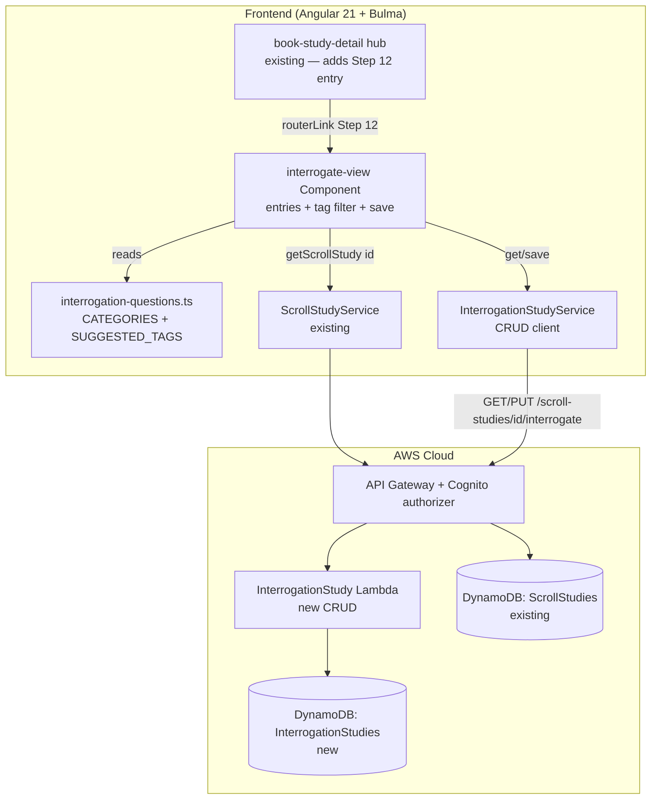

# Design Document: Interrogate the Text (Step 12 — Interrogation Study)

## Overview

This feature adds the **Interrogation Study** tool for inductive-study **Step 12 — Interrogate the
Text**. The student asks questions of a passage and records the answers found **in the text itself**,
building a saved Q&A worksheet per book. Each entry carries the student's own **question**, a
**category** (one of the 5 Ws + H, or Other), zero or more **subject tags**, an optional
**passage location**, and the student's **answer**.

The tool is reached from the shipped **Book Study hub**, reads from the Step 4 **Scroll Study**, and
persists one **Interrogation Study** per scroll per user, keyed by `scrollStudyId`, exactly as the
shipped Antecedent/Structure/Outline/Figures studies are. It is the **leanest** new step tool to
date — a flat ordered list like the Step 6 referent list — and deliberately carries **no AI and no
Bible verse text** (a scope decision locked with the user): there is no question bank (canned or
AI-generated) and no Bedrock call anywhere in the tool.

The one design nuance, decided with the user, is separating two axes a single field would have
conflated:

- **Category** — *what kind of question?* — a fixed closed set (`who|what|when|where|why|how|other`),
  one per entry, a `<select>`.
- **Tags** — *what subjects does this Q&A touch?* — zero-to-many, user-extensible, the axis the
  student filters/surfaces on. A small seeded suggested-tag list feeds autocomplete only.

## Architecture

The feature adds a new lazily-routed Angular component, a tiny client-owned constants module
(categories + suggested tags), one client CRUD service, one new DynamoDB table, one CRUD Lambda
(mirroring `structure-study`), and additive API routes. **No Bedrock, no second Lambda, no
`StageConfig` field.**



## Decisions

**One record per scroll per user, keyed by `scrollStudyId` (mirrors Structure/Figures/Outline).**
Exactly one Interrogation Study per `(scrollStudyId, userId)`, fetched by exact key and upserted on
save — so **no GSI**, and a two-method `GET`/`PUT` CRUD under the scroll, reached from the Book hub
step list. Identical to the sibling step views.

**No AI, no question bank, no verse text (locked with the user).** Step 12 is a disciplined-habit
step: the value is the student asking and answering. There is no canned question list and no AI
suggest action — the student writes every question and answer. This keeps the tool zero-Bedrock,
zero-cost, and the smallest new build, and keeps it clear of the open Step 10 Bedrock bug. An AI
"suggest questions" action could be a later increment reusing the (once-fixed) figures-assist
pattern, but it is explicitly out of scope here.

**Category vs. tags are two fields, by decision.** A question's *kind* (who/what/…) is a closed,
one-per-entry classification — a `<select>` validated server-side against a fixed set. A Q&A's
*subjects* (about-God, command, context, …) are an open, many-per-entry, user-extensible set used
for filtering. Collapsing them into one field would lose the filter axis and force subjects to
masquerade as question-kinds. Categories are a frozen constant; tags are free text with a seeded
suggestion list for autocomplete only.

**Tags are normalized server-side.** Tags are stored trimmed, lower-cased, de-duplicated, order
preserved, empties dropped, each ≤ 40 chars, the array capped at 20 — so the filter and chip
rendering are stable and a lying/oversized client cannot bloat the item. The client mirrors the
normalization for UX but the server is authoritative.

**New table vs. reuse.** A dedicated `InterrogationStudies` table, copying the `StructureStudies`/
`FiguresStudies` layout exactly — `PK`/`SK`, `PAY_PER_REQUEST`, AWS-managed encryption,
`removalPolicy: config.statefulRemovalPolicy`, **no GSI, no PITR** — so it is `Retain` in prod
(additive, not a stateful-guard violation) and `Delete` in dev. It adds **no** `StageConfig` field
of any kind.

## Components and Interfaces

### Frontend component (Angular 21 standalone, signals, Bulma)

**`interrogate-view` component** (`src/app/interrogate-view/interrogate-view.component.ts`), modeled
on `structure-view`/`figures-view`: signal-based `state` (`'loading' | 'ready' | 'preparing' |
'failed' | 'error'`), a `study` signal (the scroll), an `entries` signal (ordered editable Q&A), a
`tagFilter` signal (selected filter tags), `saving`/`saved`/`saveError` signals,
`ChangeDetectionStrategy.OnPush`, `inject()` deps, co-located `*.spec.ts`. It:

- reads `scrollStudyId` from the route, calls `ScrollStudyService.getScrollStudy(id)`, and on a
  `ready` scroll calls `InterrogationStudyService.get(scrollStudyId)` (a `404` → empty editable
  worksheet);
- distinguishes a not-found scroll (`404` → terminal `failed`) from a transient load failure
  (network/5xx → recoverable `error` with Retry), the sibling-view branch typed `(err: { status?:
  number })`;
- renders, per entry: a `question` input, a `category` `<select>` (the 7 fixed values), a **tags
  editor** (chips + an add-tag input backed by the `SUGGESTED_TAGS` datalist; chips removable; the
  editor compact when no tags), a `passageRef` input, an `answer` textarea, a `notes` textarea, and
  reorder/remove controls — mirroring the `sections`/figure-entry editors;
- renders a **tag filter** bar built from the tags in use; selecting tags narrows the visible list
  (AND semantics); clearing restores all;
- a blank-`question` row is flagged inline and dropped on save; the `Save` button persists the full
  list; `preparing`/`failed`/`error` notifications carry back links.

`data-testid`s namespaced to this view: `interrogation-entry-row`, `interrogation-entry-add`,
`question-input`, `category-select`, `tag-chip`, `tag-add-input`, `tag-remove`, `passage-ref`,
`answer-input`, `entry-notes`, `entry-reorder`, `entry-remove`, `question-blank`, `tag-filter`,
`tag-filter-option`, `interrogate-save`, `interrogate-empty`, `interrogate-preparing`,
`interrogate-failed`, `interrogate-error`.

**Reusing vs. extending.** A new, separate component on its own scroll-nested route, like every
sibling step view — it reuses `ScrollStudyService` and modifies no existing step view. The one
additive change to an existing component is a **Step 12 entry in the Book Study hub**
(`book-study-detail`), gated active when the scroll is `ready`, routing to
`scroll/:id/interrogate`.

### Client-owned constants

**`src/app/interrogation-questions.ts`** — the single source of truth for the category picker,
server-validation values, the suggested-tag datalist, and tests:

```typescript
/** The fixed question-kind categories (the 5 Ws + H, plus Other). One per entry. */
export const INTERROGATION_CATEGORIES = [
  'who', 'what', 'when', 'where', 'why', 'how', 'other',
] as const;
export type InterrogationCategory = (typeof INTERROGATION_CATEGORIES)[number];

/** Suggested subject tags (autocomplete only — the student may type any tag). Not a closed set,
 *  and carries NO pre-written questions. */
export const SUGGESTED_TAGS: readonly string[] = [
  'about-God', 'about-people', 'command', 'promise', 'warning', 'context', 'cross-reference',
];
```

(The module name mirrors the `structure-genres.ts` convention; it carries no question text.)

### Frontend service

- **`InterrogationStudyService`** (`src/app/interrogation-study.service.ts`, `providedIn: 'root'`),
  a thin `HttpClient` wrapper mirroring `StructureStudyService`, with a `toInterrogationStudy` mapper
  that coerces absent fields (`entries ?? []`, each entry's `tags ?? []`):
  ```typescript
  get(scrollStudyId: string): Observable<InterrogationStudy>                            // GET  /scroll-studies/{id}/interrogate
  save(scrollStudyId: string, study: InterrogationStudyInput): Observable<InterrogationStudy> // PUT .../interrogate
  ```
- **Routes** (`src/app/app.routes.ts`): one additive lazy `loadComponent` route nested under the
  scroll id like the siblings — `scroll/:scrollStudyId/interrogate → interrogate-view`.
- **Interceptor:** the route is under `/scroll-studies/...`, already matched by
  `user-id.interceptor.ts` — no interceptor change (called out so an implementer does not add a
  redundant branch).

### Backend Lambda

- **`InterrogationStudyFn`** (`infra/lambda/interrogation-study/index.ts`), structured exactly like
  `structure-study/index.ts`: `getRequestOrigin`, `userId` from
  `event.requestContext.authorizer.claims.sub`, dispatch on `httpMethod` + `resource`, `corsResponse`.
  Handlers: `GET` and `PUT /scroll-studies/{scrollStudyId}/interrogate`. Reads
  `process.env['INTERROGATION_STUDIES_TABLE_NAME'] ?? ''`. Imports `InterrogationStudyRecord` from
  `infra/lambda/shared/models.ts`. No Bedrock client, no model env.

## Data Model

### Shared TypeScript model

Add to both `src/app/models.ts` (frontend) and `infra/lambda/shared/models.ts` (backend):

```typescript
/** One interrogation Q&A the student recorded in Step 12. */
export interface InterrogationEntry {
  question: string;    // required free text (<=500)
  category: string;    // one of who|what|when|where|why|how|other
  tags: string[];      // 0..N normalized subject tags (each <=40, array <=20)
  passageRef: string;  // optional free-text location, '' when unset (<=50) — NO verse text
  answer: string;      // student's answer from the text, '' when unset (<=4000)
  notes: string;       // free text, '' when unset (<=1000)
}

/** The persisted Step 12 worksheet for one scroll study, owned by the current user. */
export interface InterrogationStudy {
  scrollStudyId: string;
  userId: string;             // Cognito sub
  entries: InterrogationEntry[]; // ordered
  createdAt: string;          // ISO 8601
  updatedAt: string;          // ISO 8601
}

/** Save payload (server sets userId/timestamps). */
export interface InterrogationStudyInput {
  entries?: InterrogationEntry[];
}
```

### DynamoDB table: InterrogationStudies

A new CDK `dynamodb.Table` in `WordStudyToolStack`, construct id `InterrogationStudies` (prod
`InterrogationStudies`, dev `InterrogationStudies-dev`), copying the `StructureStudies`/
`FiguresStudies` layout exactly — `PK`/`SK`, `PAY_PER_REQUEST`, `AWS_MANAGED` encryption,
`removalPolicy: config.statefulRemovalPolicy`, **no GSI, no PITR**.

The DynamoDB item shape `InterrogationStudyRecord` is added next to `StructureStudyRecord`/
`FiguresStudyRecord`:

```typescript
interface InterrogationStudyRecord {
  PK: string;        // "USER#<userId>"
  SK: string;        // "INTERROGATE#<scrollStudyId>"
  scrollStudyId: string;
  userId: string;
  entries: InterrogationEntry[];
  createdAt: string; // ISO 8601
  updatedAt: string; // ISO 8601
}
```

**Access patterns** (mirroring the structure handler):
- Get one: `GetCommand` on `PK = USER#<userId>`, `SK = INTERROGATE#<scrollStudyId>`; absent → `404`.
- Save (upsert): `PutCommand` with the same key; first save `createdAt === updatedAt`; a later save
  preserves `createdAt` (read-then-write) and refreshes `updatedAt`.

**CDK wiring (additive, non-stateful-breaking):**
- New table construct id `InterrogationStudies` + matching log group;
  `this.interrogationStudiesTable.grantReadWriteData(this.interrogationStudyFn)`.
- `InterrogationStudyFn` — new `NodejsFunction`, `functionName: n('InterrogationStudy')`, `logGroup:
  fnLogs('InterrogationStudyFn')`, `entry: .../lambda/interrogation-study/index.ts`, `environment: {
  INTERROGATION_STUDIES_TABLE_NAME: this.interrogationStudiesTable.tableName, ALLOWED_ORIGINS }`. No
  Bedrock IAM (stateless of AI; touches only its own table).
- Routes: an `interrogate` sub-resource on the existing `scrollStudyByIdResource`
  (`.../{scrollStudyId}/interrogate`) with `GET`/`PUT` carrying `authMethodOptions` (like
  `structure`/`figures`).
- No existing construct id or physical name changes.

**Counts delta (verified against the current stack):** today the stack has **8 tables** (WordStudies,
StrongsData, ScrollStudies, BookStudies, AntecedentStudies, StructureStudies, OutlineStudies,
FiguresStudies) and **11 functions** (…, FiguresStudy, FiguresAssist, ExtractText). This feature adds
**1 table** (InterrogationStudies → **9**) and **1 function** (InterrogationStudy → **12**), so the
function-log-group count goes **12 → 13**. The count-based CDK log-group assertions change
accordingly (see Testing Strategy). (Contrast Step 10, which added *two* functions / +2.)

- **Removal policy:** `config.statefulRemovalPolicy` — `Retain` in prod (additive; stateful guard
  reports info, not a violation), `Delete` in dev.
- **PITR:** omitted entirely (as the sibling study tables do); no PITR `StageConfig` field added, so
  the prod "PITR on WordStudies only" and dev "true nowhere" tests stay green.
- No new un-hashed `public/` asset; no new CDK context lookup.
- **No `StageConfig` change at all** — this tool has no per-stage behavior (no AI, no model).

## API

All routes require the Cognito authorizer; `userId` is the token `sub`.

| Method | Path | Request body | Success | Errors |
|---|---|---|---|---|
| GET | `/scroll-studies/{scrollStudyId}/interrogate` | — | `200 InterrogationStudyRecord` | `400` missing auth/id; `404` no record yet |
| PUT | `/scroll-studies/{scrollStudyId}/interrogate` | `{ entries? }` | `200 InterrogationStudyRecord` | `400` invalid field / malformed JSON / missing auth |

## Validation

Server-side, before any write (client mirrors for UX, never trusted), following the sibling handlers'
`parsePutBody` approach (JSON-parse in `try/catch`, reject non-objects/`null` → `400`):

- **entries** — optional array (absent → `[]`); order preserved; each item:
  - `question` a non-empty string ≤ 500;
  - `category` ∈ `{who,what,when,where,why,how,other}` (else `400`);
  - `tags` an optional array of strings, normalized server-side (trim, lower-case, de-dupe, drop
    empties), each remaining tag ≤ 40, the resulting array ≤ 20 (else `400`);
  - `passageRef` ≤ 50; `answer` ≤ 4000; `notes` ≤ 1000;
  - a bad item → `400` with a message.
- **userId** — from the `sub` claim only; any body `userId` ignored; missing claim → `400`.
- **scrollStudyId** path param — required; missing → `400`.

## Error Handling

| Operation | Failure | Detected | Recoverable? | Caller receives | Logged |
|---|---|---|---|---|---|
| `getScrollStudy(id)` | not found/owned (404) | `err?.status === 404` → `failed` | n/a | `failed` + back link | no |
| `getScrollStudy(id)` | network/5xx | `!== 404` → `error` | yes | `error` + Retry | console |
| `InterrogationStudyService.get` | no record (404) | `err?.status === 404` | n/a | empty editable worksheet | no |
| scroll `uploading`/`extracting` | — | `study.status` | yes (poll via scroll view) | `preparing` + back link | no |
| scroll `failed` | — | `study.status` | no (re-upload) | `failed` + back link | no |
| `PUT .../interrogate` | bad field / blank question | `400` + message | yes (fix input) | inline save error, values kept | no (expected 4xx) |
| `PUT .../interrogate` | DynamoDB throws | `500` | yes (retry) | inline save error, values kept | CloudWatch |

**Backward compatibility.** New table — no legacy records exist. The service mapper still coerces
absent `entries`/`tags` to `[]` defensively so a partial record never throws client-side.

**Invariant ownership.** User-scoping is owned by the backend (`PK = USER#<sub>`). "A category is
valid" is owned by `interrogation-questions.ts` (single source, imported by the picker and matched by
the server's validation set, kept in sync by a test). Tag normalization is owned by the server (the
client mirrors it for UX only).

## Testing Strategy

All tests run under the existing harness (Angular + vitest frontend; vitest + `setup-no-aws` for the
Lambda). Nothing calls AWS or Bedrock (there is no Bedrock in this tool at all).

### Unit tests
- **`interrogation-questions.ts`**: `INTERROGATION_CATEGORIES` is exactly the 7 fixed values with no
  duplicates; `SUGGESTED_TAGS` is non-empty, de-duplicated, and lower-cased/normalized; a test
  asserts the component renders the category options from this constant (guarding a re-inlined list).
- **`InterrogationStudyFn`** (`infra/lambda/interrogation-study/index.test.ts`, mocked DynamoDB):
  `GET` returns the stored record / `404` when absent; `PUT` success (first save `createdAt ===
  updatedAt`; second save preserves `createdAt`, bumps `updatedAt`); `userId` from claims, body
  `userId` ignored; `entries` order preserved; empty body → stored `[]`; **tags normalized**
  (mixed-case/dupe/blank/whitespace input stored trimmed+lower-cased+de-duped+compact); validation
  rejects a blank `question`, a `category` outside the set, over-long `question`/`passageRef`/
  `answer`/`notes`, an over-long single tag, an over-cap tag array, and a non-array `entries`/`tags`
  (`400`).
- **`InterrogationStudyService`**: hits the right URL/verb (`/scroll-studies/{id}/interrogate`
  GET/PUT) and the mapper coerces absent `entries`/`tags` to `[]`.

### Component tests — `interrogate-view` (Angular TestBed, stubbed `ScrollStudyService`,
`InterrogationStudyService`)
- `ready` with no saved study → empty editable worksheet; `ready` with a saved study → entries
  render in order with their category/tags.
- `uploading`/`extracting` → `preparing` + back link; `failed`/404 → `failed` + back link; network
  error → `error` + working Retry.
- add/edit/reorder/remove an entry updates the ordered list; the category `<select>` offers the 7
  fixed values from the constant.
- **tags**: adding a tag (typed and via a suggested value) appends a normalized chip; a duplicate/
  blank is not added; removing a chip drops it; the tag editor is compact when an entry has no tags.
- **tag filter**: selecting a tag narrows the visible rows to entries carrying it (AND across
  multiple selected tags); clearing restores all; the filter does not mutate the persisted list.
- **blank-question guard**: a blank-`question` row is flagged inline and dropped on save; Save calls
  `InterrogationStudyService.save` with the normalized `{ entries }` and reflects returned state; a
  save failure keeps entered values and shows an inline error.
- a regression assertion that `interrogate-view` calls only `ScrollStudyService` and
  `InterrogationStudyService` (no unexpected API dependency) and makes no AI call.

### Book hub test — `book-study-detail`
- the Step 12 — Interrogate the Text entry appears in the hub step list and is gated active only when
  the scroll is `ready` (extending the existing hub step-list tests).

### CDK assertion tests (`infra/test/word-study-tool-stack.test.ts`)
- **New assertions:** the template contains an `InterrogationStudies` table (`PAY_PER_REQUEST`,
  AWS-managed encryption, no GSI, no PITR); an `InterrogationStudy` (prod)/`InterrogationStudy-dev`
  (dev) function; `/scroll-studies/{scrollStudyId}/interrogate` `GET`/`PUT` guarded by the Cognito
  authorizer; and `InterrogationStudyFn`'s policy references only `InterrogationStudies` (and **no**
  Bedrock).
- **Existing assertions that MUST change (one new function makes the function-log-group count 13, not
  12):**
  - `keeps 90-day log retention` (prod): count `12 → 13`.
  - `keeps 7-day log retention` (dev): count `12 → 13`.
  - `uses on-demand billing for every table`, prod `enables PITR on WordStudies only`, dev `sets PITR
    explicitly false on WordStudies-dev and true nowhere` already iterate all tables and continue to
    pass: `InterrogationStudies` is `PAY_PER_REQUEST` and omits PITR.
- The stateful-guard check continues to pass — the new table is additive and uses the stage removal
  policy (`Retain` in prod); no existing stateful resource is replaced or deleted.

## Risks

- **Low build risk.** A straight copy of the shipped `structure-study`/`figures-study` CRUD pattern
  minus the AI — one table, one CRUD Lambda, one view, one constants module. No Bedrock, no
  `StageConfig`, no migration.
- **Tag sprawl.** Free-text tags could fragment (about-God vs aboutgod). Mitigated by server
  normalization (lower-case, trim, de-dupe) and the seeded suggested-tag datalist nudging consistent
  spellings; the per-entry cap bounds item size.
- **Category ↔ server sync.** The client category list and the server's validation set must agree;
  mitigated by the single `interrogation-questions.ts` constant and a test asserting the component
  renders from it and the server validates the same set.
- **Filter scope expectation.** The tag filter is within-scroll only; a user might expect book-wide
  surfacing. Called out in Out of Scope; a book-level rollup is a clean later increment.

## Out of scope

- **Any canned or AI-generated questions, and any Bedrock call** — the student authors every
  question and answer (explicit user decision).
- **Cross-passage / book-wide tag surfacing** — within one scroll's interrogation here; a book-hub
  rollup is a later feature.
- **Fetching/embedding/serving any Bible verse text** for `passageRef`.
- **A top-level navbar surface** — reached from the Book hub step list.
- **Any change** to the shipped Step 4–10 tools, the Word Study, or their routes.

## Design Review Responses

_(Reserved for responses to the spec PR's design review, following the sibling specs' convention.
Filled in point-by-point if the review returns CHANGES_REQUESTED.)_
