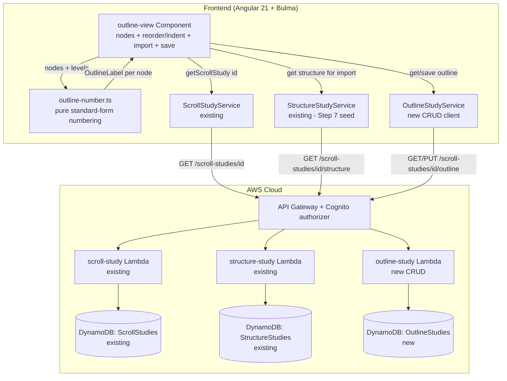
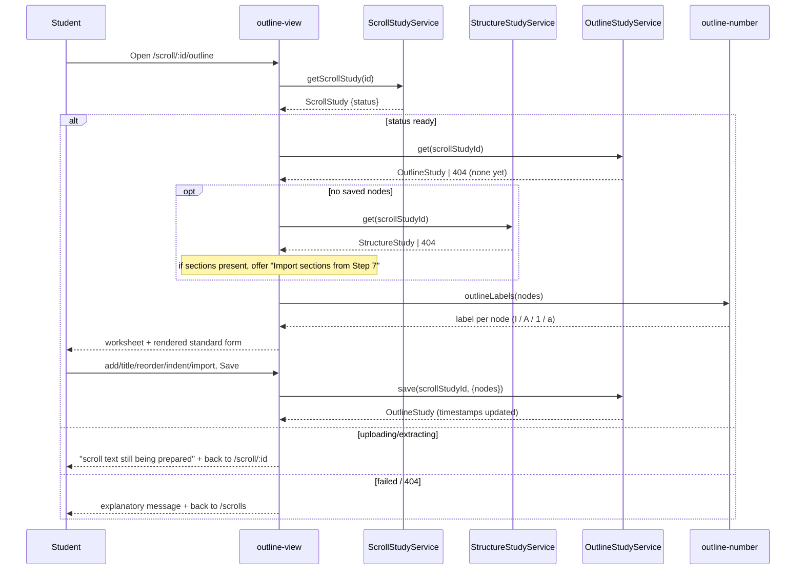

# Design Document: Make a Provisional Outline (Step 8 — Outline Study)

## Overview

This feature adds the **Outline Study** tool for inductive-study **Step 8 — Make a Provisional
Outline**. Given a book's ready **Scroll Study** (Step 4) and, optionally, the student's saved
**Structure Study** (Step 7), it lets the student build an ordered, nestable list of titled
**outline nodes** through the method's six sub-steps (list paragraphs → title → bracket → title
brackets → group → standard form), **persist** it as a re-openable **Outline Study** record, and
see it rendered in **standard outline form** (I / A / 1 / a).

The design follows the shipped **Structure Study** (`.kiro/specs/analyze-book-structure/`)
exactly. The only derivation — standard outline numbering — is a **pure, client-side function** of
the ordered node list and node levels; it persists nothing and introduces no Bible text, matching
the derived-vs-persisted split the Step 6/7 tools already drew. The persisted record mirrors
`StructureStudy`/`AntecedentStudy`: one record per scroll per user, keyed by `scrollStudyId`,
served by a new CRUD Lambda behind the existing Cognito-authorized API Gateway, backed by a new
DynamoDB table that is additive and stateful-safe. It reuses the Angular 21 standalone + signals +
Bulma patterns and the scroll-nested routing already used by `structure-view` and `antecedent-view`.

Consistent with the product's copyright stance, the Outline Study stores only the student's own
**titles and passage locations** — never verse text — and sends nothing to any AI prompt.

## Architecture

The feature adds a new lazily-routed Angular component, a pure outline-numbering utility, a new
client service for the Outline Study CRUD, and a new backend table + CRUD Lambda + API routes that
mirror the existing `structure-study` path.





## Decisions

**Flat ordered list with an explicit `level`, not a recursive tree.** An outline is naturally a
tree, but the student's editing operations (add, move up/down, indent, outdent, remove) are far
simpler over a **flat ordered list where each node carries an integer `level`**. This reuses the
Structure Study sections' signal-update pattern verbatim (map over an ordered array, update one
index), serializes to a single DynamoDB item without nested-attribute handling, and makes
reordering trivial. A recursive `children[]` tree was rejected: it complicates every edit (move
across parents, re-parent on indent) for no persisted benefit, since the standard-form rendering
reconstructs the hierarchy from levels on the fly.

**Standard outline numbering is derived, never persisted.** The I / A / 1 / a labels are a pure
function of the ordered list and the levels — recomputed on each render, exactly like the Structure
Study's frequency view and the pronoun list. Nothing about the numbering is stored, so there is no
numbering to migrate or keep consistent; only the student's titles, levels, refs, and notes
persist.

**One record per scroll per user, keyed by `scrollStudyId` (mirrors `StructureStudy`).** There is
exactly one Outline Study per `(scrollStudyId, userId)`, fetched by exact key and upserted on save.
No GSI, a two-method `GET`/`PUT` under the scroll — identical to the Structure and Antecedent
studies. A free-standing `/outline-studies` collection with its own ids and a list view was
rejected for the same reason it was for Structure: an Outline Study is always reached from its one
scroll.

**Seed from Step 7 by explicit import, never automatic.** The Step 7 design committed to shaping
its sections so Step 8 could consume them "without re-entry." We honour that with a student-triggered
**"Import sections from Step 7"** button, shown only when a saved `StructureStudy` has sections and
the outline has no nodes yet. Each section becomes one level-0 node, carrying `label` → `title` and
`startRef`/`endRef`/`notes`. Making it explicit (not an automatic prefill) keeps the student in
control, avoids surprising overwrites, and leaves the from-scratch path fully usable when there is
no Step 7 work.

**New table vs. reuse an existing one.** We add a dedicated `OutlineStudies` table rather than new
item types inside an existing table, identical to the Structure/Antecedent/Book-Study decisions:
it keeps each tool's data isolated, keeps the per-table removal policy and access grants simple, and
is additive and stateful-safe on the live stack.

## Components and interfaces

### Data model (`src/app/models.ts`)

```typescript
/** One node of the provisional outline (Step 8). */
export interface OutlineNode {
  title: string;    // required free text (<=200)
  level: number;    // 0 = "I", 1 = "A", 2 = "1", 3 = "a"; integer 0..3
  startRef: string; // optional free text, '' when unset (<=50)
  endRef: string;   // optional free text, '' when unset (<=50)
  notes: string;    // free text, '' when unset (<=1000)
}

/** The persisted Step 8 worksheet for one scroll study, owned by the current user. */
export interface OutlineStudy {
  scrollStudyId: string;
  userId: string;        // Cognito sub
  nodes: OutlineNode[];  // ordered; levels encode nesting
  createdAt: string;     // ISO 8601
  updatedAt: string;     // ISO 8601
}

/** Save payload from the outline view (server sets userId/timestamps). */
export interface OutlineStudyInput {
  nodes?: OutlineNode[];
}
```

### Pure numbering utility (`src/app/outline-number.ts`)

```typescript
/** The computed standard-form label for a node, e.g. "I", "A", "1", "a". */
export interface OutlineLabel {
  index: number; // position in the flat nodes array
  level: number;
  label: string; // Roman/letter/arabic per level
}

/** Pure: compute standard outline-form labels (I / A / 1 / a) for an ordered node list. */
export function outlineLabels(nodes: readonly OutlineNode[]): OutlineLabel[];
```

Numbering rule (A4): a per-level counter restarts whenever a node of a shallower-or-equal level is
encountered (a new parent). Level 0 → uppercase Roman, 1 → uppercase letter, 2 → arabic, 3 →
lowercase letter. Deeper levels (should they occur) reuse the arabic/lowercase cycle. This mirrors
the pure, fully-unit-tested `structure-analyze.ts` / `antecedent-suggest.ts` utilities.

### Client service (`src/app/outline-study.service.ts`)

A direct clone of `StructureStudyService`: `get(scrollStudyId)` → `GET
/scroll-studies/{id}/outline`, `save(scrollStudyId, input)` → `PUT /scroll-studies/{id}/outline`,
with a `toOutlineStudy` record-normaliser defaulting `nodes` to `[]`.

### Component (`src/app/outline-view/outline-view.component.ts`)

Standalone, signals-based, Bulma, lazily routed at `scroll/:scrollStudyId/outline` (added to
`app.routes.ts` next to the `structure` route). Signals: `scrollStatus`, `nodes`,
`structureSections` (for the import affordance), `saving`, `saved`, `saveError`. Handlers mirror
`structure-view`: `addNode`, `setNodeTitle`/`setNodeStartRef`/`setNodeEndRef`/`setNodeNotes`,
`removeNode`, `moveNode(index, delta)`, `indentNode(index)`/`outdentNode(index)`,
`importFromStep7()`, and `save()` (drops empty-title nodes, reflects the server-normalised
worksheet). The rendered standard-form view is a `computed` over `outlineLabels(nodes())`.

### Backend Lambda (`infra/lambda/outline-study/index.ts`)

A clone of `infra/lambda/structure-study/index.ts`: `GET` returns the caller's record or 404; `PUT`
validates and upserts. Validation per node: `title` a non-empty string ≤ 200; `level` an integer in
0..3; `startRef`/`endRef` optional strings ≤ 50; `notes` optional string ≤ 1000; `nodes` an array.
Any violation → 400 with a specific message, mirroring the structure-study validator. Items keyed
`PK = USER#{userId}`, `SK = OUTLINE#{scrollStudyId}` (same keying scheme the structure Lambda uses,
substituting the entity prefix).

### CDK (`infra/lib/word-study-tool-stack.ts`)

- `outlineStudiesTable` — a `dynamodb.Table` cloned from `structureStudiesTable` (PK/SK strings,
  PAY_PER_REQUEST, AWS-managed encryption, `config.statefulRemovalPolicy`, no GSI). Table count
  6 → 7.
- `outlineStudyFn` — a `nodejs.NodejsFunction` cloned from `structureStudyFn`, entry
  `lambda/outline-study/index.ts`, env `OUTLINE_STUDIES_TABLE_NAME`, its own log group via
  `fnLogs('OutlineStudyFn')`. `outlineStudiesTable.grantReadWriteData(outlineStudyFn)`. Function
  count 8 → 9, log-group count tracks the function count the same way Step 7 did.
- Routes: `scrollStudyByIdResource.addResource('outline')` with `GET` + `PUT` using
  `authMethodOptions`, mirroring the `structure` resource.

## Testing strategy

- **`outline-number.spec.ts`** — pure-function unit tests: single level, nested I/A/1/a, sibling
  restart under a new parent, deep-level cycling, empty list. Mirrors `structure-analyze.spec.ts`.
- **`outline-view.component.spec.ts`** — ready/preparing/failed/404 gating; add/title/edit/remove;
  move up/down; indent/outdent clamping at 0 and 3; import-from-Step-7 (present only with sections +
  empty outline, maps label→title and refs, no overwrite); save drops empty-title nodes and reflects
  the normalised result; save-error keeps entered values. Mirrors `structure-view.component.spec.ts`.
- **`infra/lambda/outline-study/index.test.ts`** — GET 404 when absent; GET returns the caller's
  item; PUT upsert; PUT rejects each invalid node field (title empty/too long, level non-integer or
  out of 0..3, refs/notes too long, nodes not an array); user isolation. Mirrors the structure-study
  Lambda test.
- **`infra/test/word-study-tool-stack.test.ts`** — extend the table/function/log-group count
  assertions to 7 tables / 9 functions, assert the `OutlineStudies` table is PAY_PER_REQUEST with a
  Retain deletion policy in prod, and assert the `OutlineStudy` function and the GET/PUT `outline`
  methods exist.
- **`npm run verify`** must pass end-to-end (lint, format, frontend tests, build, infra typecheck,
  infra tests, CDK synth) before the build PR.

## Stateful-safety note

The change is purely additive: a new table, a new function, new routes, and no change to any
existing table, function, route, or record. The new table uses `config.statefulRemovalPolicy`
(Retain in prod) exactly like `StructureStudies`, so deploying onto the live stack creates the new
resources without touching existing data.
