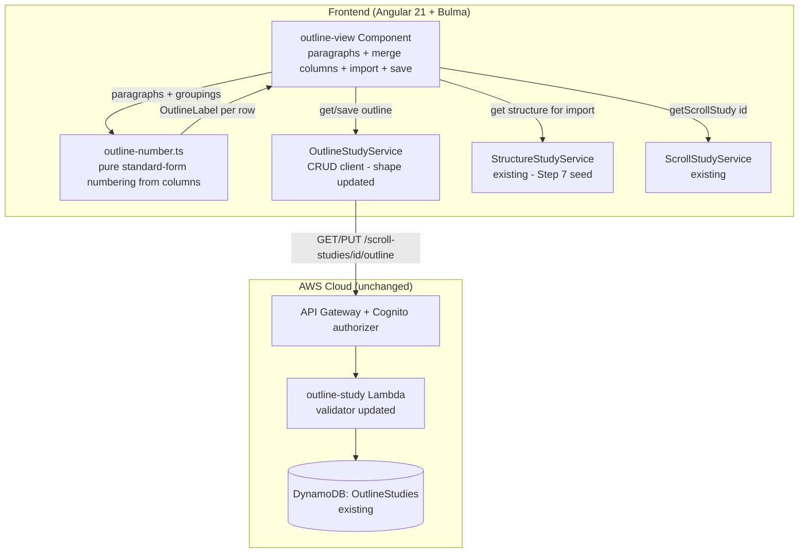

# Design Document: Make a Provisional Outline (Step 8) + State Theme & Purpose (Step 9)

> **Revision (R3).** Folds **Step 9 — State a Provisional Theme and Purpose** into this tool. Adds
> two optional free-text fields — `theme` (≤ 80) and `purpose` (≤ 500) — to the `OutlineStudy`
> record, a **Theme & Purpose panel pinned to the top of the outline view**, and server validation
> for the two fields. No new table, Lambda, route, or function; no migration (legacy records read
> `theme=''`/`purpose=''`). The theme and purpose are **student-authored free text** — captured,
> never generated. Everything in R2 below stands; R3 is purely additive.

> **Revision (R2).** Replaces the flat `OutlineNode[]` (title + `level`) model shipped in PR #42
> with a **left-to-right flow**: an ordered `paragraphs: OutlineParagraph[]` (the fixed leftmost
> column) plus `groupings: OutlineGrouping[]` (contiguous paragraph spans arranged in columns to
> the right). The standard outline form is re-derived from this structure. The backend table,
> Lambda, routes, and function count are **unchanged** — only the stored record shape and the
> frontend change.

## Overview

Step 8 — **Make a Provisional Outline** — lets a student build a book's outline the way the
inductive method and a spreadsheet both work it: a **leftmost column of paragraphs** (each with
start/stop references and a one-line main idea), then **merge columns to the right** that bracket
contiguous paragraphs into labelled groupings and groupings into larger groupings. The finished
artifact — standard outline form (I / A / 1 / a) — is **derived** from that column structure by a
pure client-side function; nothing about the numbering is persisted.

The persisted record mirrors `StructureStudy` at the infrastructure layer: one record per scroll
per user, keyed by `scrollStudyId`, served by the existing `OutlineStudy` CRUD Lambda behind the
Cognito-authorized API Gateway, backed by the existing `OutlineStudies` DynamoDB table. This
revision changes only the **shape of the stored item** (and the frontend); it adds no table, no
function, no route.

Consistent with the product's copyright stance, the Outline Study stores only the student's own
**main ideas, titles, and passage locations** — never verse text — and sends nothing to any AI
prompt.

## The model, and why it replaces the flat list

**Problem with R1 (flat list + `level`).** A single indented column is the *shape* of a finished
outline but hides the *process*. The method builds an outline left-to-right: paragraphs first,
then merges. A `level` on each node cannot express "this bracket spans paragraphs 3–5" except
implicitly through adjacency and indentation, and it offers the student no "merge these rows"
gesture — only "indent this one row". The user works this in a spreadsheet by **merging adjacent
cells across columns**, and asked for that flow.

**R2 model.** Two ordered collections:

- `paragraphs: OutlineParagraph[]` — the ground truth, in reading order. The leftmost column.
- `groupings: OutlineGrouping[]` — each a **contiguous span** `[startIndex, endIndex]` over the
  paragraph array, at a `column` (1 = first bracket column, 2 = next, …), with a `title`. A
  grouping is one "merged cell" covering the rows of the paragraphs it spans.

The hierarchy is reconstructed on render: for any paragraph, the covering grouping in the highest
column is its top division, the next-lower column its next level, down to the paragraph as leaf.
Contiguity (enforced on every edit and on the server) guarantees this projection is well-defined.

**Why contiguous-only.** A bracket in the method is always a run of adjacent paragraphs, and a
spreadsheet merge is always a contiguous block. Contiguity makes the standard-form derivation a
simple left-to-right sweep with no ambiguity about which division a paragraph belongs to, and
makes the span representable as two integers rather than a set.

## Architecture

No AWS resource changes. The frontend component, the pure numbering utility, the client service,
and the Lambda validator change; the table, function, and routes are reused as-is.



## Decisions

**Paragraphs + contiguous column groupings, not a flat level list, not a recursive tree.** The
paragraph is the primitive and is a stable, index-addressable column; groupings reference
paragraph ranges by index. This directly models the spreadsheet merge the student described, lets
the UI render a true left-to-right "merged cells" flow, and keeps every grouping to two integers
plus a title. A recursive `children[]` tree was rejected again for the same reason as R1 — it
complicates every edit and persists a hierarchy the column structure already encodes — and the
flat level list was rejected because it cannot express or offer a span-merge gesture.

**Standard outline numbering is derived, never persisted.** Unchanged in spirit from R1: the
labels are a pure function, now of `(paragraphs, groupings)` rather than `(nodes)`. Nothing is
stored, so there is nothing to migrate or keep consistent.

**Index-based spans with maintained invariants.** Groupings store integer paragraph indices.
Every structural edit (reorder/remove paragraph, merge/unmerge grouping) runs through a single
`normalize()` helper that re-clamps spans, drops emptied groupings, and guarantees contiguity, so
no code path can produce a non-contiguous span. The server independently re-validates, so a bad
client can never persist one.

**Reuse the existing table/Lambda/routes.** The infra from PR #42 already exists and fits; this
revision only changes the item shape and the validator. DynamoDB is schemaless, the sole existing
records are PR #42 test data with no real user content, so no migration is needed — a stale
R1-shaped item simply fails the new validator on next save and is replaced.

## Components and interfaces

### Data model (`src/app/models.ts` and `infra/lambda/shared/models.ts`)

Replace `OutlineNode` with `OutlineParagraph` + `OutlineGrouping`; update `OutlineStudy` /
`OutlineStudyRecord` / `OutlineStudyInput` to carry the two collections.

```typescript
/** One paragraph of the book — the atomic row of the outline (Step 8, leftmost column). */
export interface OutlineParagraph {
  startRef: string; // optional free text, '' when unset (<=50)
  endRef: string;   // optional free text, '' when unset (<=50)
  mainIdea: string; // required free text, the single-statement main idea / working title (<=200)
  notes: string;    // optional free text, '' when unset (<=1000)
}

/** A grouping: a contiguous span of paragraphs merged and titled, at a given merge column. */
export interface OutlineGrouping {
  column: number;     // 1 = first bracket column, 2 = next, …; integer >= 1
  startIndex: number; // first paragraph covered (inclusive), integer >= 0
  endIndex: number;   // last paragraph covered (inclusive), startIndex <= endIndex < paragraphs.length
  title: string;      // required free text (<=200)
  notes: string;      // optional free text, '' when unset (<=1000)
}

/** The persisted Step 8 worksheet for one scroll study, owned by the current user. */
export interface OutlineStudy {
  scrollStudyId: string;
  userId: string;                 // Cognito sub
  paragraphs: OutlineParagraph[]; // ordered, reading order; the leftmost column
  groupings: OutlineGrouping[];   // contiguous paragraph spans in columns to the right
  theme: string;                  // Step 9: what the book is about, short condensation; '' when unset (<=80)
  purpose: string;                // Step 9: the author's goal, one sentence; '' when unset (<=500)
  createdAt: string;              // ISO 8601
  updatedAt: string;              // ISO 8601
}

/** Save payload from the outline view (server sets userId/timestamps). */
export interface OutlineStudyInput {
  paragraphs?: OutlineParagraph[];
  groupings?: OutlineGrouping[];
  theme?: string;   // Step 9; omitted/'' allowed
  purpose?: string; // Step 9; omitted/'' allowed
}
```

### Step 9 — Theme & Purpose (R3)

The theme and purpose are two optional free-text fields on the same record, rendered in a panel
**pinned to the top of the outline worksheet** (where the method states them) above the
paragraph/grouping flow. They are the student's own interpretive condensation of the outline:

- **Theme** — *what the book is about*, a 1–3 word / short-phrase condensation (≤ 80). Example from
  the method: Galatians → "Justification by faith".
- **Purpose** — *the author's goal*, one sentence (≤ 500). Example: Galatians → "To rebuke the
  Galatians for tolerating a false gospel of justification through faith plus works".

The panel carries brief, non-prescriptive helper text framing the two definitions. The app
**captures but never generates** either field — consistent with "assist, never replace": Step 5's
AI summary is the method's single deliberately-assisted step, and Step 9 is explicitly the
student's own work. Nothing from theme/purpose is sent to any AI prompt and no Bible text is
introduced.

Both fields serialize with the worksheet through the existing `PUT`; legacy records (pre-R3)
default to `''` on read, so no migration is needed.

### Pure numbering utility (`src/app/outline-number.ts`)

Replace the node-list signature with one over the paragraphs + groupings. It computes, for every
paragraph and every grouping, its standard-form label and the depth level it renders at.

```typescript
export interface OutlineLabel {
  kind: 'grouping' | 'paragraph';
  ref: number;   // index into groupings[] (kind='grouping') or paragraphs[] (kind='paragraph')
  level: number; // 0 = top division; increases toward the paragraph leaf
  label: string; // Roman/letter/arabic per level
}

/**
 * Pure: compute standard outline-form labels for a paragraphs + groupings structure.
 * Levels run from the deepest-column grouping (level 0, "I") down to the paragraph leaf.
 * Sibling counters restart under each new parent. Requires contiguous spans (caller guarantees).
 */
export function outlineLabels(
  paragraphs: readonly OutlineParagraph[],
  groupings: readonly OutlineGrouping[],
): OutlineLabel[];
```

Algorithm: determine `maxColumn`. Level 0 = column `maxColumn` groupings (ordered by `startIndex`),
level 1 = column `maxColumn-1`, …, with paragraphs at the leaf level `maxColumn + 1`. A paragraph
or grouping not covered at some column inherits its parent from the next-higher covering grouping;
an uncovered paragraph sits at the top level (flat I / II / III when there are no groupings). The
per-level sibling counter restarts whenever a new parent span begins. The `toRoman` / `toLetters` /
`labelFor` helpers from R1 are reused verbatim.

### Client service (`src/app/outline-study.service.ts`)

Same two methods (`get` / `save` → `GET`/`PUT /scroll-studies/{id}/outline`). The record normaliser
now defaults `paragraphs` and `groupings` to `[]`.

### Component (`src/app/outline-view/outline-view.component.ts`)

Standalone, signals-based, Bulma, routed at `scroll/:scrollStudyId/outline` (route unchanged).
Signals: `scrollStatus`, `paragraphs`, `groupings`, `theme`, `purpose`, `structureSections`
(import affordance), a `selection` set of paragraph indices for the merge gesture,
`saving`/`saved`/`saveError`.

Handlers:
- Paragraph column: `addParagraph`, `setParagraphStartRef/EndRef/MainIdea/Notes`,
  `moveParagraph(index, delta)`, `removeParagraph(index)` — all routed through `normalize()`.
- Merge columns: `toggleSelect(index)` (builds a contiguous selection; a non-adjacent pick is
  rejected with a hint), `mergeSelection()` (creates a column-1 grouping over the selected
  contiguous span), `mergeGroupings(a, b)` (adjacent same-column groupings → next column),
  `setGroupingTitle/Notes`, `removeGrouping(index)`.
- `importFromStep7()` — one paragraph per Step 7 section (label → mainIdea, refs, notes), no
  groupings.
- Theme & Purpose (Step 9): `setTheme(value)` / `setPurpose(value)` update only their own signal.
- `save()` — drops empty-`mainIdea` paragraphs and empty-`title` groupings, re-normalises spans,
  sends `theme`/`purpose` (trimmed, `''` when unset) alongside, reflects the server result.

A single `normalize(paragraphs, groupings)` pure helper (unit-tested) re-clamps every grouping span
to `[0, paragraphs.length-1]`, drops groupings whose span collapsed, and asserts contiguity — the
one place structural invariants are maintained.

View: a left-to-right flow. **A Theme & Purpose panel is pinned to the top** (a `theme` input and a
`purpose` textarea with brief Step 9 helper text), above the outline flow — where the method states
them. Below it, the leftmost column lists paragraph rows (start/stop + main idea + notes +
reorder/remove). To its right, each merge column draws grouping blocks positioned to span the
vertical extent of the paragraph rows they cover (CSS grid rows keyed by paragraph index), so a
grouping visibly brackets its paragraphs — the "merged cells" the student draws. The rightmost box
renders the derived standard outline form, unchanged in spirit from R1.

### Backend Lambda (`infra/lambda/outline-study/index.ts`)

Replace `parsePutBody`'s per-node validation with per-paragraph + per-grouping validation:
`paragraphs` an array, each with a non-empty `mainIdea` ≤ 200, `startRef`/`endRef` ≤ 50,
`notes` ≤ 1000; `groupings` an array, each with integer `column ≥ 1`, integer `startIndex`/
`endIndex` where `0 ≤ startIndex ≤ endIndex < paragraphs.length`, non-empty `title` ≤ 200,
`notes` ≤ 1000. Add Step 9 validation: `theme` an optional string ≤ 80, `purpose` an optional
string ≤ 500 (each defaults to `''` when omitted; a non-string → 400). The persisted record carries
`paragraphs` + `groupings` + `theme` + `purpose`. Keying (`PK = USER#{userId}`,
`SK = OUTLINE#{scrollStudyId}`), read-before-write for `createdAt`, and the GET/PUT routing are
unchanged.

### CDK (`infra/lib/word-study-tool-stack.ts`)

**No change.** The `OutlineStudies` table, `OutlineStudyFn` Lambda, and `outline` GET/PUT routes
from PR #42 are reused as-is.

## Testing strategy

- **`outline-number.spec.ts`** — rewritten for the new signature: no groupings → flat I / II / III
  over paragraphs; one column of brackets → I/A with paragraphs as A/B under each bracket; two
  columns → I/A/1; sibling restart under each new parent; empty inputs → `[]`.
- **`outline-view.component.spec.ts`** — rewritten: ready/preparing/failed/404 gating; add/edit/
  reorder/remove paragraph with span maintenance; contiguous-merge creates a grouping and a
  non-adjacent selection is rejected; merge groupings to the next column; remove grouping;
  import-from-Step-7 (paragraphs only, no overwrite); save drops empty paragraphs/groupings and
  reflects the normalised result; save-error keeps values. **R3:** the top Theme & Purpose panel
  renders; editing `theme`/`purpose` updates only those fields; save sends them and reload shows
  them; a legacy record with no theme/purpose loads empty without error.
- **`infra/lambda/outline-study/index.test.ts`** — rewritten: GET 404/own-item; PUT upsert of the
  new shape; PUT rejects each invalid field (mainIdea empty/too long, grouping column < 1, span
  out of range or inverted, title empty/too long, refs/notes too long, paragraphs/groupings not an
  array). **R3:** PUT accepts/persists `theme`/`purpose`, defaults them to `''` when omitted, and
  rejects a too-long `theme` (> 80), a too-long `purpose` (> 500), or a non-string value; user
  isolation.
- **`infra/test/word-study-tool-stack.test.ts`** — **unchanged counts** (7 tables / 9 functions);
  no new assertions needed since no infra changes.
- **`npm run verify`** must pass end-to-end before the build PR.

## Stateful-safety note

No infra change: the existing table, function, and routes are reused. DynamoDB is schemaless and
the only existing records are PR #42 test data with no real user content, so changing the stored
item shape needs no migration — a stale R1-shaped item is simply overwritten by the next save in
the new shape. Deploying is a Lambda code update plus the frontend, with no table or route churn.
