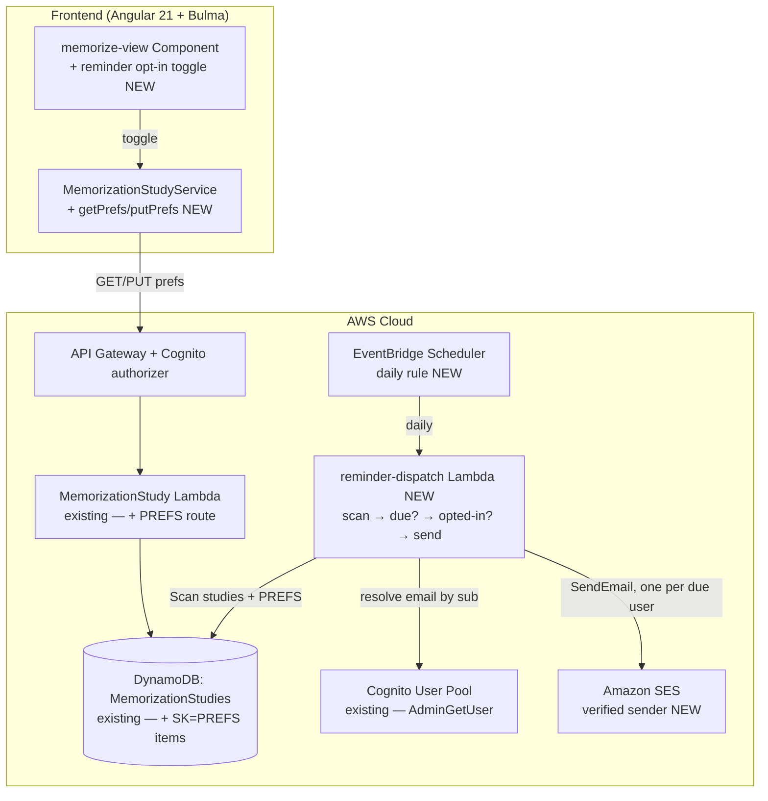

# Design Document: Memorize the Scroll — daily due-review reminder

## Overview

This feature adds the **daily outbound reminder** to the shipped Memorize the Scroll tool. Once a day it
emails each opted-in student who has memorization chunks coming due — "**N chunks of &lt;book&gt; are due
for review today**" — so the SM-2 schedule the v2 scheduler computes actually pulls them back to the
tool. The v2 scheduler (`.kiro/specs/memorize-srs-scheduler/`, shipped) added the per-chunk `dueDate` and
SM-2 fields this reminder reads; that dependency is now satisfied.

This is the **first outbound infrastructure in the whole app**. Every memorization change before it was
additive and client-side; this one genuinely adds AWS resources — an **EventBridge Scheduler** daily
rule, a new **reminder-dispatch Lambda**, an **SES** email identity, and a CDK-named **log group** — and
touches a per-stage **sender-identity** value that is config the maintainer fills in. It stays
**stateful-safe**: the MemorizationStudies table and the Cognito user pool are untouched in shape, the
user preference rides the existing table as a new `SK=PREFS` item (no new table), and the stateful guard
reports `✅ No stateful-resource replacement or deletion`. Counts move **additively** — +1 Lambda
function, +1 log group; DynamoDB tables unchanged.

Three design points were decided with the user before this draft:

- **"Who is due" is a daily table scan, filtered in the Lambda (D1).** `dueDate` lives *inside* each
  chunk in the `chunks[]` list, which DynamoDB cannot index, and there is no GSI on due-date. The table
  is tiny, so a once-a-day scan is the simplest correct approach; a derived `nextDueDate` + GSI was
  rejected as premature.
- **Delivery is SES email (D2).** Email reaches the student when the tool is closed — the point of a
  reminder. SES starts in sandbox (verified recipients only), which suffices for a personal tool.
- **Opt-in, default off, preference on the existing table (D3).** A per-user `SK=PREFS` item holds
  `reminderOptIn` (+ optional `reminderHour`); a student not actively memorizing gets no mail.

## Architecture

The existing request/response topology (memorize view ↔ `memorization-study` Lambda ↔ MemorizationStudies
table) is unchanged. The new piece is an **independent scheduled path**: EventBridge Scheduler → dispatch
Lambda → (DynamoDB scan + Cognito lookup + SES send). The only crossover is that the dispatch Lambda reads
the same MemorizationStudies table (the studies and the `SK=PREFS` items).



## Decisions

**Daily scan, filtered in code (D1).** The dispatch Lambda issues a paginated `Scan` over
MemorizationStudies. It partitions the items by `PK` (user) into (a) MEMORIZE# studies and (b) the PREFS
item. For each user it computes due chunks with the same date-only rule the client uses, checks
`reminderOptIn`, and — if due and opted-in — sends one email. The table holds one small item per
user-per-scroll plus one PREFS item per user, so a daily scan is a handful of RCUs — fractions of a cent.
No GSI, no `nextDueDate` denormalization, no write-path change. This is the "simplest service that meets
the requirement" reading and keeps the hot PUT path untouched.

**SES email, sandbox-acceptable (D2).** The dispatch Lambda calls `ses:SendEmail` from a verified sender
identity provisioned in the stack. SES in sandbox can email only verified recipients, which is fine for a
single-maintainer tool (the maintainer's address is verified once). Leaving sandbox is a one-time
production-access request, documented as an operational follow-up — not provisioned here.

**Opt-in preference on the existing table as `SK=PREFS` (D3).** Rather than a new table or a new Lambda,
the per-user preference is one more item under the same `PK=USER#<sub>` with `SK=PREFS`. The existing
`memorization-study` Lambda gains a small additive route to read/write it. Default off: a user with no
PREFS item, or `reminderOptIn=false`, is skipped by the dispatch job regardless of due state.

**Recipient email from Cognito, never from the table (A2).** The memorization data stores only the
Cognito `sub`. The dispatch Lambda resolves each due, opted-in user's email with
`cognito-idp:AdminGetUser` against the existing user pool at send time. No email address is ever written
to DynamoDB — the PREFS item carries only the boolean/hour.

**Sender address is a human-fills-in `stage-config.ts` blank (A1).** `reminderSender` joins `StageConfig`
as a per-stage value, shipped as a clearly-marked placeholder (e.g. `'REPLACE_ME@example.com'`). The CDK
wires it into the SES identity and the dispatch Lambda's `REMINDER_SENDER` env + `ses:SendEmail` resource
condition. The build does **not** invent a real address; the maintainer edits the two stage values (and
verifies the address in SES) as the one manual step. This mirrors how `figuresAssistModelId` is a
per-stage behavior value rather than a frozen physical name — it may be edited with an explicit change.

**One email per due user, counts/locations only (A3).** A user with several due books gets one email that
lists each book and its due count (and may list due reference labels like `Philippians 2:1-5`). The body
never contains verse text — only counts, book names, location labels, and a link to `siteDomain`.

**Additive, stateful-safe infra (A7).** Every new resource is an addition. The MemorizationStudies table
and the user pool keep their construct IDs and physical names. The stateful guard is a no-op; counts move
+1 function / +1 log group; the `diff` comment shows only additive `[+]` lines on `WordStudyToolStack`
plus the bundle-hash rotation on the existing `memorization-study` function (not a resource replacement).

## Components and Interfaces

### Scheduled dispatch Lambda (new)

`infra/lambda/reminder-dispatch/index.ts` — a scheduled handler (no API Gateway event; an EventBridge
Scheduler payload). Pure-ish core extracted for unit testing:

```typescript
/** A due-review summary for one user, ready to render into an email. */
export interface DueSummary {
  sub: string;                        // Cognito sub
  books: { book: string; dueCount: number; dueRefs: string[] }[];
  totalDue: number;
}

/** Group scanned items into per-user studies + the PREFS item. (pure) */
export function groupByUser(items: Record<string, unknown>[]): Map<string, {
  studies: MemorizationStudyRecord[];
  optIn: boolean;
  reminderHour?: number;
}>;

/** Compute the due summary for one user on `today` (date-only); null when nothing is due. (pure) */
export function dueSummaryFor(
  studies: MemorizationStudyRecord[],
  bookNameByScrollId: Map<string, string>,
  today: Date,
): DueSummary | null;

/** Render the email subject + plaintext/HTML body from a summary (counts/locations only, no verse text). (pure) */
export function renderReminderEmail(summary: DueSummary, siteUrl: string): { subject: string; text: string; html: string };
```

The handler wires these to the AWS SDK: paginated `ScanCommand` over MemorizationStudies →
`groupByUser` → for each opted-in user with a non-null `dueSummaryFor`, `AdminGetUserCommand` to resolve
email → `SendEmailCommand`. A per-user try/catch logs and continues (A/R2.6, NFR7). The book name per
scroll is resolved from the ScrollStudies table (or carried if already denormalized) — a bounded read
batched per run.

`today` is the run date (`new Date()` at the handler boundary, date-only in UTC); the pure functions take
it as an argument so the due-math is deterministic under test, exactly as `srs.ts` does in the frontend.

### Preference route on the existing `memorization-study` Lambda (additive)

The existing handler gains a PREFS read/write. Two low-risk shapes (design review picks one; the
requirements allow either):

- **Preferred:** a dedicated resource `/scroll-studies/prefs/memorize-reminder` with `GET` (returns
  `{ reminderOptIn, reminderHour? }`, defaulting to `{ reminderOptIn: false }` when absent) and `PUT`
  (validates `reminderOptIn` boolean and `reminderHour` integer 0–23 when present, upserts the
  `SK=PREFS` item).

The handler reads/writes `PK=USER#<sub>` / `SK=PREFS`. It never stores an email address. Validation
mirrors the existing `parsePutBody` style (reject malformed → `400`, never coerce).

### Frontend (`memorize-view` + service, additive)

- `MemorizationStudyService` gains `getReminderPref()` / `putReminderPref(pref)` hitting the new route.
- `memorize-view` gains a **reminder toggle** (`data-testid` `reminder-optin`) and, when on, an optional
  **hour selector** (`reminder-hour`), with a short explanation ("Get a daily email when chunks are due").
  Reads the pref on load; writes on change. Default rendered state is **off**. Keyboard + ARIA per the
  sibling editors.

### Infrastructure (`word-study-tool-stack.ts` + `stage-config.ts`)

- **`StageConfig` gains:** `reminderSender: string` (per-stage, human-fills-in placeholder) and
  `reminderScheduleExpression: string` (the daily EventBridge Scheduler cron/rate; a sensible default per
  stage — e.g. a fixed morning UTC hour). Both live only here.
- **Stack gains:** an SES `EmailIdentity` for `reminderSender`; the `reminder-dispatch` NodejsFunction
  (mirroring `commonLambdaProps`, its own `fnLogs('ReminderDispatchFn')` log group); an EventBridge
  `Scheduler` schedule targeting the Lambda daily; IAM — the dispatch Lambda granted
  `memorizationStudiesTable.grantReadData` (scan), `cognito-idp:AdminGetUser` (+ `ListUsers` if needed)
  on the user pool, and `ses:SendEmail`/`SendRawEmail` scoped to the verified identity. Constructs use
  **new** IDs (e.g. `ReminderDispatchFn`, `ReminderSchedule`, `ReminderSenderIdentity`); nothing existing
  is renamed.

## Data Model

### Preference item — new `SK=PREFS` on the existing MemorizationStudies table

```
PK = USER#<sub>
SK = PREFS
reminderOptIn: boolean       // default false; no item ⇒ false
reminderHour?: number         // 0..23, optional; absent ⇒ stage default send time
createdAt, updatedAt: string  // ISO 8601
```

No email address is stored. The MemorizationStudies **table itself is unchanged** (same PK/SK schema,
billing, removal policy) — it simply holds one more item kind per user. The MEMORIZE# study items and
their chunks are untouched.

### Shared model (both `src/app/models.ts` and `infra/lambda/shared/models.ts`)

Add an additive interface for the preference (studies/chunks unchanged):

```typescript
/** Per-user reminder preference for Memorize the Scroll (stored at PK=USER#<sub> / SK=PREFS). */
export interface MemorizationReminderPref {
  reminderOptIn: boolean;
  reminderHour?: number; // 0..23 local hour; absent = stage default
}
```

## API

| Method | Path | Request body | Success | Errors |
|---|---|---|---|---|
| GET | `/scroll-studies/prefs/memorize-reminder` | — | `200 { reminderOptIn, reminderHour? }` (defaults to `{ reminderOptIn:false }` when absent) | `400` missing auth |
| PUT | `/scroll-studies/prefs/memorize-reminder` | `{ reminderOptIn, reminderHour? }` | `200` persisted pref | `400` invalid field / missing auth |

Existing memorize `GET`/`PUT /scroll-studies/{scrollStudyId}/memorize` unchanged. The dispatch Lambda has
**no** HTTP surface (EventBridge-invoked only).

## Validation

Preference `PUT` (in the existing handler, same reject-don't-coerce style):

- `reminderOptIn` — required boolean (else `400`).
- `reminderHour` — if present, an integer `0 ≤ h ≤ 23` (else `400`).
- No other fields accepted; no email address ever accepted or stored.

The dispatch Lambda performs no user-input validation (its input is the table + Cognito); it defends
against malformed stored items by skipping and logging, never throwing out of the whole run.

## Error Handling

| Operation | Failure | Behaviour |
|---|---|---|
| preference `PUT` | malformed body | `400`, nothing written |
| dispatch scan | DynamoDB throttle/error | the run fails and is retried next day; EventBridge logs the error (idempotent — nothing partial persisted) |
| resolve email | Cognito user missing/disabled | log + skip that user, continue the run |
| send | SES throttle / unverified recipient (sandbox) | log + skip that user, continue; next day's run retries |

A missed or partially-failed run is self-healing: the next daily run re-evaluates "due" from scratch and
re-sends for anything still due. No sent-state is persisted.

## Testing Strategy

All under the existing harness (Angular + vitest frontend; vitest + `setup-no-aws` for Lambdas). Nothing
calls AWS, SES, Cognito, or Bedrock.

### Unit tests — dispatch Lambda core (pure, injected `today`, mocked SDK)
- `groupByUser` partitions MEMORIZE# studies and the PREFS item per user; a user with no PREFS → opt-in
  false.
- `dueSummaryFor` — counts chunks due (never-reviewed and `dueDate <= today`), groups by book, returns
  `null` when nothing is due; date-only (ignores time-of-day); a v1/legacy chunk with no `dueDate` counts
  as due.
- `renderReminderEmail` — subject + body carry book names, counts, and (optionally) ref labels, **never**
  verse text; includes the site link.
- Handler with mocked DynamoDB/Cognito/SES: sends exactly one email to each opted-in due user; sends
  **none** to opted-out users and to due-but-not-opted-in users; one user's Cognito/SES failure does not
  stop the others (mock one rejection, assert the rest still send).

### Lambda tests — `memorization-study/index.test.ts` (mocked DynamoDB)
- PREFS `GET` with no item returns `{ reminderOptIn:false }`; after a `PUT` returns the saved pref.
- PREFS `PUT` validation: non-boolean `reminderOptIn` → `400`; `reminderHour` out of 0–23 or non-integer
  → `400`; a well-formed pref round-trips.
- The existing memorize study `GET`/`PUT` tests stay green (the new route is additive).

### Component tests — `memorize-view` (TestBed, stubbed service)
- The toggle renders **off** by default; reads an opted-in pref and renders **on**; toggling calls
  `putReminderPref` with the new value; the hour selector shows only when on and persists its value.

### CDK assertion tests — `word-study-tool-stack.test.ts` (UPDATED to the new counts)
- Resource counts move additively: `AWS::Lambda::Function` **+1**, `AWS::Logs::LogGroup` **+1**,
  `AWS::DynamoDB::Table` **unchanged**. Assert the `ReminderDispatchFn`, its log group, the EventBridge
  `Scheduler` schedule, and the SES `EmailIdentity` are present. Assert the dispatch Lambda's IAM allows
  the MemorizationStudies scan, Cognito `AdminGetUser`, and `ses:SendEmail`. The stateful-guard
  expectations (no table/user-pool replace/delete) stay green.

## Risks

- **First outbound infra — the only one in this spec that adds resources.** Mitigated by keeping every
  new resource additive with new construct IDs, riding the preference on the existing table, and updating
  the count assertions so the `diff`/guard reads are explicit.
- **SES sandbox.** In sandbox, SES reaches only verified recipients. For the maintainer that is fine
  (verify once). If signups broaden, SES production access is a one-time request — flagged as an
  operational follow-up, not a code change.
- **Sender address is manual.** `reminderSender` ships as a placeholder; the maintainer must set a real
  verified address in both stages (or at least the stage being deployed) and verify it in SES before the
  first send. Until then the dispatch Lambda logs an unverified-sender error and skips — no crash, no
  bad email. Called out as the one human step.
- **Scan cost at scale.** A daily full scan is cheap for a single-maintainer tool. If the table ever grew
  large, a derived `nextDueDate` + GSI (rejected now, D1) would be the upgrade path — a later spec, not
  this one.
- **Timezone of the daily send.** The schedule fires at a stage-configured UTC time; `reminderHour` is a
  stored preference recorded for a future per-user send-time refinement, but v1 of the reminder sends all
  due users at the single scheduled run. The due-compare itself is date-only, matching the client, so the
  email and the in-app queue agree.
- **No sent-state / possible duplicate on retry.** The job keeps no delivery log; an EventBridge retry of
  a failed run could re-send to users already emailed that run. Accepted for a daily personal reminder
  (at most one duplicate, same content); a sent-state table is explicitly out of scope.

## Out of scope

- **SES production access** (leaving sandbox) — operational follow-up if signups broaden.
- **Push / SMS / in-app badge** — email only; the in-app due queue already shipped with v2.
- **A delivery-log/sent-state table or cross-run de-duplication** — the daily scan-and-send self-heals.
- **Per-user send-time dispatch** (honoring `reminderHour` as the actual fire time per user) — the field
  is stored for a later refinement; v1 sends all due users at one scheduled run.
- **A GSI / derived `nextDueDate` index** — rejected (D1); the daily scan suffices at this scale.
- **Any AI / Bedrock call.**
- **Any change** to the v1/v2 memorization data shape beyond the additive `SK=PREFS` item, or to any
  shipped Step 4–12 tool or route.

## Design Review Responses

_(Reserved for responses to the spec PR's design review, following the sibling specs' convention.
Filled in point-by-point if the review returns CHANGES_REQUESTED.)_
