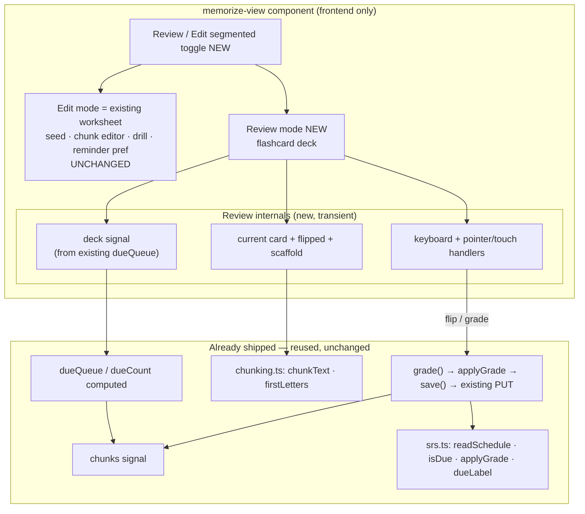

# Design Document: Memorize the Scroll — mobile-first flashcard Review mode

## Overview

This feature reshapes the **review loop** of the shipped Memorize the Scroll tool into a mobile-first,
near hands-free **flashcard deck**, without discarding any existing capability. Today the memorize page is
one dense desktop worksheet: a scrolling box of seed controls, the due queue, the reminder toggle, a
per-chunk editor (small ↑ / Merge up / Remove buttons), and a drill tucked underneath behind a `<select>`
chunk picker and small mode toggles. It works with a mouse; on a phone, mid-recitation, it demands too
much precise tapping to be "hands-free."

The change adds a **Review mode** — a full-bleed card the student flips and grades with a thumb, driven by
the already-shipped `dueQueue` — and preserves the current worksheet verbatim as an **Edit mode** behind a
segmented toggle. It is **100% frontend**: it reuses the v2 SM-2 scheduler surface (`readSchedule`,
`isDue`, `applyGrade`, `dueLabel`, the existing `grade()`/`save()` path) and the `chunkText`/`firstLetters`
chunking helpers. **No backend, no infrastructure, no new dependency, no API/schema change.** The v1/v2
data loads unchanged; the stateful guard stays a no-op; the CDK counts are unchanged.

Five design points were decided with the user before this draft:

- **Review is additive; Edit is preserved (D1).** A Review/Edit segmented toggle at the top; Edit is
  today's worksheet unchanged.
- **The deck is the due queue; grading auto-advances (D2).** One card at a time from `dueQueue`; grading
  runs the existing SM-2 and advances.
- **The card flips, honoring reduced motion (D3).** 3-D `rotateY` front↔back; a cross-fade under
  `prefers-reduced-motion: reduce`.
- **Near hands-free: large targets + keyboard + swipe (D4).** Full-width ≥44px grade buttons; Space/→/Enter
  to flip then `1 2 3 4` to grade; swipe up to flip, left=Again, right=Easy; native events, no library.
- **TTS is out (D5).** No audio API; deferred to a later V3.

## Architecture

There is **no change to the request/response topology** — no new network path, no new service call. The
feature is entirely within the `memorize-view` component. The data it drives (`chunks`, `dueQueue`,
`activeIndex`, `grade()`, `save()`) already exists; Review mode is a second rendering of that same state
plus transient view state (current card, flipped flag, scaffold level, deck order for the session).



## Decisions

**Additive mode toggle, Edit preserved verbatim (D1).** A new `viewMode` signal (`'review' | 'edit'`)
gates two template branches inside the existing `@case ('ready')`. The **Edit** branch is the *current*
template content moved under the toggle with **no markup or logic change** — every existing `data-testid`
(`seed-controls`, `memorize-chunk-row`, `memorize-drill`, `reminder-pref`, `memorize-save`, …) is retained,
so the existing component spec stays green. The **Review** branch is new. `viewMode` defaults to `'review'`
when a saved study has ≥1 chunk, else `'edit'`; an explicit toggle click sticks for the session. Both
branches read the same `chunks` signal, so switching never re-fetches or drops unsaved edits.

**The deck is the due queue (D2).** Review mode derives a session **deck** from the existing `dueQueue`
computed signal. `dueQueue` already yields `{ index, verseRef, dueLabel }` soonest-due-first; the deck is
an ordered list of those chunk indices for the session. A `deckPos` signal points at the current card.
Grading advances `deckPos`; an **Again** grade appends the current index to the end of the session deck so
it recurs within the session (it is still due after a miss). A pass removes it from the remaining deck
(its new `dueDate` is in the future, so it would drop out of `dueQueue` on recompute anyway). When
`deckPos` passes the end, the deck is complete → end state.

**Card flip with reduced-motion fallback (D3).** The card is a CSS 3-D flip: an outer `perspective`
container, an inner element that `transform: rotateY(180deg)` toggles via a `flipped` signal, with
`backface-visibility: hidden` front/back faces. Under `@media (prefers-reduced-motion: reduce)` the
rotation is removed and the faces cross-fade via `opacity` (the `flipped` class still drives which face
shows, but with no rotation and a short opacity transition). All styling is inline component `styles` with
CSS variables so it themes (light/dark), matching the `outline-view` convention.

**Near hands-free input (D4).** Three input channels converge on two actions — **flip** and **grade(g)**:
- **Tap/click** anywhere on the card → flip.
- **Keyboard** (a `@HostListener('keydown')` active only in Review mode): `Space`/`Enter`/`ArrowRight`
  flips when not yet flipped; once flipped, `1/2/3/4` → `grade('again'|'hard'|'good'|'easy')`. Shortcuts
  are ignored when focus is in an input (so Edit-mode fields are unaffected).
- **Touch/pointer** on the card: a lightweight swipe detector (pointerdown/up, no library) — vertical-up
  beyond a threshold → flip; horizontal-left → `grade('again')`, horizontal-right → `grade('easy')`, only
  once flipped. A small dominant-axis + min-distance guard avoids accidental grades.
The **visible buttons are always rendered** and are the primary control; keyboard/swipe are additive (A4).
The grade buttons are full-width, `min-height: 44px`, bottom-anchored on narrow viewports via the media
query.

**Grading reuses the existing path (A1).** `grade(g)` is the *already-shipped* method — it runs
`applyGrade(readSchedule(chunk), g, today)`, writes only the scheduling fields (never `state`), and calls
`save()`. Review mode calls it unchanged, then advances the deck. No new persistence, no new signal
saved — the only additions are transient view signals.

**Copyright invariant held (A2).** The card back renders `chunkText(scrollText, chunk)` exactly as the
current drill does; the front shows the `verseRef` **label** (or "Chunk K"). No verse text is fetched or
sent; TTS (which would *speak* it) is out (D5).

**Frontend-only, zero infra (A6).** No file under `infra/` changes. The CDK assertion test is **not**
touched (counts unchanged). The `diff` job shows no `WordStudyToolStack` resource delta; at most the site
asset bundle hash rotates because the component source changed (a frontend asset, not a resource
replacement) — consistent with prior frontend-only merges.

## Components and Interfaces

### `memorize-view.component.ts` (the only runtime file changed)

New transient view state (signals; none persisted):

```typescript
readonly viewMode = signal<'review' | 'edit'>('review'); // default decided on load
readonly deck = signal<number[]>([]);        // session deck: chunk indices, from dueQueue
readonly deckPos = signal(0);                 // current card position in the deck
readonly flipped = signal(false);             // current card front/back
readonly scaffold = signal<'none' | 'first'>('none'); // front first-letters hint
readonly legendDismissed = signal(false);     // shortcut legend shown until dismissed
```

New computed/derived:

```typescript
/** The chunk index for the current card, or -1 when the deck is complete. */
readonly currentCardIndex = computed(() => this.deck()[this.deckPos()] ?? -1);
/** Deck progress for the aria-live indicator: { pos, total }. */
readonly deckProgress = computed(() => ({ pos: this.deckPos(), total: this.deck().length }));
/** True when the deck is complete (nothing left to review this session). */
readonly deckComplete = computed(() => this.deckPos() >= this.deck().length);
/** Front prompt text: the reference label or "Chunk K". */
readonly cardFrontLabel = computed(() => /* verseRef || `Chunk ${i+1}` */);
/** Back text and optional first-letters scaffold (reusing chunkText / firstLetters). */
readonly cardBackText = computed(() => chunkText(this.scrollText(), chunk));
readonly cardScaffoldText = computed(() => firstLetters(this.cardBackText()));
```

New methods:

```typescript
setViewMode(mode: 'review' | 'edit'): void;   // toggle; sets flip/deck fresh on entering review
private buildDeck(): void;                     // deck = dueQueue indices; deckPos = 0; flipped = false
flip(): void;                                  // toggles flipped (guarded to front→back where relevant)
gradeCard(g: Grade): void;                     // calls existing grade(g); 'again' re-queues; advances deck
private advanceDeck(): void;                   // deckPos++, flipped=false, scaffold reset
toggleScaffold(): void;                        // none ↔ first
dismissLegend(): void;
// input handlers:
onCardKeydown(e: KeyboardEvent): void;         // Space/Enter/→ flip; 1-4 grade (only when flipped)
onCardPointerDown / onCardPointerUp(e): void;  // swipe: up=flip, left=again, right=easy
```

`buildDeck()` is called when entering Review mode and after a study (re)loads. `gradeCard` wraps the
**existing** `grade()` (unchanged) so the SM-2 persistence path is identical to today; it adds only the
deck bookkeeping (`again` → append index; then `advanceDeck`).

The existing worksheet template moves wholesale under `@if (viewMode() === 'edit')`; the Review template
is new under `@if (viewMode() === 'review')`. The Review/Edit toggle sits above both, inside `@case
('ready')`, before the study-dependent content.

### Optional pure helper (only if the swipe/keyboard logic is non-trivial)

If the gesture math (dominant axis, distance threshold, mapping to flip/grade) is worth isolating, extract
`src/app/memorize-view/gestures.ts` — a pure module (no Angular) exporting e.g.
`classifySwipe(dx, dy, opts) → 'up' | 'left' | 'right' | 'none'` and the key→action mapping — with its own
`gestures.spec.ts`, mirroring how `srs.ts`/`chunking.ts` are pure and unit-tested. The component then wires
the classified gesture to `flip()`/`gradeCard()`. This keeps the component test focused on rendering/wiring
and the gesture edge-cases deterministic. (If the logic stays trivial, it lives inline and this module is
skipped — the design allows either; no new file is mandatory.)

## Data Model

**Unchanged.** No model, no persisted field, no table or route. Review mode reads `chunks` and writes only
through the existing `grade()`→`save()` path (the same scheduling-field update shipped in v2). The new
signals (`viewMode`, `deck`, `deckPos`, `flipped`, `scaffold`, `legendDismissed`) are **transient
view-only** and are never serialized.

## API

**No change.** No new endpoint; the existing memorize `GET`/`PUT /scroll-studies/{scrollStudyId}/memorize`
and the reminder-pref route are untouched. Review mode issues no new network call — grading reuses the
existing save.

## Validation

**No new input validation** — Review mode has no form fields. The grade mapping (`1/2/3/4`,
swipe-left/right) maps only to the four existing `Grade` values; any other key/gesture is a no-op. The
scaffold and flip toggles are purely visual.

## Error Handling

| Operation | Failure | Behaviour |
|---|---|---|
| grade save | existing `save()` rejects | the card's updated schedule stays in memory (optimistic, as shipped); the existing inline save-error affordance shows; the deck does **not** advance past a failed save until retried (or advances per the existing optimistic behavior, decided in build to match current UX) |
| empty deck | no due chunks today | Review shows the all-caught-up end state (R2.5) — not an error |
| no study / no chunks | nothing to review | Review shows an empty state pointing at Edit to seed (A3) |
| stale card index | a chunk removed in Edit then back to Review | `buildDeck()` recomputes from `dueQueue`; `currentCardIndex` guards with `-1` and the end/empty state renders |

## Testing Strategy

All under the existing frontend harness (Angular TestBed + vitest), service stubbed exactly as the current
`memorize-view.component.spec.ts` does. **Nothing calls AWS** (frontend-only).

### Component tests — `memorize-view.component.spec.ts` (added describe block)
- **Mode toggle:** renders the Review/Edit toggle; defaults to Review when a study has chunks and to Edit
  when none; toggling flips `aria-pressed` and swaps the rendered surface; Edit mode still renders the
  existing worksheet (`seed-controls`, `memorize-chunk-row`, `memorize-drill`, `reminder-pref` present).
- **Deck:** the deck is built from `dueQueue` in soonest-due order; deck progress reads "card 1 of N";
  with an empty queue the all-caught-up end state renders; with no chunks the seed-pointer empty state
  renders.
- **Flip:** the card starts on the front; flip (via click, Space, and →) reveals the back text
  (`chunkText`); the first-letters scaffold toggles on the front.
- **Grade + advance:** grading calls the existing `grade()` with the right `Grade`; a pass advances to the
  next card and removes it from the remaining deck; an **Again** re-queues the card to the end so it recurs
  within the session; `state` is never changed by grading (orthogonality assertion retained).
- **Keyboard/gesture mapping:** `1/2/3/4` map to again/hard/good/easy only once flipped; shortcuts are
  ignored when focus is in an input; a classified swipe up→flip, left→again, right→easy (via the pure
  helper if extracted, else via dispatched pointer events).
- **Reduced motion:** the flip container carries the reduced-motion-aware class/style hook (asserted by
  class presence; the actual animation is CSS and not asserted pixel-wise).
- **Non-regression:** every existing memorize-view test stays green (Edit mode preserves behavior).

### Pure helper tests — `gestures.spec.ts` (only if the helper is extracted)
- `classifySwipe` returns `'up' | 'left' | 'right' | 'none'` by dominant axis + distance threshold; a short
  or diagonal-ambiguous move returns `'none'`; the key→action map returns the right `Grade`.

### Infra / CDK
- **No change.** The CDK assertion test is **not** touched; counts stay as shipped. (A line may note in the
  PR that `diff` shows no resource delta.)

## Risks

- **Regressing Edit mode while relocating it under the toggle.** Mitigated by moving the existing template
  **verbatim** under the `edit` branch (no markup/logic edits) and keeping every `data-testid`, so the full
  existing component spec is the regression gate.
- **Gesture false-positives (accidental grade on a scroll).** Mitigated by a dominant-axis + min-distance
  threshold and by only honoring left/right grades **after** the card is flipped; the visible buttons are
  always the reliable path. Unit-tested via the pure classifier.
- **Keyboard shortcuts hijacking Edit-mode typing.** Mitigated by scoping the keydown handler to Review
  mode and ignoring events whose target is an input/textarea/select.
- **Animation on low-end phones / motion sensitivity.** Mitigated by GPU-composited `transform`/`opacity`
  only and a `prefers-reduced-motion` cross-fade fallback; the flip is short and purposeful (it carries the
  front→back information), satisfying the animation guidance.
- **Deck staleness vs. the live due queue.** The session deck is a snapshot taken on entering Review;
  re-entering Review or reloading rebuilds it from `dueQueue`. Accepted — a within-session snapshot is the
  expected flashcard behavior; `buildDeck()` + the `-1` guard keep it safe if chunks change under it.

## Out of scope

- **Text-to-speech / audio** — deferred to a later V3 (D5).
- **Any backend, infra, route, Lambda, table, or StageConfig change** — frontend-only.
- **Changing SM-2, the grade→quality mapping, or the learned-`state` ladder** — Review drives the existing
  scheduler; axes stay orthogonal.
- **A gesture/animation/charting library or a CSS-framework swap** — Bulma + inline styles + native events.
- **Offline/PWA / service worker / installable app** — a possible later increment.
- **Persisting review-session state (deck order / current card) across reloads** — the deck is recomputed
  from the due queue; transient view state is not saved.
- **Any change** to v1 seeding/editing drill behavior beyond relocating it under the Edit toggle, or to any
  shipped Step 4–12 tool or route.

## Design Review Responses

_(Reserved for responses to the spec PR's design review, following the sibling specs' convention.
Filled in point-by-point if the review returns CHANGES_REQUESTED.)_
