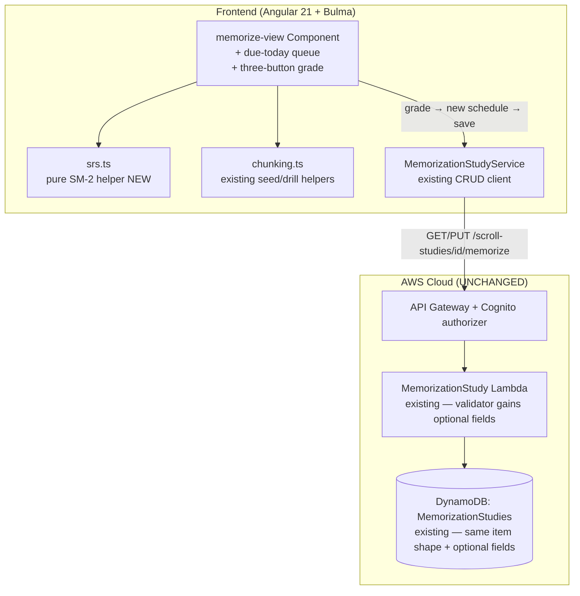

# Design Document: Memorize the Scroll — spaced-repetition scheduler (v2)

## Overview

This feature adds the **spaced-repetition scheduler** to the shipped Memorize the Scroll tool. v1
(`.kiro/specs/memorize-the-scroll/`) persists one Memorization Study per scroll per user — an ordered
list of chunks, each `{ start, end, verseRef, state }`, where `state ∈ {new, learning, chained, solid}`
is set by hand and carries **no timing**. v2 adds the timing and the scheduling math so the tool can
tell the student **which chunks are due today** and grow each chunk's review interval as recall
improves — the thing that gets a whole book memorized over weeks rather than crammed once.

It is a **refinement of the shipped tool, additive to its persisted model and its single CRUD Lambda**:
new **optional** scheduling fields on `MemorizationChunk`, a new **pure client SM-2 helper** (`srs.ts`)
beside `chunking.ts`, a **"due today" queue** derived in the view, and a **three-button grade control**
on the drill surface. There is **no new table, Lambda, route, EventBridge rule, SES identity, or
`StageConfig` field, and no AI** — so the `diff` job should show no `WordStudyToolStack` resource
change and the table/function/log-group counts are unchanged (10 / 13 / 14, as left by the v1 build).

The scheduling algorithm is **SM-2** (SuperMemo 2 — the original spaced-repetition scheduler). Two
design nuances, both decided with the user:

- **Scheduling is a second axis, kept orthogonal to the learned-state ladder.** v1's `state` is *how
  well the student knows the chunk* (set by hand). v2's schedule is *when it is next due* (computed by
  SM-2). A chunk can be `solid` **and** come due for maintenance — grading updates the schedule and
  does **not** silently change `state`.
- **The daily reminder is NOT here.** An outbound "N chunks due today" email/push needs net-new
  scheduler + notification infra (no EventBridge/cron/SES exists) and a cost line; it is tracked as
  issue #68 and depends on this scheduler. v2 delivers the value in-app via the due-today queue,
  computed every time the student opens the tool.

## Architecture

No topology change from v1. The same `memorize-view` component, `MemorizationStudyService`,
`MemorizationStudy` Lambda, and `MemorizationStudies` table carry the new data. The only genuinely new
code is a pure `srs.ts` module and the view wiring for the due queue + grade control.



## Decisions

**Additive optional fields on the existing chunk (no migration).** `MemorizationChunk` gains
`easeFactor?`, `intervalDays?`, `repetitions?`, `dueDate?`, `lastReviewed?`. A v1 chunk persisted
without them stays valid and reads as **never reviewed → due now, ease 2.5, repetitions 0, interval 0**.
No field is renamed or removed; the same `GET`/`PUT` serves the record; no legacy backfill is needed
(the mapper coerces absent fields at read time). This is the whole reason v2 needs no new resource.

**SM-2, textbook, in a pure helper.** `srs.ts` holds the SM-2 math as pure functions with no Angular,
no AWS, no baked-in clock (today is passed in). SM-2's recurrence:

```
grade(q):                         // q ∈ 0..5
  if q < 3:                       // miss
    repetitions = 0
    intervalDays = 1
  else:                           // pass
    repetitions += 1
    intervalDays = 1  if repetitions == 1
                 = 6  if repetitions == 2
                 = round(intervalDays * easeFactor)  otherwise
  easeFactor = max(1.3, easeFactor + (0.1 - (5 - q) * (0.08 + (5 - q) * 0.02)))
  dueDate = today + intervalDays days
  lastReviewed = today
```

So a chunk the student keeps passing walks its interval out `1 → 6 → ~15 → ~37 → ~90+` days, while a
miss pins it back to a 1-day interval until it sticks. The helper is deterministic and unit-tested in
isolation — the interesting logic is separated from the Angular wiring exactly as `chunking.ts` is.

**Three-button grade (Hard / Good / Easy) + Again (confirmed with the user).** The grade control maps
**Hard → q 3, Good → q 4, Easy → q 5** (all passing, advancing the interval at different rates via the
ease adjustment), and an explicit **Again** (could-not-recall) maps to a miss (`q = 2`), resetting the
chunk to a 1-day interval. Three buttons give finer interval tuning than a two-button pass/fail while
staying far simpler than a raw 0–5 flashcard scale.

**"Due today" is derived, never persisted.** The view computes the due queue from the persisted chunks
and today's local date: a chunk is **due** when `dueDate` is absent/`''` (never reviewed) or
`dueDate <= today` (date-only compare). The server stores dates and computes nothing. This keeps the
scheduler entirely client-side and makes the in-app queue free of any new endpoint.

**The two axes stay orthogonal.** Grading updates only the scheduling fields; it never writes `state`.
The student still advances `state` (`new → learning → chained → solid`) by hand as in v1. A "grade also
bumps state" convenience is deliberately out of scope so the learned axis and the scheduling axis do
not entangle.

**Server validates but does not schedule.** The Lambda's `parsePutBody` gains optional-field validation
(bounds and types) so a malformed schedule cannot persist, but it never computes or re-derives the
schedule — SM-2 is owned by the client. The server continues to own only structural validity.

**Zero infra delta.** No table, Lambda, route, EventBridge, SES, or `StageConfig` change. The CDK
template is unchanged; the stateful guard is a no-op; counts stay 10 / 13 / 14. The `diff` comment
should show no `WordStudyToolStack` resource change (only, at most, the Lambda bundle hash rotating
because the handler source changed — which is not a resource replacement).

## Components and Interfaces

### Client SM-2 helper (new, pure)

`src/app/memorize-view/srs.ts`, Angular-free and AWS-free, unit-tested beside `chunking.spec.ts`:

```typescript
/** SM-2 scheduling fields on a chunk (all optional on the persisted model). */
export interface Schedule {
  easeFactor: number;    // >= 1.3, default 2.5
  intervalDays: number;  // >= 0
  repetitions: number;   // >= 0 integer
  dueDate: string;       // ISO date ('' = due now / never reviewed)
  lastReviewed: string;  // ISO date ('' = never)
}

/** SM-2 recall quality for the three-button grade + Again. */
export type Grade = 'again' | 'hard' | 'good' | 'easy';   // → q 2 / 3 / 4 / 5

export const DEFAULT_EASE = 2.5;
export const MIN_EASE = 1.3;

/** Read a chunk's schedule, defaulting absent fields to "never reviewed". */
export function readSchedule(chunk: Partial<Schedule>): Schedule;

/** True when this schedule is due on `today` (date-only): never reviewed, or dueDate <= today. */
export function isDue(s: Schedule, today: Date): boolean;

/** Apply SM-2 for a graded recall, returning the next schedule (pure; `today` injected). */
export function applyGrade(s: Schedule, grade: Grade, today: Date): Schedule;

/** Human label for the next-due date, e.g. "due today" / "due in 6 days". */
export function dueLabel(s: Schedule, today: Date): string;
```

Keeping `today` an argument (not `new Date()` inside) makes every function deterministic under test.

### Frontend component (`memorize-view`, extended — not replaced)

The shipped component gains, with no change to its existing state model beyond additive signals:

- a **due-today** computed signal — the chunks (with their indices) that `isDue(readSchedule(chunk),
  today)`, ordered soonest-first then by chunk order — rendered as a summary box above the chunk editor
  (count + list, each row linking to select that chunk as the active drill chunk);
- on the drill surface, a **grade control**: four buttons `Again` / `Hard` / `Good` / `Easy`
  (`data-testid` `grade-again|grade-hard|grade-good|grade-easy`), each calling `grade(g)` which runs
  `applyGrade` on the active chunk, writes the returned schedule fields back onto that chunk in the
  `chunks` signal, and calls the existing `save()`;
- a **next-due label** beside the active chunk and in each due-queue row (`dueLabel`);
- an **empty/"nothing due today"** state when zero chunks are due.

`today` is read once per change-detection pass from a small injectable clock (or `new Date()` at the
component boundary) and passed into the pure helpers, so the component stays thin and the math stays in
`srs.ts`. New `data-testid`s: `memorize-due-queue`, `memorize-due-count`, `memorize-due-row`,
`memorize-due-empty`, `grade-again`, `grade-hard`, `grade-good`, `grade-easy`, `chunk-next-due`.

### Frontend service + model mapper

`MemorizationStudyService.toMemorizationStudy` (the existing mapper) extends its per-chunk coercion to
default the new fields (`easeFactor ?? 2.5`, `intervalDays ?? 0`, `repetitions ?? 0`, `dueDate ?? ''`,
`lastReviewed ?? ''`) so a v1 record never throws and reads as "due now". `save()` sends the fields as
part of each chunk — no new method, same `PUT`.

### Backend Lambda (`memorization-study`, validator extended)

`infra/lambda/memorization-study/index.ts` — the only backend change is in `parsePutBody`: for each
chunk, **when present**, validate `easeFactor` (finite number ≥ `MIN_EASE` 1.3), `intervalDays`
(non-negative integer), `repetitions` (non-negative integer), `dueDate`/`lastReviewed` (each `''` or an
ISO date string within a length cap), rejecting a malformed value with `400`. Absent fields stay
absent (optional). The handler still never reads the ScrollStudies table, never calls Bedrock, and
computes no schedule. The record shape and the chunk push gain the optional fields passed through as
given.

## Data Model

### Shared TypeScript model (both `src/app/models.ts` and `infra/lambda/shared/models.ts`)

Extend the existing `MemorizationChunk` additively:

```typescript
export interface MemorizationChunk {
  start: number;
  end: number;
  verseRef: string;
  state: MemorizationChunkState;
  // --- v2 scheduling (all optional/additive; absent = never reviewed → due now) ---
  easeFactor?: number;    // SM-2 ease, default 2.5, floored at 1.3
  intervalDays?: number;  // current interval in days; 0 = due immediately
  repetitions?: number;   // consecutive successful recalls; resets to 0 on a miss
  dueDate?: string;       // ISO date next due; '' / absent = due now
  lastReviewed?: string;  // ISO date of last graded review; '' / absent = never
}
```

`MemorizationStudy`, `MemorizationStudyInput`, and `MemorizationStudyRecord` are unchanged in shape —
they already carry `chunks: MemorizationChunk[]`, so the new fields flow through automatically.

### DynamoDB table: MemorizationStudies — UNCHANGED

No table change. Same `PK = USER#<sub>` / `SK = MEMORIZE#<scrollStudyId>`, same `PAY_PER_REQUEST`, same
no-GSI/no-PITR, same `removalPolicy`. The item simply carries richer chunk objects. **No CDK resource
delta; counts stay 10 tables / 13 functions / 14 log groups.**

## API

Unchanged from v1 — the new fields ride inside each chunk on the existing endpoints.

| Method | Path | Request body | Success | Errors |
|---|---|---|---|---|
| GET | `/scroll-studies/{scrollStudyId}/memorize` | — | `200 MemorizationStudyRecord` (chunks carry optional schedule fields) | `400` missing auth/id; `404` no record |
| PUT | `/scroll-studies/{scrollStudyId}/memorize` | `{ chunks? }` (chunks may carry schedule fields) | `200 MemorizationStudyRecord` | `400` invalid field / malformed JSON / missing auth |

## Validation

In `parsePutBody`, per chunk, **in addition to** the unchanged v1 checks (offsets integer & `start <
end`, `verseRef` ≤ 50, `state` ∈ set, array ≤ 2000):

- `easeFactor` — if present, a finite number and `>= 1.3` (else `400`).
- `intervalDays` — if present, a non-negative integer (else `400`).
- `repetitions` — if present, a non-negative integer (else `400`).
- `dueDate`, `lastReviewed` — if present, each a string that is `''` or matches an ISO date / timestamp
  and is within a length cap (≤ 40) (else `400`).
- Absent → the field is simply not stored (optional); a v1 payload still saves.
- The server computes **no** schedule and reads **no** `scrollText`.

## Error Handling

Unchanged from v1 except the new field validation (expected `400`s, not logged). A grade that fails to
save behaves like any save failure — the inline save error shows and the entered schedule stays in the
`chunks` signal so the student can retry; the in-memory schedule is already updated optimistically and
is re-sent on retry.

| Operation | Failure | Caller receives |
|---|---|---|
| grade → `PUT` | bad field (shouldn't happen; client computes) → `400` | inline save error, values kept |
| grade → `PUT` | DynamoDB `500` | inline save error, values kept, retry re-sends |
| read v1 record (no schedule fields) | — | coerced to "due now, ease 2.5" by the mapper |

## Testing Strategy

All under the existing harness (Angular + vitest frontend; vitest + `setup-no-aws` for the Lambda).
Nothing calls AWS or Bedrock.

### Unit tests — `srs.ts` (pure, no Angular, injected `today`)
- `readSchedule` defaults absent fields (ease 2.5, interval 0, reps 0, due/`lastReviewed` `''`).
- `isDue` — true for never-reviewed and for `dueDate <= today`; false for a future `dueDate`; date-only
  (ignores time-of-day).
- `applyGrade` — SM-2 recurrence: first pass → interval 1; second pass → 6; third pass → `round(prev ×
  ease)`; a miss (`again`) resets reps to 0 and interval to 1; ease moves by the SM-2 formula and never
  drops below 1.3; `Hard/Good/Easy → q 3/4/5` produce the expected differing ease deltas; `dueDate =
  today + interval`, `lastReviewed = today`.
- `dueLabel` — "due today" at interval 0/≤today, "due in N days" otherwise.

### Lambda tests — `memorization-study/index.test.ts` (mocked DynamoDB)
- A chunk **with** valid schedule fields round-trips (stored and returned as given).
- A chunk **without** schedule fields still saves (optional) — the v1 regression stays green.
- Each new field's bound is enforced: `easeFactor < 1.3` → `400`; non-integer/negative `intervalDays`
  or `repetitions` → `400`; a non-string or over-long `dueDate`/`lastReviewed` → `400`.
- The handler still makes no ScrollStudies call and no Bedrock call.

### Component tests — `memorize-view` (TestBed, stubbed services, injected/fixed `today`)
- A saved study with mixed `dueDate`s renders the **due-today queue** with the correct count and order;
  a study with all-future chunks shows the **nothing-due** state.
- A v1 study (chunks with no schedule fields) renders all chunks as **due now**.
- Clicking **Good** on the active chunk calls `applyGrade`, updates the chunk's schedule fields, calls
  `save` with the new fields, and the next-due label + due queue update; **Again** resets to 1 day.
- Grading does **not** change the chunk's learned-`state` (orthogonality regression).
- A save failure on a grade keeps the (optimistically updated) schedule and shows the inline error.

### CDK assertion tests — UNCHANGED, asserted no-delta
- **No new assertions and no count changes** — this is a frontend-plus-validator change. The existing
  table/function/log-group count assertions (10 / 13 / 14) and the stateful-guard expectations stay
  exactly as the v1 build left them; a passing `infra` suite with no edits to the CDK assertions is
  itself the evidence that v2 adds no resource.

## Risks

- **Very low build risk.** Additive optional fields + a pure, textbook SM-2 module + view wiring. No
  migration, no infra, no AI, no new endpoint. The only backend edit is optional-field validation.
- **Clock/timezone.** "Due today" uses the client's local date. A student crossing midnight or
  timezones sees the natural local-date behaviour; v2 does date-only compares (no time-of-day), which
  is the standard SRS behaviour and avoids off-by-one from timestamps. The pure helper takes `today`
  as an argument so this is testable and centralised.
- **Optimistic grade update.** The schedule is updated in memory before the save confirms; a save
  failure keeps the updated schedule and shows the error so a retry re-sends it. No data loss, and the
  server is the source of truth on the next load.
- **Orthogonality drift.** The temptation to auto-bump `state` on a grade is explicitly out of scope;
  a component test asserts grading leaves `state` untouched so the two axes do not entangle.

## Out of scope

- **The daily outbound reminder (email/push)** — issue #68 (`needs-spec`); net-new scheduler +
  notification infra and a cost line; depends on this scheduler.
- **Driving `state` from grades** — the learned ladder and the schedule stay orthogonal.
- **A configurable/custom SM-2 variant** (fuzz, leeches, per-user ease floor, a different algorithm) —
  v2 is textbook SM-2.
- **Any AI / Bedrock call.**
- **A new table, Lambda, route, EventBridge rule, SES identity, or `StageConfig` field.**
- **Re-anchoring chunks after a scroll re-upload** — unchanged from v1.
- **Any change** to the shipped Step 4–12 tools or their routes.

## Design Review Responses

_(Reserved for responses to the spec PR's design review, following the sibling specs' convention.
Filled in point-by-point if the review returns CHANGES_REQUESTED.)_
