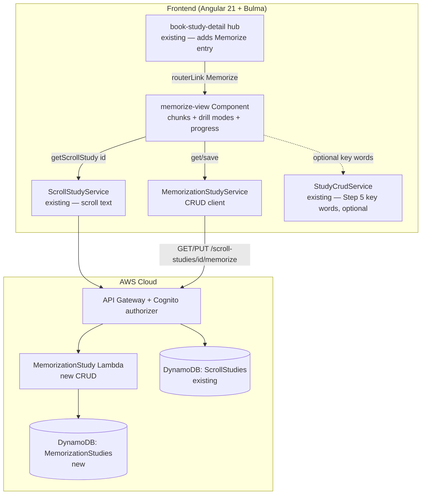

# Design Document: Memorize the Scroll (Memorization companion — v1)

## Overview

This feature adds a **Memorization companion** tool to the shipped **Book / Scroll hub**. While a
student works a book, they can also **memorize its scroll text** — breaking the scroll into the
paragraph chunks they memorize (each labelled by a kept verse reference), drilling a chunk in the
style that suits them, and tracking which chunks they have learned so progress survives across
sessions.

It is **not** one of the method's 17 numbered steps; it is a *discipline alongside* them (memorizing a
book in scroll form is a recognised practice in this inductive tradition). It reads the Step 4
**Scroll Study**'s persisted `scrollText` and persists one **Memorization Study** per scroll per user,
keyed by `scrollStudyId`, exactly as the shipped Antecedent/Structure/Outline/Figures/Interrogation
studies are. It deliberately carries **no AI and no new Bible-verse-text source** (a scope decision
locked with the user): it reads only the student's own uploaded scroll, and there is no Bedrock call
anywhere.

Two design nuances, both decided with the user:

- **Verse reference vs. paragraph are two different things**, and the method keeps them distinct (Step 7
  reference: chapter/verse numbers are "convenient for reference… not inspired"). The **verse reference
  is a kept reference anchor** (present in the text, shown de-emphasised, a free-text label on a chunk);
  the **paragraph is the author's-flow unit** the student reads, tests, and chains. The chunk boundary
  is the paragraph; the verse ref merely labels it.
- **A chunk stores offsets, not text.** The memorization record holds `start`/`end` character offsets
  into `scrollText`, never a copy of the scroll — so no verse text is duplicated into a second record,
  and the "serve no verse text" commitment holds by construction.

## Architecture

The feature adds a new lazily-routed Angular component, one client CRUD service, one new DynamoDB
table, one CRUD Lambda (mirroring `interrogation-study`), and additive API routes. It reads the
existing `ScrollStudyService` for the scroll text and, optionally, the existing `StudyCrudService`
for a book's Step 5 key words (the cloze mode). **No Bedrock, no second Lambda, no `StageConfig`
field.**



## Decisions

**One record per scroll per user, keyed by `scrollStudyId` (mirrors the sibling studies).** Exactly
one Memorization Study per `(scrollStudyId, userId)`, fetched by exact key and upserted on save — so
**no GSI**, a two-method `GET`/`PUT` CRUD under the scroll, reached from the Book hub. Identical plumbing
to Step 6–12.

**Chunks are offsets into `scrollText`, not copies of it.** A chunk is `{ start, end, verseRef, state
}`. The view slices `scrollText.slice(start, end)` to render chunk text; the record never stores verse
text. This keeps the "serve/store no Bible verse text" commitment true by construction (the only verse
text anywhere is the student's own scroll, in its own record), keeps the memorization item small, and
means re-labelling or re-stating a chunk never touches the text.

- *Stale-offset risk.* Offsets are valid only against the `scrollText` they were cut from. v1 assumes
  the scroll is **stable once `ready`** (it is: the extract pipeline writes `scrollText` once and the
  status moves to `ready`; a re-upload creates a new scroll study). The design records the seam —
  storing a short `scrollTextHash`/length on the study and warning if it no longer matches — but
  **does not implement re-anchoring in v1** (Out of Scope). If offsets ever fall outside the current
  text, the view clamps the slice and flags the chunk rather than throwing.

**Seed-then-edit chunking (student owns the divisions).** On first open the student triggers a
best-guess seed: split `scrollText` on blank-line/paragraph boundaries; where a chunk begins with a
leading verse marker (`/^\s*\d+\s/`), lift that number into the chunk's `verseRef` label. The student
then edits — re-seed, add, split (at a cursor offset), merge (adjacent), relabel, reorder, remove.
This honours the method's "let the student set the divisions" and is robust whether or not the upload
carries visible markers. Seeding is a pure client transform over `scrollText`; nothing is persisted
until Save.

**No AI, no new verse-text source (locked with the user).** Memorization is a disciplined-habit tool;
the value is the student's own repetition. No AI chunking and no AI grading — cloze checking is a
client-side normalised string compare. This keeps the tool zero-Bedrock, zero-cost, the smallest new
build, and clear of the open Step 10 Bedrock bug (#58).

**Drill mode is a view concern, not persisted.** `chain`/`reveal`/`cloze`, the reveal level, and the
cloze N are UI state (signals), reset per session. Only chunk boundaries and per-chunk learned-state
persist — the durable thing is *what the student has learned*, not *how they were drilling it last*.

**Learned-state is a 4-value ladder.** `new → learning → chained → solid`, advanced/reset by the
student from the drill UI, validated server-side. It is deliberately the substrate a **v2 spaced-
repetition scheduler** will read (due dates/intervals computed over these states) — v1 stores the
states and summarises them but computes no schedule and sends no nudge.

**New table vs. reuse.** A dedicated `MemorizationStudies` table, copying the `InterrogationStudies`/
`StructureStudies` layout exactly — `PK`/`SK`, `PAY_PER_REQUEST`, AWS-managed encryption,
`removalPolicy: config.statefulRemovalPolicy`, **no GSI, no PITR** — so it is `Retain` in prod
(additive, not a stateful-guard violation) and `Delete` in dev. It adds **no** `StageConfig` field.

## Components and Interfaces

### Frontend component (Angular 21 standalone, signals, Bulma)

**`memorize-view` component** (`src/app/memorize-view/memorize-view.component.ts`), modeled on
`interrogate-view`/`structure-view`: signal-based `state` (`'loading' | 'ready' | 'preparing' |
'failed' | 'error'`), a `study` signal (the scroll), a `chunks` signal (ordered editable chunks), a
`mode` signal (`'chain' | 'reveal' | 'cloze'`), per-mode UI signals (`revealLevel`, `clozeN`,
`clozeUseKeyWords`, `activeChunkIndex`, typed-answer buffers), `saving`/`saved`/`saveError` signals,
`ChangeDetectionStrategy.OnPush`, `inject()` deps, co-located `*.spec.ts`. It:

- reads `scrollStudyId` from the route, calls `ScrollStudyService.getScrollStudy(id)`, and on a `ready`
  scroll calls `MemorizationStudyService.get(scrollStudyId)` (a `404` → empty worksheet offering the
  seed action);
- distinguishes a not-found scroll (`404` → terminal `failed`) from a transient load failure
  (network/5xx → recoverable `error` with Retry), the sibling-view branch typed `(err: { status?:
  number })`;
- renders a **chunk editor**: the seed/re-seed action; per chunk a text preview (sliced from
  `scrollText`), a de-emphasised `verseRef` label input, a `state` control, and split/merge/reorder/
  remove controls;
- renders a **drill surface** with a mode switcher and, per mode: `chain` (active chunk + accumulated
  run); `reveal` (the chunk at the chosen reveal level with a full↔first-letter↔blank stepper); `cloze`
  (the chunk with every-Nth or key-word words blanked, typed inputs or a reveal-to-self-grade toggle);
- renders a **progress summary** ("7 of 23 chunks solid") computed from the persisted states;
- a `Save` button persists the full chunk list + states; `preparing`/`failed`/`error` notifications
  carry back links.

`data-testid`s namespaced to this view: `memorize-seed`, `memorize-chunk-row`, `chunk-preview`,
`chunk-verseref`, `chunk-state`, `chunk-split`, `chunk-merge`, `chunk-reorder`, `chunk-remove`,
`drill-mode-chain`, `drill-mode-reveal`, `drill-mode-cloze`, `reveal-level`, `chain-run`, `cloze-n`,
`cloze-keywords-toggle`, `cloze-input`, `cloze-check`, `memorize-progress`, `memorize-save`,
`memorize-empty`, `memorize-preparing`, `memorize-failed`, `memorize-error`.

**Reusing vs. extending.** A new, separate component on its own scroll-nested route, like every sibling
step view — it reuses `ScrollStudyService` (scroll text) and optionally `StudyCrudService` (Step 5 key
words for the cloze mode) and modifies no existing step view. The one additive change to an existing
component is a **"Memorize the Scroll" entry in the Book Study hub** (`book-study-detail`), gated active
when the scroll is `ready`, routing to `scroll/:id/memorize`.

### Client text helpers

Pure functions live beside the component (`src/app/memorize-view/chunking.ts`), unit-tested
independently of Angular:

```typescript
/** Seed a best-guess chunking of scroll text: paragraph boundaries, lifting a leading
 *  verse marker into the chunk's verseRef label. Returns offset-based chunks. */
export function seedChunks(scrollText: string): MemorizationChunk[];

/** Render helpers over a chunk's scrollText slice (no persistence). */
export function firstLetters(text: string): string;            // "J___ w___"
export function blankEveryNth(text: string, n: number): ClozeToken[];
export function blankKeyWords(text: string, keyWords: string[]): ClozeToken[];

/** Normalised, punctuation-tolerant, case-insensitive compare for cloze grading. */
export function clozeMatches(typed: string, expected: string): boolean;
```

Keeping these pure and separately tested isolates the text logic (the interesting part) from the
Angular wiring and keeps them AWS/Bedrock-free.

### Frontend service

- **`MemorizationStudyService`** (`src/app/memorization-study.service.ts`, `providedIn: 'root'`), a
  thin `HttpClient` wrapper mirroring `InterrogationStudyService`, with a `toMemorizationStudy` mapper
  that coerces absent fields (`chunks ?? []`, each chunk's `state ?? 'new'`, `verseRef ?? ''`):
  ```typescript
  get(scrollStudyId: string): Observable<MemorizationStudy>                            // GET  /scroll-studies/{id}/memorize
  save(scrollStudyId: string, study: MemorizationStudyInput): Observable<MemorizationStudy> // PUT .../memorize
  ```
- **Routes** (`src/app/app.routes.ts`): one additive lazy `loadComponent` route nested under the scroll
  id like the siblings — `scroll/:scrollStudyId/memorize → memorize-view`.
- **Interceptor:** the route is under `/scroll-studies/...`, already matched by `user-id.interceptor.ts`
  — no interceptor change (called out so an implementer does not add a redundant branch).

### Backend Lambda

- **`MemorizationStudyFn`** (`infra/lambda/memorization-study/index.ts`), structured exactly like
  `interrogation-study/index.ts`: `getRequestOrigin`, `userId` from
  `event.requestContext.authorizer.claims.sub`, dispatch on `httpMethod` + `resource`, `corsResponse`.
  Handlers: `GET` and `PUT /scroll-studies/{scrollStudyId}/memorize`. Reads
  `process.env['MEMORIZATION_STUDIES_TABLE_NAME'] ?? ''`. Imports `MemorizationStudyRecord` from
  `infra/lambda/shared/models.ts`. **No Bedrock client, no model env, and it does NOT read the
  ScrollStudies table** — it validates and stores offsets as given (the slice happens client-side).

## Data Model

### Shared TypeScript model

Add to both `src/app/models.ts` (frontend) and `infra/lambda/shared/models.ts` (backend):

```typescript
/** Learned-progress ladder for one memorization chunk. */
export type MemorizationChunkState = 'new' | 'learning' | 'chained' | 'solid';

/** One paragraph chunk the student memorizes, as offsets into the scroll text. */
export interface MemorizationChunk {
  start: number;              // inclusive char offset into scrollText (>=0)
  end: number;                // exclusive char offset (> start)
  verseRef: string;           // kept reference anchor label, '' when unset (<=50) — NO verse text
  state: MemorizationChunkState;
}

/** The persisted memorization worksheet for one scroll study, owned by the current user. */
export interface MemorizationStudy {
  scrollStudyId: string;
  userId: string;             // Cognito sub
  chunks: MemorizationChunk[]; // ordered
  createdAt: string;          // ISO 8601
  updatedAt: string;          // ISO 8601
}

/** Save payload (server sets userId/timestamps). */
export interface MemorizationStudyInput {
  chunks?: MemorizationChunk[];
}
```

### DynamoDB table: MemorizationStudies

A new CDK `dynamodb.Table` in `WordStudyToolStack`, construct id `MemorizationStudies` (prod
`MemorizationStudies`, dev `MemorizationStudies-dev`), copying the `InterrogationStudies`/
`StructureStudies` layout exactly — `PK`/`SK`, `PAY_PER_REQUEST`, `AWS_MANAGED` encryption,
`removalPolicy: config.statefulRemovalPolicy`, **no GSI, no PITR**.

The DynamoDB item shape `MemorizationStudyRecord` is added next to `InterrogationStudyRecord`:

```typescript
interface MemorizationStudyRecord {
  PK: string;        // "USER#<userId>"
  SK: string;        // "MEMORIZE#<scrollStudyId>"
  scrollStudyId: string;
  userId: string;
  chunks: MemorizationChunk[];
  createdAt: string; // ISO 8601
  updatedAt: string; // ISO 8601
}
```

**Access patterns** (mirroring the interrogation handler):
- Get one: `GetCommand` on `PK = USER#<userId>`, `SK = MEMORIZE#<scrollStudyId>`; absent → `404`.
- Save (upsert): `PutCommand` with the same key; first save `createdAt === updatedAt`; a later save
  preserves `createdAt` (read-then-write) and refreshes `updatedAt`.

**CDK wiring (additive, non-stateful-breaking):**
- New table construct id `MemorizationStudies` + matching log group;
  `this.memorizationStudiesTable.grantReadWriteData(this.memorizationStudyFn)`.
- `MemorizationStudyFn` — new `NodejsFunction`, `functionName: n('MemorizationStudy')`, `logGroup:
  fnLogs('MemorizationStudyFn')`, `entry: .../lambda/memorization-study/index.ts`, `environment: {
  MEMORIZATION_STUDIES_TABLE_NAME: this.memorizationStudiesTable.tableName, ALLOWED_ORIGINS }`. No
  Bedrock IAM (touches only its own table).
- Routes: a `memorize` sub-resource on the existing `scrollStudyByIdResource`
  (`.../{scrollStudyId}/memorize`) with `GET`/`PUT` carrying `authMethodOptions` (like
  `interrogate`/`structure`).
- No existing construct id or physical name changes.

**Counts delta (verified against the current stack):** today the stack has **9 tables** (WordStudies,
StrongsData, ScrollStudies, BookStudies, AntecedentStudies, StructureStudies, OutlineStudies,
FiguresStudies, InterrogationStudies) and **12 functions** (…, FiguresStudy, FiguresAssist,
InterrogationStudy, ExtractText). This feature adds **1 table** (MemorizationStudies → **10**) and
**1 function** (MemorizationStudy → **13**), so the function-log-group count goes **13 → 14**. The
count-based CDK log-group assertions change accordingly (see Testing Strategy).

- **Removal policy:** `config.statefulRemovalPolicy` — `Retain` in prod (additive; stateful guard
  reports info, not a violation), `Delete` in dev.
- **PITR:** omitted entirely (as the sibling study tables do); no PITR `StageConfig` field added, so
  the prod "PITR on WordStudies only" and dev "true nowhere" tests stay green.
- No new un-hashed `public/` asset; no new CDK context lookup.
- **No `StageConfig` change at all** — this tool has no per-stage behaviour (no AI, no model).

## API

All routes require the Cognito authorizer; `userId` is the token `sub`.

| Method | Path | Request body | Success | Errors |
|---|---|---|---|---|
| GET | `/scroll-studies/{scrollStudyId}/memorize` | — | `200 MemorizationStudyRecord` | `400` missing auth/id; `404` no record yet |
| PUT | `/scroll-studies/{scrollStudyId}/memorize` | `{ chunks? }` | `200 MemorizationStudyRecord` | `400` invalid field / malformed JSON / missing auth |

## Validation

Server-side, before any write (client mirrors for UX, never trusted), following the sibling handlers'
`parsePutBody` approach (JSON-parse in `try/catch`, reject non-objects/`null` → `400`):

- **chunks** — optional array (absent → `[]`); order preserved; array capped at **2000** (else `400`);
  each item:
  - `start` a non-negative integer; `end` a non-negative integer; `start < end` (else `400`);
  - `verseRef` a string ≤ 50 (else `400`);
  - `state` ∈ `{new,learning,chained,solid}` (else `400`);
- **userId** — from the `sub` claim only; any body `userId` ignored; missing claim → `400`.
- **scrollStudyId** path param — required; missing → `400`.
- The handler does **not** fetch `scrollText` to validate offsets (cross-record read avoided); offsets
  are stored as given and clamped client-side on render.

## Error Handling

| Operation | Failure | Detected | Recoverable? | Caller receives | Logged |
|---|---|---|---|---|---|
| `getScrollStudy(id)` | not found/owned (404) | `err?.status === 404` → `failed` | n/a | `failed` + back link | no |
| `getScrollStudy(id)` | network/5xx | `!== 404` → `error` | yes | `error` + Retry | console |
| `MemorizationStudyService.get` | no record (404) | `err?.status === 404` | n/a | empty worksheet + seed action | no |
| scroll `uploading`/`extracting` | — | `study.status` | yes (poll via scroll view) | `preparing` + back link | no |
| scroll `failed` | — | `study.status` | no (re-upload) | `failed` + back link | no |
| chunk offsets fall outside current text | clamp on slice | view-side guard | yes | chunk flagged, slice clamped | no |
| `PUT .../memorize` | bad field / bad offsets | `400` + message | yes (fix input) | inline save error, values kept | no (expected 4xx) |
| `PUT .../memorize` | DynamoDB throws | `500` | yes (retry) | inline save error, values kept | CloudWatch |

**Backward compatibility.** New table — no legacy records exist. The service mapper still coerces
absent `chunks`/`state`/`verseRef` defensively so a partial record never throws client-side.

**Invariant ownership.** User-scoping is owned by the backend (`PK = USER#<sub>`). Chunk-offset
validity against the live text is owned by the view (it holds the `scrollText`); the server owns only
the structural validity of a chunk (integers, ordering, state ∈ set, cap). The slice-and-render of
verse text is owned by the view and never persisted.

## Testing Strategy

All tests run under the existing harness (Angular + vitest frontend; vitest + `setup-no-aws` for the
Lambda). Nothing calls AWS or Bedrock (there is no Bedrock in this tool at all).

### Unit tests
- **`chunking.ts`** (pure, no Angular): `seedChunks` splits on blank lines and lifts a leading verse
  marker into `verseRef`; produces contiguous, ordered, non-overlapping offset chunks covering the
  text; `firstLetters` reduces each word to its first letter + blanks; `blankEveryNth` blanks every
  Nth token; `blankKeyWords` blanks only the given key words (case-insensitive) where they appear;
  `clozeMatches` is case-insensitive and punctuation-tolerant and rejects a genuine mismatch.
- **`MemorizationStudyFn`** (`infra/lambda/memorization-study/index.test.ts`, mocked DynamoDB): `GET`
  returns the stored record / `404` when absent; `PUT` success (first save `createdAt === updatedAt`;
  second save preserves `createdAt`, bumps `updatedAt`); `userId` from claims, body `userId` ignored;
  `chunks` order preserved; empty body → stored `[]`; validation rejects `start >= end`, a negative
  offset, a non-integer offset, an over-long `verseRef`, a `state` outside the set, an over-cap chunk
  array, and a non-array `chunks` (`400`); confirms the handler does **not** call the ScrollStudies
  table.
- **`MemorizationStudyService`**: hits the right URL/verb (`/scroll-studies/{id}/memorize` GET/PUT)
  and the mapper coerces absent `chunks`/`state`/`verseRef`.

### Component tests — `memorize-view` (Angular TestBed, stubbed `ScrollStudyService`,
`MemorizationStudyService`, `StudyCrudService`)
- `ready` with no saved study → empty worksheet with a seed action; seeding produces editable chunks
  from the stubbed `scrollText`; `ready` with a saved study → chunks render in order with their
  `verseRef`/`state`.
- `uploading`/`extracting` → `preparing` + back link; `failed`/404 → `failed` + back link; network
  error → `error` + working Retry.
- chunk edit: split/merge/reorder/remove updates the ordered offset list; relabel sets `verseRef`;
  advancing a chunk's `state` updates the progress summary.
- **drill modes**: switching to `chain` shows the active chunk and the accumulated run of learned
  predecessors; `reveal` steps full → first-letters → blank; `cloze` blanks every-Nth and (with the
  key-words toggle and a stubbed Word Study) the Step 5 key words, typed-answer checking passes on a
  normalised match and fails on a mismatch — all client-side with no service call.
- **persistence**: Save calls `MemorizationStudyService.save` with `{ chunks }` (offsets + states, no
  text) and reflects returned state; a save failure keeps entered values and shows an inline error.
- a regression assertion that `memorize-view` persists **no verse text** (the saved payload chunks
  carry only `start`/`end`/`verseRef`/`state`) and makes **no AI call**.

### Book hub test — `book-study-detail`
- the "Memorize the Scroll" entry appears in the hub and is gated active only when the scroll is
  `ready` (extending the existing hub step-list tests); it is presented as a companion entry, not
  numbered among the steps.

### CDK assertion tests (`infra/test/word-study-tool-stack.test.ts`)
- **New assertions:** the template contains a `MemorizationStudies` table (`PAY_PER_REQUEST`,
  AWS-managed encryption, no GSI, no PITR); a `MemorizationStudy` (prod)/`MemorizationStudy-dev` (dev)
  function; `/scroll-studies/{scrollStudyId}/memorize` `GET`/`PUT` guarded by the Cognito authorizer;
  and `MemorizationStudyFn`'s policy references only `MemorizationStudies` (and **no** Bedrock, and
  **no** ScrollStudies grant).
- **Existing assertions that MUST change (one new function makes the function-log-group count 14, not
  13):**
  - `keeps 90-day log retention` (prod): count `13 → 14`.
  - `keeps 7-day log retention` (dev): count `13 → 14`.
  - `uses on-demand billing for every table`, prod `enables PITR on WordStudies only`, dev `sets PITR
    explicitly false on WordStudies-dev and true nowhere` already iterate all tables and continue to
    pass: `MemorizationStudies` is `PAY_PER_REQUEST` and omits PITR.
- The stateful-guard check continues to pass — the new table is additive and uses the stage removal
  policy (`Retain` in prod); no existing stateful resource is replaced or deleted.

## Risks

- **Low build risk.** A straight copy of the shipped `interrogation-study`/`structure-study` CRUD
  pattern minus the AI, plus a small pure client text module (`chunking.ts`) that carries the only
  genuinely new logic. No Bedrock, no `StageConfig`, no migration.
- **Stale offsets after a scroll re-upload.** Offsets are valid only against the `scrollText` they were
  cut from. Mitigated by the v1 stability assumption (a re-upload is a new scroll study), a view-side
  clamp-and-flag on an out-of-range slice, and the recorded seam (optional `scrollTextHash`) for a v2
  re-anchor. Not re-anchored in v1 (Out of Scope).
- **Seed quality varies with the upload.** A scroll with no blank lines seeds as one big chunk; one
  with visible verse markers seeds finely. Mitigated by making the seed fully editable (split/merge)
  and re-seedable — the student always owns the final divisions.
- **Cloze key-word dependency.** The key-word cloze mode reads a Step 5 Word Study; absent, the mode
  simply offers every-Nth only. The dependency is read-only and optional (the view degrades
  gracefully).

## Out of scope

- **Spaced-repetition scheduling and reminders (v2)** — which chunk is *due*, SM-2 intervals, daily
  nudge. v1 persists the learned-states v2 will schedule over.
- **Audio (v3)** — TTS listen-mode, speech-to-text recitation self-check.
- **Any AI / Bedrock call** — no AI chunking, no AI grading.
- **Re-anchoring chunks after a scroll re-upload** — v1 assumes scroll text is stable once `ready`.
- **Fetching/embedding/serving any Bible verse text** — reads only the student's own scroll, by offset.
- **A top-level navbar surface** — reached from the Book hub.
- **Any change** to the shipped Step 4–12 tools, the Word Study (read-only for key words), or their
  routes.

## Design Review Responses

_(Reserved for responses to the spec PR's design review, following the sibling specs' convention.
Filled in point-by-point if the review returns CHANGES_REQUESTED.)_
